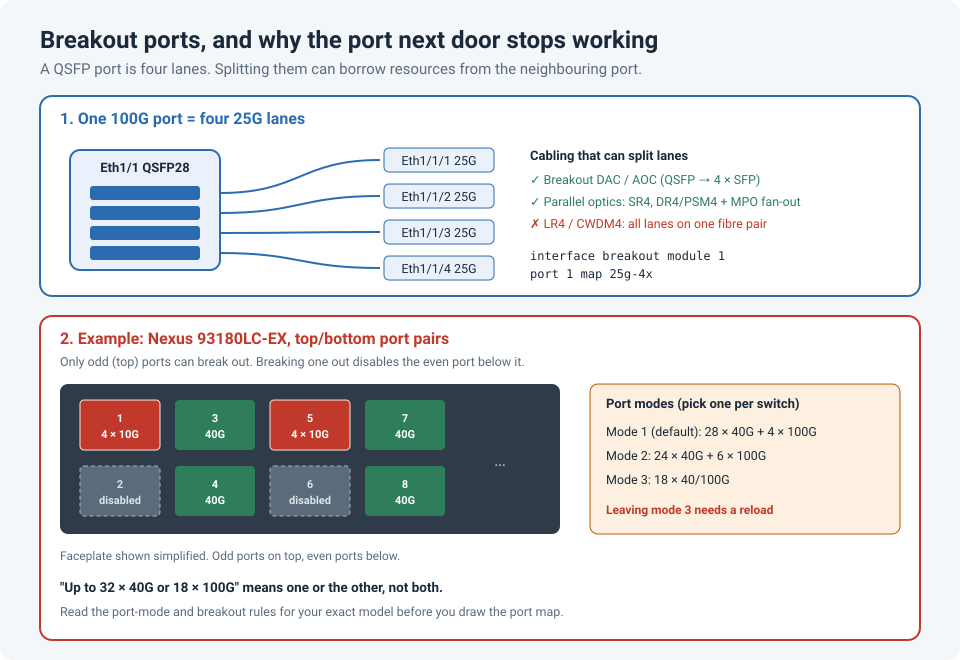

# Breakout Ports, and Why You Can't Always Use Every Port at Full Speed

You count the high-speed ports on the front of the switch, plan the cabling to use them,
and then during the build some of them simply won't come up.

I ran into this on a Cisco Nexus: certain ports only work if the port next to them is left
empty, or runs at a lower speed. It's not a fault. It's how the hardware is built, and it's
in the documentation, usually as a footnote.

!!! abstract "Key takeaway"
    A 40G or 100G QSFP port is really **four lanes** (10G or 25G each). **Breakout** splits
    those lanes into separate ports, such as 4×10G, 4×25G or 2×50G. But the switch chip has a
    limited number of lanes and port resources, so on many platforms, breaking out a port, or
    choosing a high-speed **port mode**, makes the **neighbouring port unusable**. Check the
    platform's port-mode and breakout rules in the configuration guide **before** you assign
    ports in the design.



## How breakout works

A QSFP port isn't one big pipe. Inside, it carries **four electrical lanes**:

| Port type | Lanes | Common breakout options |
|---|---|---|
| 40G QSFP+ | 4 × 10G | 4 × 10G |
| 100G QSFP28 | 4 × 25G | 4 × 25G, 4 × 10G (platform-dependent), 2 × 50G |
| 400G QSFP-DD | 8 × 50G | 4 × 100G, 2 × 200G, 8 × 50G (platform-dependent) |

Breakout tells the switch to treat each lane (or pair of lanes) as its **own interface**. On
NX-OS, port `Ethernet1/1` broken out into four becomes `Ethernet1/1/1` to `Ethernet1/1/4`.

### You need the right cable or optic

Breakout only works if each lane is carried to a separate destination:

- **Breakout DAC or AOC cables:** a QSFP connector on one end and four SFP connectors on the
  other. The simplest option inside a rack.
- **Parallel-fibre optics** (such as SR4 or PSM4/DR4) with an **MPO** connector, then an MPO
  to 4 × LC-duplex fan-out cable or cassette. Each fibre pair carries one lane.
- **WDM optics such as LR4 or CWDM4 can't be broken out.** They combine all four lanes onto
  one fibre pair using different wavelengths, so there's nothing to split.

## The limit: lanes and resources are shared

The switch ASIC has a fixed number of **SerDes lanes** and port resources. A switch with 32
QSFP ports might not have enough to run all of them at full speed **and** break some out.
Vendors handle this in one of two ways:

1. **Port modes (templates):** you choose a mode for the whole switch, such as "more ports
   at lower speed" or "fewer ports at higher speed".
2. **Port pairs:** breaking out one port borrows resources from its neighbour, which stops
   working.

### A concrete example: Cisco Nexus 93180LC-EX

The Nexus 93180LC-EX has 32 QSFP ports on the front, but the datasheet says it supports **up
to 32 × 40/50G, or 18 × 100G**. You don't get 32 × 100G. The interfaces configuration guide
describes three port modes:

| Mode | Ports |
|---|---|
| Mode 1 (default): `hardware profile portmode 4x100G+28x40G` | 28 × 40G + 4 × 40/100G |
| Mode 2 | 24 × 40G + 6 × 40/100G |
| Mode 3 | 18 × 40/100G |

And in modes 1 and 2, breakout follows the **top/bottom pair** rule: you can only break out
the **odd** (top) ports, and when you do, the **even** (bottom) port below it becomes
non-operational. Break out `Eth1/1` into 4 × 10G and `Eth1/2` stops working.

So a plan that assumes "32 ports, and we'll break out a few for servers" can lose up to
half of the ports it counted on.

!!! warning "Changing the port mode isn't a quick change"
    On the 93180LC-EX, moving between modes 1 and 2 needs a `copy running-config
    startup-config`, and changing out of mode 3 needs a **reload** as well. Check the
    platform's guide for your NX-OS version, and do it in a maintenance window, before
    anything is cabled.

### Power and heat can limit ports too

Lanes aren't the only shared resource. High-power optics, such as long-reach coherent 400G
modules, draw much more power and produce much more heat than a short-reach optic. On some
platforms they're only supported in **specific ports**, or with neighbouring ports left
empty, so the faceplate and fans can cool them. The supported port list is in the platform's
release notes and the optics compatibility matrix.

## Configuring breakout on NX-OS

```
! Check the current port mode
show running-config | include portmode

! Break out port 1 into 4 x 10G
configure terminal
 interface breakout module 1 port 1 map 10g-4x
end
! On a port running at 100G, the maps are 25g-4x (4 x 25G) or 50g-2x (2 x 50G)

! The new interfaces
show interface brief | include Eth1/1/
show interface ethernet1/1/1 status

! Undo it (the subinterfaces' configuration is removed)
configure terminal
 no interface breakout module 1 port 1 map 10g-4x
```

!!! danger "Breakout deletes configuration"
    Breaking a port out (or back in) removes the configuration on the affected interfaces,
    and the module-wide form `interface breakout module 1` reloads the module. Save the
    interface configuration first, and plan it like any other disruptive change.

## Before you plan the rack

- [ ] Find the switch's **port modes** and **breakout rules** in the NX-OS interfaces
  configuration guide for your exact model and release
- [ ] Mark which ports are **paired**, and which can break out, on your port map
- [ ] Check the **optics matrix**: is the breakout cable or optic supported on that model and port?
- [ ] Choose **parallel** optics (SR4, DR4/PSM4) or breakout DACs, not LR4/CWDM4, for anything you'll split
- [ ] Set the port mode **before** cabling, since changing it may need a reload
- [ ] Label breakout cables with both the parent port and the lane (`Eth1/1/3`)

## Lessons learned

!!! tip "Takeaways"
    - A QSFP port is **four lanes**. Breakout gives each lane its own interface.
    - Lanes and ASIC resources are **shared**. On many platforms, one port's breakout or
      speed disables its neighbour.
    - The datasheet's "up to" numbers are alternatives, not a total. Read the port-mode table.
    - WDM optics like LR4 can't be broken out; use parallel optics or breakout DACs.
    - Breakout and port-mode changes delete configuration or need a reload. Do them before
      the switch goes live.

## References

- Cisco: [Nexus 9000 NX-OS Interfaces Configuration Guide, Release 9.2(x): Overview](https://www.cisco.com/c/en/us/td/docs/switches/datacenter/nexus9000/sw/92x/interfaces/configuration/guide/b-cisco-nexus-9000-nx-os-interfaces-configuration-guide-92x/b-cisco-nexus-9000-nx-os-interfaces-configuration-guide-92x_chapter_010.pdf) (93180LC-EX port modes and breakout)
- Cisco: [Nexus 9300-EX Series data sheet](https://andovercg.com/datasheets/cisco-nexus-9300-EX-series-switches-datasheet-c78-742283.pdf)
- Cisco Community: [Difference between even and odd ports on N9K-C93180LC-EX](https://communities.cisco.com/t5/application-centric-infrastructure/difference-between-even-and-odd-ports-on-n9k-c93180lc-ex/m-p/4524368)
- Cisco: [Transceiver Module Group (TMG) compatibility matrix](https://tmgmatrix.cisco.com/)
