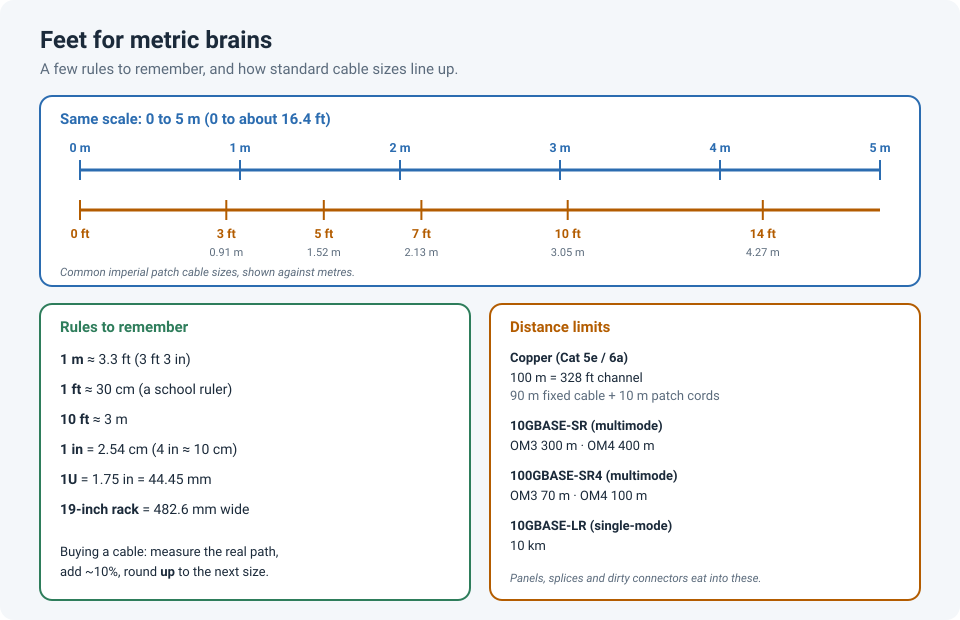

# Cable Lengths for Metric Brains: Feet, Metres and a Converter

I grew up with metres and centimetres. Then I started working in North American data rooms,
where patch cables come in **3, 5, 7 and 14 feet**, racks are **19 inches** wide, and someone on
the phone says the run is "about 60 feet". Meanwhile the standards and optics datasheets still
say **100 m** and **300 m**.

So I keep a few rules in my head, and a converter for everything else. Both are below.

!!! abstract "Key takeaway"
    **1 m ≈ 3.3 ft** (3 ft 3 in), **1 ft ≈ 30 cm**, **10 ft ≈ 3 m**, **1 in = 2.54 cm**, and the
    copper limit **100 m = 328 ft**. For a patch cable, measure the real path (along the tray
    and down to the port), add **about 10%** for slack, then pick the **next standard size up**.
    The converter at the bottom does the arithmetic, and suggests a cable size.

## Rules worth memorizing

| Rule | Exact | Good enough in the field |
|---|---|---|
| Metre → feet | 1 m = 3.281 ft | **× 3.3**, or "3 ft and a bit" |
| Feet → metres | 1 ft = 0.3048 m | **× 0.3**, or "a foot is a 30 cm ruler" |
| Ten feet | 10 ft = 3.05 m | **10 ft ≈ 3 m** |
| One yard | 1 yd = 3 ft = 0.914 m | **a yard is a bit less than a metre** |
| Inch | 1 in = 2.54 cm | **4 in ≈ 10 cm** |
| Copper channel | 100 m = 328 ft | **"328" is the number you'll hear** |
| Rack unit | 1U = 1.75 in = 44.45 mm | **about 4.5 cm per U** |
| Rack width | 19 in = 482.6 mm | the "19-inch rack" |

The trick that helped me most: think of **feet as 30 cm rulers**. A 7 ft cable is seven rulers,
about 2.1 m. A 14 ft cable is about 4.3 m.

## Common patch cable sizes

Sizes in North America are usually in feet. Elsewhere they're in metres, and the two don't
line up exactly, which matters when you're replacing a cable from a different supplier.

| Imperial size | In metres | Nearest metric size |
|---|---|---|
| 1 ft | 0.30 m | 0.3 m |
| 3 ft | 0.91 m | 1 m |
| 5 ft | 1.52 m | 1.5 m |
| 7 ft | 2.13 m | 2 m |
| 10 ft | 3.05 m | 3 m |
| 14 ft | 4.27 m | 5 m (or 4 m, if it's tight) |
| 25 ft | 7.62 m | 7.5–8 m |
| 50 ft | 15.24 m | 15 m |

## Distance limits that matter

| Link | Media | Maximum distance |
|---|---|---|
| 1000BASE-T, 10GBASE-T | Cat 5e / Cat 6a copper | **100 m (328 ft)** channel: up to 90 m (295 ft) of fixed cable plus 10 m (33 ft) of patch cords |
| 10GBASE-T | Cat 6 unshielded | 55 m (180 ft) |
| 1000BASE-SX | OM2 multimode | 550 m |
| 10GBASE-SR | OM3 / OM4 multimode | 300 m / 400 m |
| 40GBASE-SR4 | OM3 / OM4 multimode | 100 m / 150 m |
| 100GBASE-SR4 | OM3 / OM4 multimode | 70 m / 100 m |
| 10GBASE-LR | Single-mode | 10 km |

These are the standard limits. Real links also lose length to patch panels, splices and dirty
connectors, so leave a margin, and check the optics vendor's datasheet for your exact module
(see [SFP Types and Compatibility](sfp-types-compatibility.md)).

## Measuring a run properly

1. **Follow the path, not the straight line.** Up into the tray, along it, and down the rack
   to the port. Straight-line distance is often half the real length.
2. **Add the vertical drops.** Each rack is about 2 m (7 ft) tall for a 42U rack.
3. **Add about 10%** for slack and bends.
4. **Pick the next standard size up.** A cable that's too short can't be fixed; one that's a
   little long can be dressed neatly.

## Converter

<h4>Length: metres ⇄ feet</h4>

<label>Metres<input id="c-m" type="number" inputmode="decimal" min="0" step="any" value="3"></label>
=
<label>Feet (decimal)<input id="c-ft" type="number" inputmode="decimal" min="0" step="any"></label>
=
<label>Feet + inches<input id="c-ftin" type="text" readonly></label>

<h4>Small sizes: centimetres ⇄ inches</h4>

<label>Centimetres<input id="c-cm" type="number" inputmode="decimal" min="0" step="any" value="10"></label>
=
<label>Inches<input id="c-in" type="number" inputmode="decimal" min="0" step="any"></label>
=
<label>Rack units (U)<input id="c-u" type="text" readonly></label>

<h4>Which patch cable should I buy?</h4>

<label>Measured path length (metres)<input id="c-run" type="number" inputmode="decimal" min="0" step="any" value="3.5"></label>
<label>Slack to add (%)<input id="c-slack" type="number" inputmode="decimal" min="0" step="1" value="10"></label>

## Lessons learned

!!! tip "Takeaways"
    - **1 m ≈ 3.3 ft**, **1 ft ≈ 30 cm**, **10 ft ≈ 3 m**, **1 in = 2.54 cm**.
    - Copper Ethernet: **100 m (328 ft)** for the whole channel, including patch cords.
    - Imperial and metric cable sizes don't match exactly. A 7 ft cable is 2.13 m, not 2 m.
    - Measure the real path, add about 10%, and round **up** to the next standard size.

## References

- University of Wisconsin KnowledgeBase: [Ethernet media standards and distances](https://kb.wisc.edu/7829)
- Ethernet Alliance: [10GbE standardized to 400 metres on OM4 fiber](https://ethernetalliance.org/blog/2012/06/13/10gbe-standardized-to-400-meters-on-om4-fiber/)
- TrueCABLE: [Calculating Ethernet cable overall channel length](https://www.truecable.com/blogs/cable-academy/calculating-ethernet-cable-overall-channel-length-for-success)
