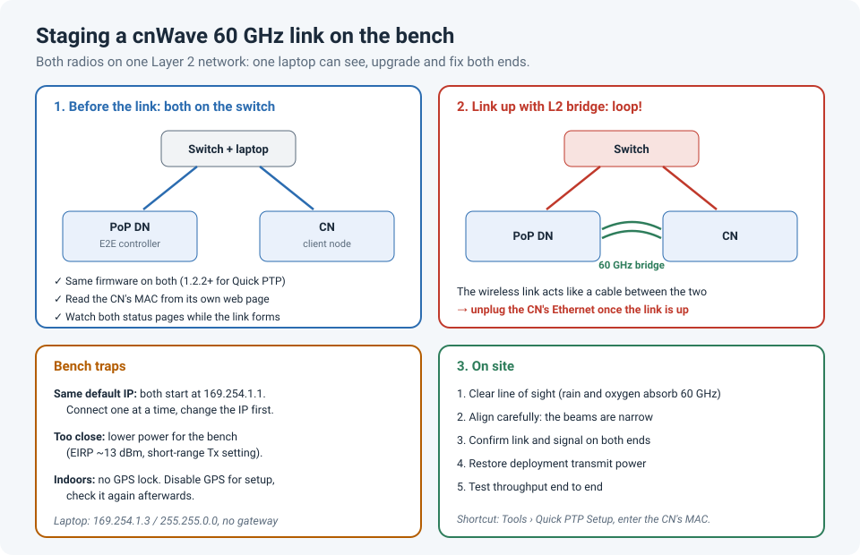

# Pairing a Cambium cnWave V3000 60 GHz Link: What Made the First Sync Easier

The Cambium cnWave V3000 is a 60 GHz radio used for short, very fast point-to-point (PtP)
links, such as connecting two buildings across a road or a parking lot. Once it's up, it's
great. Getting it up the first time took me more attempts than I expected.

What made the initial sync much easier was giving **both radios Layer 2 connectivity over
Ethernet** while I set them up: both units on the same switch, reachable from one laptop,
before the wireless link existed. I'm honestly not sure it's the officially recommended way,
but it made every step easier to see and to fix, and I've used it since.

!!! abstract "Key takeaway"
    Before you climb anything, **stage both radios together**: same firmware, a known IP on
    each, the client node's MAC address, and the link configured, either with the
    **Quick PTP Setup** tool or with the onboard E2E controller. Having both on one Layer 2
    network lets you manage and watch both ends from one laptop. Two things to watch:
    both ship with the same default IP (**169.254.1.1**), so connect them one at a time
    first; and once the wireless link comes up as a **Layer 2 bridge**, two Ethernet
    connections to the same switch make a **loop**, so disconnect one side.



## How a cnWave PtP link is built

cnWave isn't configured like an old point-to-point bridge where you set the same SSID on
both ends. It has a controller:

| Role | What it does |
|---|---|
| **PoP DN** (point of presence) | The end connected to your network. In a simple PtP link, it also runs the **onboard E2E controller** |
| **E2E controller** | Holds the topology: which nodes exist (by **MAC address**) and which links between them should form |
| **CN** (client node) | The far end. It joins the link the controller has defined for it |

So the link only forms when the controller knows the CN's **MAC address**, both radios run
compatible firmware, and the radios can see each other. Cambium's **Quick PTP Setup** tool
does most of this for you: you enter the CN's MAC on the PoP, and the radios configure
themselves, enable the E2E controller and form the link in about 4 to 7 minutes.

## Why Layer 2 between the radios helped

With both radios on the same switch as my laptop, before any wireless link existed:

- **Firmware**: I could upgrade both to the same release first. Quick PTP Setup needs
  release 1.2.2 or later on both.
- **MAC address**: I could read the CN's MAC straight from its web page, instead of from a
  label on a radio that's already on a pole.
- **Both ends visible**: I could watch both status pages while the link formed, and see which
  side was stuck.
- **Fix it on the ground**: when something was wrong, a factory reset and retry took minutes,
  not a ladder.

That's really the general lesson: **stage radios on the bench**, where everything is in
reach.

## Doing it without causing new problems

### Same default IP on both

Every cnWave radio starts at **169.254.1.1**. Put two new radios on the same switch and they
conflict. Connect them **one at a time**, give each a unique management IP, then connect both.
(Your laptop needs an address in 169.254.0.0/16, such as 169.254.1.3 with mask 255.255.0.0, to
reach a factory-default radio.)

### The bridging loop

Once the link comes up with the **Layer 2 bridge** enabled, the wireless link is effectively a
cable between the two radios' Ethernet ports. If both radios are **also** plugged into the same
switch, you've made a loop.

```
Laptop ── Switch ──┬── PoP DN ))) 60 GHz ((( CN ──┐
                   └──────────────────────────────┘   ← loop once the link is up
```

Disconnect the CN's Ethernet as soon as the link is up, or use two separate switches that
don't connect to each other. If your switch runs spanning tree, it may block a port, which
is safe, but it's better not to rely on it.

### Radios too close together

60 GHz radios are built to talk across tens or hundreds of metres. Face to face on a desk,
the signal can be too strong. For bench work, Cambium community guidance is to drop transmit
power: a maximum EIRP of about **13 dBm**, and the transmit power setting for **short range
(under 25 m)**. Raise them back to normal before you install. And if the radios are indoors,
GPS won't lock: Cambium's PtP setup notes say to disable GPS for indoor setup on the V3000,
and check it again afterwards.

## Then on site

60 GHz is very sensitive to the path: it needs **clear line of sight**, and rain and even
oxygen absorb it, which is why these links are short. Once the pre-configured radios are
mounted:

1. Align them carefully (the beams are narrow), using the alignment readings on the radio.
2. Confirm the link and signal levels on both ends.
3. Restore the deployment transmit power if you lowered it.
4. Test throughput end to end.

## Lessons learned

!!! tip "Takeaways"
    - Stage both radios together on the bench: firmware, IPs, CN MAC, link config.
    - Give them Layer 2 connectivity so one laptop can see and fix both ends.
    - Both start at **169.254.1.1**, so connect them one at a time first.
    - A Layer 2 bridge link plus two Ethernet connections to one switch = **loop**.
    - Lower transmit power for the bench, then raise it for the real link.
    - Try Cambium's **Quick PTP Setup** first; it does most of the work.

## References

- Purdi Support: [cnWave Getting Started: PtP Basic Link](https://support.purdi.com/en/articles/3095362) (Quick PTP Setup, firmware 1.2.2+, GPS)
- Cambium Community: [cnWave PtP Layer 2 bridge using on-board E2E](https://community.cambiumnetworks.com/t/cnwave-ptp-layer-2-bridge-using-on-board-e2e/74561)
- Cambium Community: [V3000: enable onboard E2E](https://community.cambiumnetworks.com/t/v3000-enable-onboard-e2e/98915)
- Cambium Community: [Configuring a pair of V2000 nodes](https://community.cambiumnetworks.com/t/trying-to-configure-a-pair-of-v2000-nodes/96639) (default IP, lab power settings)
- Cambium Networks: [60 GHz cnWave V3000 data sheet](https://cambiumnetworks.com/resource/60-ghz-cnwave-v3000-datasheet)
