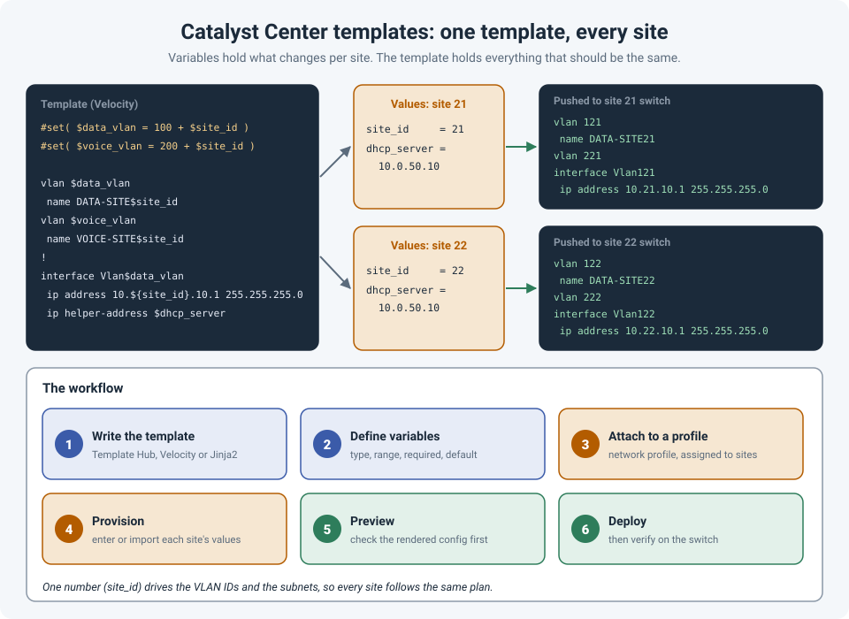

# Catalyst Center Templates: Using Variables to Assign VLANs and Subnets

Configuring the tenth branch switch by hand is when mistakes happen. A VLAN typed as 1120
instead of 120, a helper address copied from the wrong site, a subnet that overlaps with
another branch. None of it is hard; it's just repetitive, and repetition is where typos live.

Cisco **Catalyst Center** (formerly DNA Center) solves this with **templates**: you write the
standard configuration once, mark the parts that change per site as **variables**, and let
Catalyst Center fill them in for each switch.

!!! abstract "Key takeaway"
    Put everything that should be **the same everywhere** in the template, and everything that
    **changes per site** in variables. A good trick is to derive values from **one site number**:
    `site_id = 21` becomes VLAN 121, VLAN 221 and subnet 10.21.10.0/24, so every site follows
    the same addressing plan automatically. Templates can be written in **Velocity** or
    **Jinja2**, attached to sites through a **network profile**, and should always be
    **previewed** before they're pushed.



## How templates work

A template is a block of normal CLI configuration with placeholders in it. In Catalyst Center:

1. **Write the template** in the Template Hub (or Template Editor in older versions), in
   **Velocity** or **Jinja2**.
2. **Define the variables.** Catalyst Center detects them and lets you set a type (text,
   integer, IP address), a valid range, a default, and whether a value is required. This is your
   first line of defence against bad input.
3. **Attach the template to a network profile**, and assign that profile to sites.
4. **Provision** a device. Catalyst Center asks for the variable values for that device, or
   imports them.
5. **Preview** the rendered configuration.
6. **Deploy**, then verify on the switch.

There are two kinds of templates you'll use:

- **Onboarding (Day-0) templates**, applied through **Plug and Play** when a new switch first
  comes online, to give it just enough configuration to be managed.
- **Day-N templates**, for the full configuration and ongoing changes after that.

## The simple version: one variable per value

The most direct approach is a variable for every value that changes:

```
vlan $data_vlan
 name DATA
vlan $voice_vlan
 name VOICE
!
interface Vlan$data_vlan
 description Data gateway
 ip address $data_gateway $data_mask
 ip helper-address $dhcp_server
```

It works, but every site needs five or six values typed in correctly, and nothing stops two
sites from getting the same subnet.

## The better version: derive everything from a site number

If your addressing plan follows a pattern, let the template do the arithmetic. With one
integer variable, `site_id`:

=== "Velocity"

    ```
    #set( $data_vlan  = 100 + $site_id )
    #set( $voice_vlan = 200 + $site_id )

    vlan $data_vlan
     name DATA-SITE$site_id
    vlan $voice_vlan
     name VOICE-SITE$site_id
    !
    interface Vlan$data_vlan
     description Data gateway
     ip address 10.${site_id}.10.1 255.255.255.0
     ip helper-address $dhcp_server
    !
    interface Vlan$voice_vlan
     description Voice gateway
     ip address 10.${site_id}.20.1 255.255.255.0
     ip helper-address $dhcp_server
    ```

=== "Jinja2"

    ```
    
    

    vlan {{ data_vlan }}
     name DATA-SITE{{ site_id }}
    vlan {{ voice_vlan }}
     name VOICE-SITE{{ site_id }}
    !
    interface Vlan{{ data_vlan }}
     description Data gateway
     ip address 10.{{ site_id }}.10.1 255.255.255.0
     ip helper-address {{ dhcp_server }}
    !
    interface Vlan{{ voice_vlan }}
     description Voice gateway
     ip address 10.{{ site_id }}.20.1 255.255.255.0
     ip helper-address {{ dhcp_server }}
    ```

For site 21, that renders VLAN 121 (data), VLAN 221 (voice), and gateways 10.21.10.1 and
10.21.20.1. For site 22, VLAN 122 and 222, and 10.22.x.x. The only thing anyone types is the
site number.

Define `site_id` as an **integer** with a valid range (for example 1 to 250) in the variable
settings, so nobody can enter "21a" or 300. If a value arrives as text in Velocity, convert it
first with `$Integer.parseInt($site_id)`; in Jinja2 the `| int` filter does the same.

## Going further: loop over the switch's interfaces

Variables can also be **bound** to data Catalyst Center already has. Bind a variable (say
`interfaces`) to the **inventory**, entity **interface**, and you can loop through the switch's
real ports:

```
#foreach( $interface in $interfaces )
#if( $interface.interfaceType == "Physical" && $interface.portMode == "access" )
interface $interface.portName
 switchport access vlan $data_vlan
 switchport voice vlan $voice_vlan
#end
#end
```

Every physical access port gets the site's data and voice VLANs, whatever the switch model or
port count.

## Lessons that keep it safe

- **Always preview first.** Look at the rendered configuration for at least one real device
  before deploying to many.
- **Templates add configuration; they don't clean up.** If an old VLAN or line needs to go,
  the template needs an explicit `no` command.
- **Catalyst Center won't re-push an identical template** with the same values unless you choose
  to force it. If "nothing happened", that's often why.
- **Resync the device** before deploying a template that depends on its current state (like the
  interface loop), so Catalyst Center isn't working from old inventory data.
- **Test on one site, then roll out.** A template mistake is copied perfectly to every site.
  Combine it with the usual safety nets (see
  [Safe Changes on Remote Switches](safe-remote-changes.md)).
- **Keep templates in version control.** Export them and keep them in a repository, so you know
  what changed and when.
- **Document the addressing plan** that the template assumes (site 21 = 10.21.0.0/16), so the
  next engineer understands where the numbers come from.

## References

- [Cisco Blogs: Velocity templates in DNA Center, part 2](https://blogs.cisco.com/developer/velocity-templates-dnac-2)
- [Cisco Blogs: Using Velocity to create Plug and Play templates in DNA Center](https://blogs.cisco.com/developer/using-velocity-to-create-plug-and-play-templates-in-dna-center-part-4)
- [Cisco Code Exchange: CATC-TEMPLATES (Velocity and Jinja2 examples)](https://github.com/kebaldwi/CATC-TEMPLATES)
- [Cisco Live 2025: BRKOPS-2697](https://www.ciscolive.com/c/dam/r/ciscolive/global-event/docs/2025/pdf/BRKOPS-2697.pdf)
