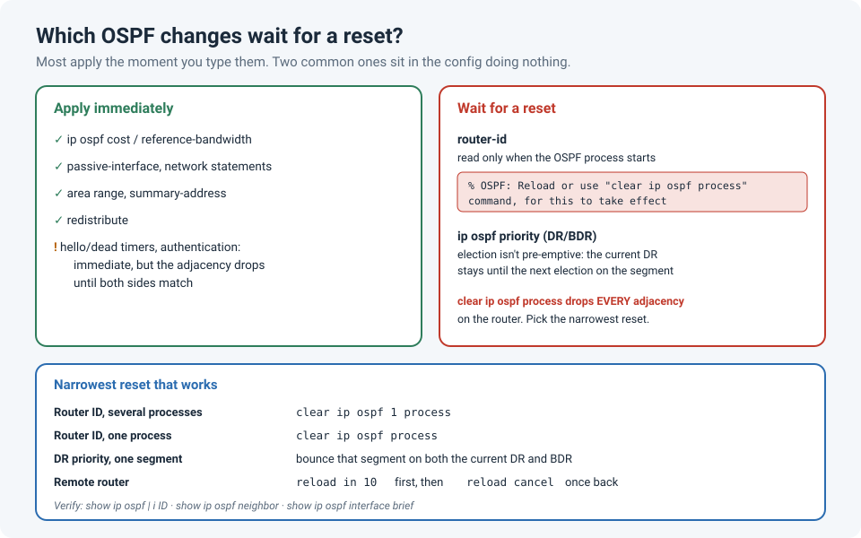

# The OSPF Change That Didn't Take Effect: When You Need `clear ip ospf process`

I made an OSPF change, checked the result, and nothing had changed. No error, no warning
I'd noticed, the command was right there in the running config. The router was simply still
using the old value.

What fixed it was resetting the OSPF process:

```
Router# clear ip ospf process
Reset ALL OSPF processes? [no]: yes
```

A few seconds later the neighbours came back up, and this time with the new setting. That
made me look into **which** OSPF changes apply straight away, and which ones quietly wait for
a restart.

!!! abstract "Key takeaway"
    Most OSPF changes, such as cost, passive interfaces, network statements or area ranges,
    apply **immediately**. Two common ones don't: a new **router ID** only takes effect after
    the process restarts, and a new **DR priority** only matters at the next DR election,
    because the election isn't pre-emptive. `clear ip ospf process` fixes both, but it
    **drops every adjacency** on the router, so use it in a change window and, on a remote
    router, with a `reload in` safety net. For a DR change, resetting just that one interface
    is enough.



## Why some changes wait

OSPF only reads certain values at specific moments:

| Change | When OSPF uses it | Needs a reset? |
|---|---|---|
| `router-id` | When the process **starts** | **Yes**: the process |
| `ip ospf priority` (DR/BDR) | At the next DR **election** on that segment | **Yes**: the adjacency on that segment |
| `ip ospf cost`, `auto-cost reference-bandwidth` | Straight away (new SPF run) | No |
| `passive-interface`, `network` statements | Straight away (adjacencies form or drop) | No |
| `area range`, `summary-address`, `redistribute` | Straight away (new LSAs) | No |
| Hello/dead timers, authentication | Straight away, **but** the adjacency drops until both sides match | No reset, but plan for the drop |

### Router ID

The router ID identifies the router in every LSA it originates, so OSPF can't change it
while it's running. Cisco IOS tells you so, and it's easy to miss when you paste a block of
config:

```
Router(config)# router ospf 1
Router(config-router)# router-id 10.255.0.1
% OSPF: Reload or use "clear ip ospf process" command, for this to take effect
```

A common reason to change it is a **duplicate router ID**, typically from a cloned config or a
copied loopback address. The log shows it:

```
%OSPF-4-DUP_RTRID_NBR: OSPF detected duplicate router-id 10.255.0.1 from 10.1.1.2 on interface GigabitEthernet0/1
```

### DR priority

On broadcast networks (Ethernet), OSPF elects a **designated router** (DR) and a backup (BDR).
The election is **not pre-emptive**: once a DR exists, a router with a higher priority joining
later, or a priority raised later, doesn't take over. The new priority only counts at the
**next** election, which happens when the current DR and BDR go away.

## Resetting with the least disruption

`clear ip ospf process` drops **every** OSPF adjacency on the router, flushes its OSPF routes,
and relearns everything. On a small network that takes seconds. On a large one, or a router
that's your only path to a remote site, it can cut you off. So pick the narrowest reset that
does the job:

| What you changed | Narrowest reset |
|---|---|
| Router ID, on a router with several OSPF processes | `clear ip ospf 1 process` (just that process) |
| Router ID, one process | `clear ip ospf process` |
| DR priority on one segment | Bounce OSPF on that segment on **both** the current DR and BDR (`shutdown` / `no shutdown` on those interfaces). Bouncing only the DR just promotes the BDR |
| Cisco NX-OS | `restart ospf <instance-tag>` |

!!! warning "On a remote router, arm the safety net first"
    If the session you're typing in rides on OSPF-learned routes, the reset will drop it.
    Usually it comes back within seconds, but if the new setting breaks an adjacency, it
    won't. Run `reload in 10` before the reset and `reload cancel` once you're back (see
    [Safe Changes on Remote Switches](safe-remote-changes.md)).

## Check it worked

```
show ip ospf | include ID                      ! Routing Process "ospf 1" with ID 10.255.0.1
show ip ospf neighbor                          ! all neighbours back in FULL (or 2WAY between DROTHERs)
show ip ospf interface brief                   ! State column: DR, BDR or DROTH per interface
show ip ospf database router self-originate    ! LSAs now carry the new router ID
show ip route ospf                             ! routes relearned
```

Compare the neighbour count and the number of OSPF routes with what you saved **before** the
change. If either is lower, something didn't come back.

## The BGP version of this lesson

BGP has the same pattern: a new route-map or policy doesn't apply to routes you've already
received or sent until you refresh the session. There, a **soft** reset (`clear ip bgp <neighbor>
soft in` / `soft out`) applies the policy **without** dropping the session (see
[Taking a Bad ISP Out of BGP](bgp-drain-isp.md)). OSPF has no soft equivalent for a router ID
change; it really does need the restart.

## Lessons learned

!!! tip "Takeaways"
    - Read the console output after pasting config: for a router ID change, IOS **tells** you it
      needs a reset.
    - Router ID changes need the **process** restarted; DR priority changes need a new
      **election** on that segment.
    - Cost, passive interfaces, network statements, summaries and redistribution apply
      immediately.
    - `clear ip ospf process` drops **all** adjacencies. Use the narrowest reset, in a change
      window, with `reload in` on remote routers.
    - Save `show ip ospf neighbor` and the OSPF route count before, and compare after.

## References

- Cisco: [OSPF Design Guide](https://www.cisco.com/c/en/us/support/docs/ip/open-shortest-path-first-ospf/7039-1.html) (router ID, DR election)
- Cisco Community: [OSPF router ID](https://community.cisco.com/t5/routing/ospf-router-id/m-p/3812993)
- Cisco Community: [OSPF DR/BDR election and reselection](https://community.cisco.com/t5/routing/reselection-of-dr-ospf/m-p/4803101/highlight/true)
