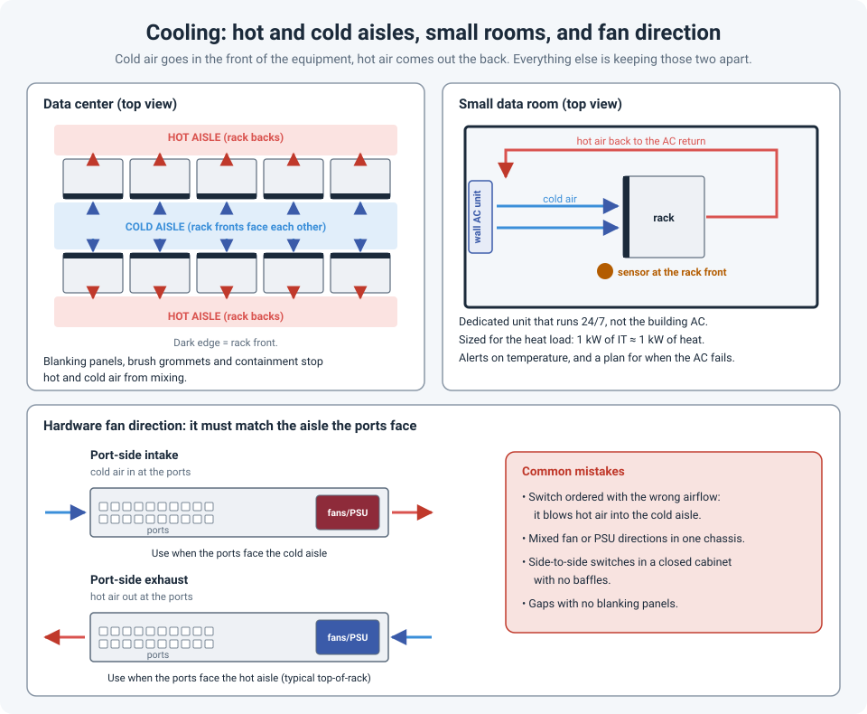

# Keeping It Cool: Hot and Cold Aisles, Small Data Rooms, and Fan Direction

Every watt that goes into a switch, firewall or server comes out as heat. Get rid of that heat
and the equipment runs for years. Don't, and you'll see fans screaming at full speed, warning
messages, random reboots, and eventually devices shutting themselves down to survive.

The principle is the same in a large data center and a small data room: **cold air in the
front of the equipment, hot air out the back, and don't let the two mix.**

!!! abstract "Key takeaway"
    Measure temperature at the **front (inlet)** of the equipment; ASHRAE recommends **18 to
    27 °C**. In a data center, racks face each other across a **cold aisle** and back onto a
    **hot aisle**, and blanking panels and containment keep the air separate. In a small room,
    use a **dedicated AC unit that runs 24/7**, sized for the heat load, with a temperature alert
    for when it fails. And check every switch's **airflow direction**: a port-side intake switch
    in a rack that expects port-side exhaust blows hot air straight into the cold aisle.



## How hot is too hot?

ASHRAE (the industry body most data center cooling standards refer to) recommends an **inlet
temperature of 18 to 27 °C** for IT equipment. Most equipment can run outside that range for
a while (the "allowable" range for the common A1 class goes up to 32 °C), but reliability drops
the longer it stays there.

Two things people often get wrong:

- **Measure at the inlet, not the room.** A thermostat on the wall by the door says nothing about
  the air entering the top of the rack. Put sensors at the **front** of the rack, ideally at
  the top, middle and bottom.
- **Colder isn't better.** Running a room at 16 °C wastes energy and doesn't help the hardware.
  Aim for steady temperatures inside the recommended range.

## Data centers: hot aisle / cold aisle

Almost all rack equipment pulls air in at the **front** and pushes it out the **back**. So the
racks are arranged in rows:

- **Fronts face fronts** across a **cold aisle**. Cooled air is delivered here, often through
  perforated floor tiles on a raised floor, or from in-row cooling units.
- **Backs face backs** across a **hot aisle**. Hot exhaust is collected here and returned to the
  cooling units.

The enemy is **mixing**: hot air finding its way back to the front of the equipment
(recirculation), or cold air escaping without passing through any equipment (bypass). The
fixes are simple and cheap:

- **Blanking panels** in every empty U. An open gap lets hot air flow back to the front.
- **Brush grommets** or seals where cables pass through floors and cabinet tops.
- **Containment**: closing off the cold aisle (doors and a roof) or the hot aisle, so the two
  air streams physically can't mix.

## Small data rooms and closets

Most of us work with something smaller: a room or closet with a few racks, or a single rack in
a comms room. The physics are the same, but the cooling is usually one of these:

| Option | When it fits | Watch out for |
|---|---|---|
| **Dedicated split / ductless AC** (wall unit) | Most small data rooms. Runs independently of the building system. | Choose a model that **restarts automatically** after a power cut, and that can run in cold weather if you need cooling all year. |
| **Building (comfort) AC** | Only as a supplement | Often turned down or **off at night and on weekends**, which is exactly when nobody is there to notice. |
| **Portable AC unit** | Temporary or emergency use | The hot exhaust hose must go **outside the room**, and many units **stop when the condensate tank fills**. |
| **Ventilation fans only** | Very small loads, with cooler air available next door | Can only cool to the temperature of the air it brings in. |
| **Precision cooling (CRAC / in-row)** | Larger rooms and data centers | Cost, and it needs proper design and maintenance. |

Sizing in one line: **almost all the electrical power the equipment uses turns into heat**.
If the rack draws 3 kW, you need at least 3 kW of cooling, plus the UPS losses, lighting and a
margin. AC units are often sold in BTU/h or "tons": **1 kW ≈ 3,412 BTU/h**, and **1 ton = 3.5 kW**.

Even in a small room, point the AC at the **front** of the rack, and let the hot air return to
the unit from the back, not across the front of the equipment.

!!! warning "Plan for the AC failing"
    One AC unit is a single point of failure, and a small, closed room heats up quickly when it
    stops. Have a temperature sensor with **alerts** (SNMP, email, or a monitored PDU or UPS
    probe), a second unit or a documented backup plan, and a list of what to shut down first if
    the room keeps getting hotter.

## Hardware fan direction

A switch doesn't know where the cold aisle is. You choose its airflow when you order it, and it
has to match how it's mounted.

Rack switches usually have ports on one end and fans and power supplies on the other. Vendors
describe the airflow relative to the **port side**:

| Airflow | Air enters at | Use when the ports face |
|---|---|---|
| **Port-side intake** | The port side | The **cold aisle** (front of the rack) |
| **Port-side exhaust** | The fan/PSU side | The **hot aisle**, the usual setup for **top-of-rack** switches, whose ports face the server NICs at the back of the rack |

How to tell which one you have:

- **Color coding.** Many vendors color the fans and PSUs. On Cisco Nexus switches, for example,
  **blue** modules are port-side exhaust and **burgundy** modules are port-side intake.
- **Part numbers.** The fan and PSU part numbers usually include a direction code; check the
  datasheet, because "front" and "back" don't mean the same thing for every vendor.
- **Hold your hand behind it.** Not scientific, but it works.

The rules that matter:

- **All fans and power supplies in one device must use the same direction.** Mixing them
  fights the airflow, and most switches raise an alarm.
- **Order the right direction for the rack**, especially for switches mounted backwards (ports
  to the rear) so they face the patch panels or servers.
- **Side-to-side** airflow switches (common on some chassis) need side baffles or air dams in
  an enclosed cabinet, or they'll breathe their own exhaust.

## Checking temperatures from the CLI

```
show environment all                  ! Cisco Catalyst
show environment temperature          ! Cisco Nexus
show environment fan                  ! Cisco Nexus: fan status and airflow direction
execute sensor list                   # FortiGate (hardware models)
show system environmentals            # Palo Alto
```

Rising inlet temperatures, fans at high speed and temperature syslog messages are early
warnings. Send them to your monitoring system before they become an outage.

## References

- [ASHRAE TC 9.9: Thermal Guidelines for Data Processing Environments, reference card](https://www.ashrae.org/file%20library/technical%20resources/bookstore/supplemental%20files/therm-gdlns-5th-r-e-refcard.pdf)
- [NetApp: Cisco Nexus 92300YC components (port-side intake and exhaust coloring)](https://docs.netapp.com/us-en/ontap-systems-switches/switch-cisco-92300/components-92300.html)
- [Racking Gear: Rack Sizes, Cage Nuts, and PDU vs. UPS](rack-power-basics.md)
