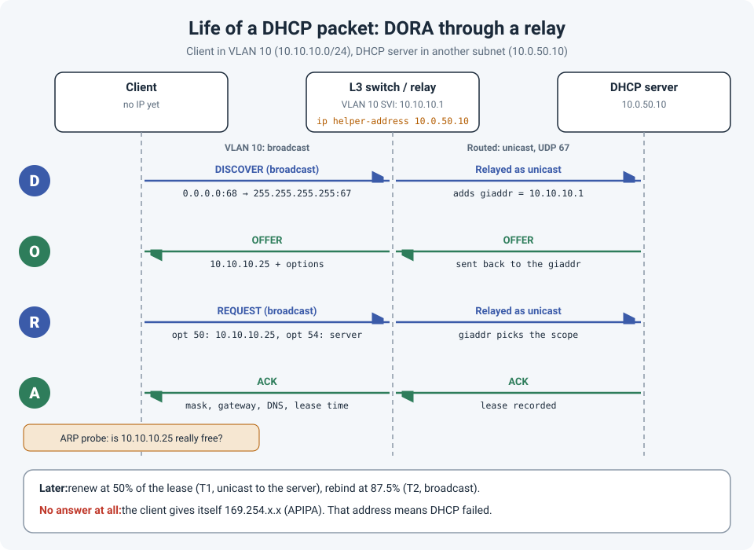

# Life of a Packet: DHCP, Step by Step

"The laptop has a 169.254 address" is one of the most common tickets in networking. To fix it
quickly, it helps to know exactly what DHCP is trying to do, which packets should be on the wire,
and where each one can get lost.

This post follows one DHCP exchange from a client to a server in a different subnet, the setup
almost every enterprise network uses.

!!! abstract "Key takeaway"
    DHCP is four packets: **Discover, Offer, Request, Ack** (DORA). The client's packets are
    **broadcasts**, so they never leave the VLAN on their own. A **relay** (`ip helper-address`)
    on the gateway turns them into **unicasts** to the server and stamps them with the
    **giaddr**, which tells the server which scope to use. When DHCP fails, follow the packet:
    did the Discover reach the relay, did the relay forward it, did the server answer, and did
    the answer make it back?



## The setup

| Device | Address |
|---|---|
| Client | No IP yet, in VLAN 10 |
| Gateway (SVI for VLAN 10) | 10.10.10.1/24, configured as a DHCP relay |
| DHCP server | 10.0.50.10, in a server subnet |

DHCP uses **UDP 67** (server) and **UDP 68** (client).

## D: Discover

The client has no IP address, no gateway and no idea where the server is. So it shouts:

- Source **0.0.0.0:68**, destination **255.255.255.255:67**
- Destination MAC **ff:ff:ff:ff:ff:ff**
- Includes its own MAC address (`chaddr`) and the options it wants (parameter request list)

A broadcast never crosses a router. Without help, this packet dies at the edge of VLAN 10.

### The relay steps in

The gateway SVI is configured as a relay:

```
interface Vlan10
 ip address 10.10.10.1 255.255.255.0
 ip helper-address 10.0.50.10
```

When the Discover arrives, the relay:

1. Sets **giaddr** (gateway IP address) to **10.10.10.1**, the address of the interface the
   request came in on.
2. Sends the packet as a **unicast** to 10.0.50.10 on UDP 67.

The **giaddr** is the key field. The server uses it to choose the scope: a request with giaddr
10.10.10.1 gets an address from the 10.10.10.0/24 scope. It's also where the server sends its
reply.

## O: Offer

The server picks a free address, for example **10.10.10.25**, and sends an **Offer** back to the
giaddr (10.10.10.1) on UDP 67. Some servers ping the address first to make sure nobody is using
it. Cisco IOS DHCP servers do this by default; on Windows Server it's the optional "conflict
detection" setting.

The relay forwards the Offer to the client, as a broadcast or a unicast to the client's MAC,
depending on the **broadcast flag** the client set in its Discover.

The Offer contains the address and the options: subnet mask, default gateway, DNS servers,
lease time, and anything else configured (for example option 43 for wireless APs to find
their controller).

## R: Request

The client could receive offers from more than one server. It picks one and **broadcasts** a
**Request** that includes:

- **Option 50:** the address it wants (10.10.10.25)
- **Option 54:** the server it chose (10.0.50.10)

It's a broadcast on purpose: any other server that made an offer sees it wasn't chosen and
releases its address. The relay forwards it to the server as before.

## A: Ack

The server confirms with an **Ack**, records the lease, and the relay delivers it to the client.

Before using the address, the client usually sends an **ARP probe** asking "is anyone already
using 10.10.10.25?" If someone answers, the client sends a **Decline** and starts over.
Otherwise it configures the address, mask, gateway and DNS, and it's online.

## After the Ack: renew, rebind, and APIPA

A lease isn't forever:

| When | What happens |
|---|---|
| **50% of the lease** (T1) | The client sends a **unicast** Request directly to its server to renew. No relay needed, just routing. |
| **87.5% of the lease** (T2) | If the renewal got no answer, the client **broadcasts** to any server (rebind). |
| **Lease expires** | The client must stop using the address and start again from Discover. |

If no server answers at all, most operating systems assign themselves an address from
**169.254.0.0/16** (APIPA, or link-local). A 169.254 address doesn't mean "bad IP"; it means
"**DHCP never answered**". That's the starting point for troubleshooting.

## Where it breaks in real networks

Most DHCP failures I've seen come down to one of these:

| Symptom | Likely cause |
|---|---|
| Whole new VLAN gets 169.254 addresses | No `ip helper-address` on the new SVI, or it points at the wrong server |
| Relay is configured, still no address | Firewall or ACL between relay and server blocking UDP 67, or the server has **no route back** to the giaddr subnet |
| Server receives requests but doesn't answer | No scope for that giaddr subnet, scope not activated, or **scope exhausted** |
| Works on one switch, fails on another | **DHCP snooping**: the uplink isn't trusted, so offers are dropped |
| Snooping on, relay or IOS server drops requests | **Option 82** inserted by the access switch with giaddr 0.0.0.0 (see below) |
| Only APs or phones fail | Wrong **native VLAN** on the switch port, so they request in the wrong VLAN |
| Devices on 802.1X ports fail after a change | Port not yet authorized when the client sent its Discovers; the client gives up and falls back to APIPA |
| Clients get addresses from the wrong range | A **rogue DHCP server** (often a home router) on the network; DHCP snooping prevents this |

!!! warning "The option 82 trap"
    With DHCP snooping enabled, Cisco access switches insert **option 82** (relay agent
    information) by default but leave giaddr empty. Many relays and Cisco IOS DHCP servers drop
    those packets as invalid. If snooping just went in and DHCP stopped, either stop the
    insertion on the access switch (`no ip dhcp snooping information option`) or tell the
    relay to accept it (`ip dhcp relay information trust-all`).

## Following the packet: commands

Work hop by hop, the same direction the packet travels.

**1. At the client**

```
ipconfig /all            # current address, DHCP server, lease times
ipconfig /release
ipconfig /renew          # trigger a fresh DORA
```

**2. At the access switch (if snooping is on)**

```
show ip dhcp snooping                    # enabled VLANs and trusted ports
show ip dhcp snooping binding            # did the client get a lease through this switch?
show ip dhcp snooping statistics         # dropped packets
```

**3. At the relay**

```
show ip interface vlan 10 | include Helper    # Helper address is 10.0.50.10
debug ip dhcp server packet                   # shows relayed packets; use carefully, and undebug all after
```

On a firewall acting as the gateway, the relay lives on the interface:

=== "FortiGate"

    ```
    config system interface
        edit "vlan10"
            set dhcp-relay-service enable
            set dhcp-relay-ip "10.0.50.10"
        next
    end
    ```

=== "Palo Alto"

    **Network > DHCP > DHCP Relay**: add the VLAN 10 interface, enable IPv4, and add the server
    address 10.0.50.10.

**4. At the server**

On a Cisco IOS DHCP server:

```
show ip dhcp pool         # addresses leased vs. total
show ip dhcp binding      # who has which address
show ip dhcp conflict     # addresses found in use by ping
```

On Windows Server, check scope usage in PowerShell:

```
Get-DhcpServerv4ScopeStatistics
```

**5. On the wire**

In Wireshark, filter with `dhcp` (`bootp` in older versions). To follow one client, use
`dhcp.hw.mac_addr == aa:bb:cc:dd:ee:ff`. Seeing Discovers with no Offers puts the problem
between the relay and the server; seeing Offers with no Request means the reply isn't reaching
the client.

## References

- [RFC 2131: Dynamic Host Configuration Protocol](https://www.rfc-editor.org/rfc/rfc2131)
- [RFC 3046: DHCP Relay Agent Information Option (option 82)](https://www.rfc-editor.org/rfc/rfc3046)
- [RFC 5227: IPv4 Address Conflict Detection](https://www.rfc-editor.org/rfc/rfc5227)
- [RFC 3927: Dynamic Configuration of IPv4 Link-Local Addresses](https://www.rfc-editor.org/rfc/rfc3927)
