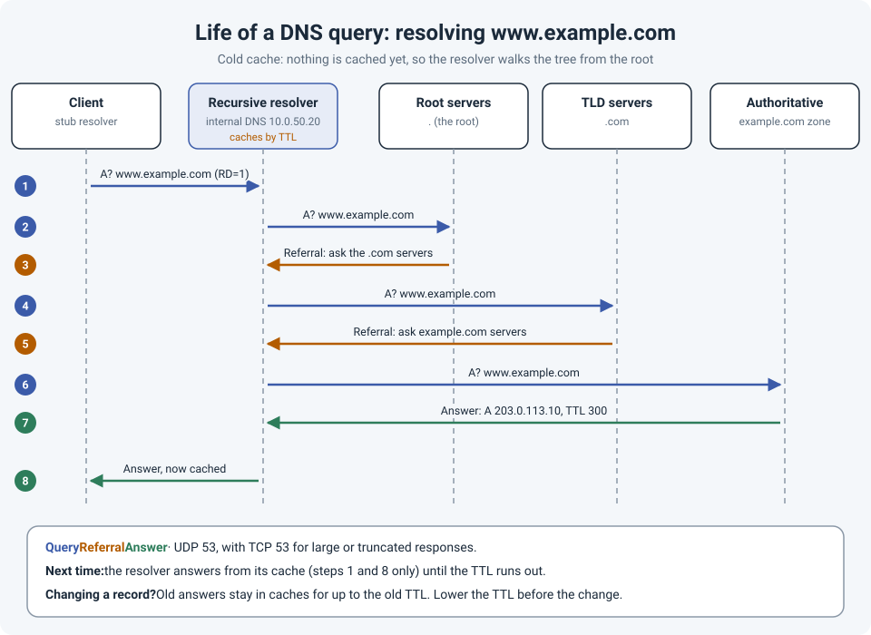

# Life of a Packet: DNS, Step by Step

"It's always DNS" is a joke because it's so often true. An application is "down", the network
gets blamed, and the real problem is a name that resolves to the wrong address, an old answer
stuck in a cache, or a client asking the wrong server.

This post follows one DNS lookup from start to finish. It picks up where
[Life of a Packet: DHCP](dhcp-life-of-packet.md) ends: the client now has an IP address, and
through DHCP **option 6** it also knows which DNS server to ask.

!!! abstract "Key takeaway"
    The client asks **one** server, its recursive resolver, and expects a final answer. The
    resolver does the hard work: it asks a **root** server, gets referred to the **TLD**
    servers (.com), gets referred again to the domain's **authoritative** servers, and finally
    gets the answer. Every answer is **cached** for its **TTL**, which is why DNS is fast, and
    also why changes take time to show up. When DNS fails, check which server the client asked,
    what that server answered, and whether the answer is coming from a cache.



## The players

| Role | What it does | Example |
|---|---|---|
| **Stub resolver** | The small DNS client in the operating system. It asks one server and waits for a final answer. | Windows DNS Client service |
| **Recursive resolver** | Does the full lookup for clients, and caches the results. | Internal DNS servers (often the domain controllers), or a public resolver |
| **Root servers** | The top of the tree. They don't know the answer, but they know who runs each TLD. | 13 named root servers (a to m), each with many anycast instances around the world |
| **TLD servers** | Know which servers are authoritative for each domain under the TLD. | .com, .ca, .org |
| **Authoritative servers** | Hold the actual records for a domain. | The DNS servers that host the example.com zone |

DNS uses **UDP 53** for most queries and **TCP 53** for zone transfers and responses too
large for UDP.

## Step 0: before any packet leaves the client

The client checks locally first:

1. The **application's own cache** (browsers keep one).
2. The **OS DNS cache**.
3. The **hosts file** (`C:\Windows\System32\drivers\etc\hosts`, or `/etc/hosts`).

Only if none of these has the answer does a packet go on the wire. A forgotten hosts file
entry can override DNS completely, and it's worth checking when one machine resolves a name
differently from everyone else.

## Steps 1 to 8: the full lookup

**1. Client to resolver.** The client sends `A? www.example.com` to its DNS server
(10.0.50.20) with the **RD** (recursion desired) flag set: "please give me a final answer."

**2 and 3. Resolver to root.** With an empty cache, the resolver asks a root server. The root
doesn't know www.example.com, so it sends a **referral**: "here are the servers for .com."
Referrals include the IP addresses of those servers (called **glue records**) so the resolver
can reach them.

**4 and 5. Resolver to TLD.** The resolver asks a .com server, which sends another referral:
"here are the authoritative servers for example.com."

**6 and 7. Resolver to authoritative.** The resolver asks example.com's authoritative server
and gets the real answer: **A 203.0.113.10, TTL 300**.

**8. Resolver to client.** The resolver passes the answer to the client and **caches** every
piece it learned: the .com servers, the example.com servers and the final record.

Steps 2 to 7 are **iterative** queries: each server answers with what it knows, and the
resolver does the walking.

!!! info "Forwarders"
    Many internal DNS servers don't walk the tree themselves. They **forward** anything they
    aren't authoritative for to another resolver (an ISP or public DNS service), which does
    steps 2 to 7. A **conditional forwarder** sends only one domain to a specific server, which
    is how internal DNS resolves a partner's domain across a VPN.

## Caching and TTL: why changes "don't work"

Every record has a **TTL** (time to live), in seconds. Once a resolver caches an answer, it
keeps using it until the TTL runs out, without asking again.

That's great for speed, but it's the reason for a classic change-window surprise: you update a
record, test it, and still get the **old** address. The old answer is cached on the resolver,
on the client, or both, for up to the old TTL.

- **Before a planned change**, lower the record's TTL (for example from 3600 to 300 seconds),
  and do it at least one old-TTL period in advance.
- **After the change**, flush the caches you control instead of waiting.
- Failed lookups are cached too. If someone queried a name **before** it was created, the
  "does not exist" (NXDOMAIN) answer can stay cached for a while (negative caching).

## Where it breaks in real networks

| Symptom | Likely cause |
|---|---|
| Internal names fail, internet names work | Client is using a public resolver instead of internal DNS (wrong DHCP option 6, manual setting, or a VPN client without split DNS) |
| Works for some users, not others | Different resolvers or cached answers. Compare `nslookup` results against each server. |
| Record changed but clients still go to the old IP | Cached answer, wait for the TTL or flush the caches |
| A partner's domain doesn't resolve over the VPN | Missing conditional forwarder, or the firewall doesn't allow DNS to their server |
| Small lookups work, some large ones fail | UDP 53 allowed but **TCP 53** blocked, or a firewall's DNS inspection dropping large responses |
| Short names like `fileserver` don't resolve | Missing DNS suffix (search domain) on the client |
| One machine resolves a name differently from everyone else | A hosts file entry |
| Typos on a Cisco CLI hang for several seconds ("Translating...") | The router is trying to resolve the typo as a hostname |

That last one isn't an outage, just an annoyance. Unless the router actually needs DNS, turn
it off:

```
no ip domain lookup
```

(`no ip domain-lookup` on older IOS versions.)

## Following the query: commands

**On the client (Windows)**

```
ipconfig /all                                        # which DNS servers am I using?
ipconfig /displaydns                                 # what's in my cache?
ipconfig /flushdns                                   # clear it
nslookup www.example.com                             # ask my default server
nslookup www.example.com 10.0.50.20                  # ask a specific server
Resolve-DnsName www.example.com -Server 10.0.50.20   # PowerShell, more detail
```

**On Linux or macOS**

```
dig www.example.com                  # answer, TTL and which server replied
dig @10.0.50.20 www.example.com      # ask a specific server
dig +trace www.example.com           # do the root, TLD, authoritative walk yourself
```

`dig +trace` is the best way to see the life of a DNS packet for yourself: it shows every
referral, from the root down. Running `dig` twice also shows caching in action: the TTL in
the answer counts down.

**On a Windows DNS server (PowerShell)**

```
Clear-DnsServerCache
Add-DnsServerConditionalForwarderZone -Name "partner.example" -MasterServers 192.0.2.53
```

**On the wire**

In Wireshark, filter with `dns`. To check for TCP fallback, use `tcp.port == 53`. A response
with the **TC** (truncated) flag set means the client should retry over TCP; if that retry is
blocked, the lookup fails.

## References

- [RFC 1034: Domain Names, Concepts and Facilities](https://www.rfc-editor.org/rfc/rfc1034)
- [RFC 1035: Domain Names, Implementation and Specification](https://www.rfc-editor.org/rfc/rfc1035)
- [RFC 2308: Negative Caching of DNS Queries](https://www.rfc-editor.org/rfc/rfc2308)
- [RFC 7766: DNS Transport over TCP](https://www.rfc-editor.org/rfc/rfc7766)
- [root-servers.org: the root server system](https://root-servers.org/)
