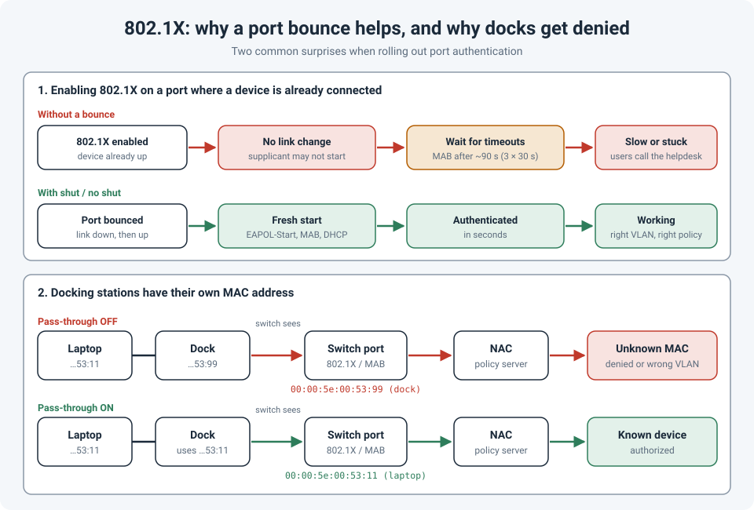

# 802.1X Rollout Surprises: Port Bounces and Docking Stations

Enabling 802.1X on access ports looks simple on paper: configure the switch, point it at the
NAC server, done. In practice, two things caught me out:

1. Devices that were **already connected** when 802.1X was turned on didn't authenticate
   until we **shut / no shut** their ports.
2. Laptops on **docking stations** were denied, because the switch saw the **dock's** MAC
   address, not the laptop's. The fix was **MAC address pass-through**.

!!! abstract "Key takeaway"
    Authentication starts reliably on **link up**. Turn on 802.1X under a live device and it may
    sit waiting for timeouts (MAB fallback takes about **90 seconds** with default Cisco
    timers) or never authenticate at all. A **port bounce** gives it a clean start. Docks
    with a built-in network card send traffic from **their own MAC**, which breaks MAB and any
    policy tied to the laptop's MAC. Enable **MAC address pass-through** in the laptop's
    BIOS/UEFI so the dock uses the laptop's MAC.



## Part 1: why existing devices don't authenticate

A device's 802.1X client (the **supplicant**) usually starts authentication when the link comes
up: it sends an **EAPOL-Start** and answers the switch's identity requests. If 802.1X is
enabled on a port where the device is **already** up, there is no link-up event:

- A device with a supplicant may not notice anything changed, and keeps waiting.
- A device **without** a supplicant (printer, camera, badge reader) relies on **MAB** (MAC
  Authentication Bypass), which by default only starts after 802.1X gives up. On Cisco
  switches that's `tx-period` (30 s) × (`max-reauth-req` (2) + 1), about **90 seconds**.
- Meanwhile, depending on the configuration, the port may be blocked or sitting in the wrong
  VLAN, and users call the helpdesk.

A port bounce triggers a clean link down / link up, so everything starts fresh: EAPOL, MAB,
DHCP.

```
interface range GigabitEthernet1/0/1 - 48
 shutdown
 no shutdown
```

A gentler option restarts authentication without dropping the link:

```
clear authentication sessions interface GigabitEthernet1/0/14
! or, on newer IOS-XE with IBNS 2.0:
clear access-session interface GigabitEthernet1/0/14
```

!!! warning "Bouncing ports also cuts PoE"
    A `shutdown` drops power on PoE ports. **Phones, APs and cameras reboot.** Bounce ports in
    batches, during the change window, and warn people first. For PoE devices, try clearing the
    session before bouncing.

Things that make the rollout smoother:

- **Plan the bounce into the change.** Enable 802.1X, then bounce the ports deliberately,
  instead of finding out from tickets.
- **Tune the timers** if you rely on MAB for many devices. Lowering `tx-period` speeds up MAB
  fallback; for example, `dot1x timeout tx-period 10` brings it to about 30 seconds. Test it
  first, since some slow supplicants need the time.
- **Check the Windows side.** On Windows, the wired 802.1X client is the **Wired AutoConfig**
  service (`dot3svc`), and it **isn't started by default**. It has to be set to start
  automatically, usually through Group Policy. `netsh lan show interfaces` shows whether
  it's running and the authentication state.

To verify a port:

```
show authentication sessions interface GigabitEthernet1/0/14 details
! or, on IBNS 2.0:
show access-session interface GigabitEthernet1/0/14 details
```

You're looking for the **method** (dot1x or mab), the **status** (authorized), and the
**VLAN or policy** that was applied.

## Part 2: docking stations and their own MAC address

A typical USB-C or Thunderbolt dock has its **own network card** with its **own MAC address**.
When a laptop is docked, its network traffic goes out through the dock, so the switch sees
the dock's MAC, not the laptop's.

That breaks anything that depends on the laptop's MAC:

- **MAB**: the laptop's MAC is in the NAC's allowed list; the dock's MAC isn't, so the
  device is denied or lands in the wrong VLAN.
- **Device profiling and policies** tied to the laptop.
- **DHCP reservations** and asset tracking.

It's also a security gap the other way: if someone adds a dock's MAC to the allowed list,
**any** laptop plugged into that dock gets the same access.

### The fix: MAC address pass-through

Most business laptops have a BIOS/UEFI setting usually called **MAC Address Pass-Through**.
When it's enabled, a supported dock uses the **laptop's** MAC address (typically the
laptop's built-in system MAC) instead of its own. To the switch and the NAC, the laptop now
looks the same docked or undocked.

Things to check:

- **Supported docks only.** Pass-through usually works only with the laptop vendor's own
  docks (and a supported OS driver). A third-party dock may ignore it.
- **Roll it out centrally**, through the vendor's BIOS management tools, not one laptop at a
  time.
- **Watch the host mode.** Some docks can still send frames from their own MAC at times (for
  example, before the operating system loads). On a port in **single-host** mode, a second
  MAC can trigger a security violation. **Multi-auth** (or **multi-domain** where there's a
  phone) is more forgiving.
- **Confirm from the switch.** `show authentication sessions interface ... details` shows which
  MAC the switch actually authenticated. If it's not the laptop's, pass-through isn't working.

## References

- [Cisco: Troubleshoot 802.1X on Catalyst 9000 Series Switches](https://www.cisco.com/c/en/us/support/docs/lan-switching/8021x/220919-troubleshoot-dot1x-on-catalyst-9000-seri.html)
- [Cisco: Configuring IEEE 802.1X Port-Based Authentication](https://www.cisco.com/en/US/docs/ios-xml/ios/sec_usr_8021x/configuration/15-2mt/config-ieee-802x-pba.html)
- [Microsoft: Troubleshooting secure 802.3 wired connections (Wired AutoConfig)](https://learn.microsoft.com/en-us/previous-versions/windows/it-pro/windows-vista/cc749352%28v=ws.10%29)
