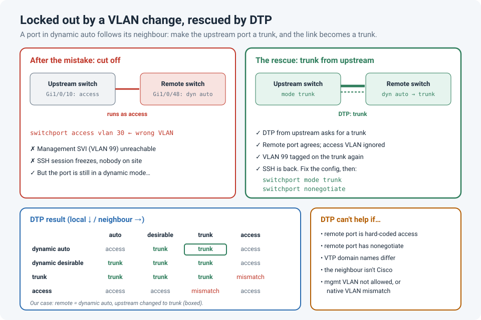

# Locked Out by a VLAN Change: Getting a Remote Switch Back with DTP

A remote switch, no one on site, and a VLAN change on its uplink. The moment I pressed Enter,
the SSH session froze. The switch's management VLAN no longer reached it, so neither did I.

There was no `reload in` armed (lesson learned, see
[Safe Changes on Remote Switches](safe-remote-changes.md)). But there was still a way back in,
and it came from a protocol most of us only remember as something to disable:
**DTP, the Dynamic Trunking Protocol**.

!!! abstract "Key takeaway"
    If a remote switch's uplink is still in a **dynamic** mode (`dynamic auto` is the default
    on most Catalyst switches), its own access VLAN only applies while the port runs as an
    access port. Configure the **upstream** port as a **trunk** (or `dynamic desirable`), and
    DTP turns the link into a trunk again, carrying the management VLAN. Once you're back in,
    fix the config properly, then **hard-code the trunk and turn DTP off** with
    `switchport nonegotiate`.



## What went wrong

The remote switch's uplink had never been hard-coded. It was left in its default mode,
`switchport mode dynamic auto`, and because the upstream port was configured as an access
port, the link ran in **access** mode, in the management VLAN.

Then a change put the wrong VLAN on that uplink:

```
interface GigabitEthernet1/0/48
 switchport access vlan 30        ! meant for a different port
```

The uplink, and with it the remote switch's management SVI, was now in the wrong VLAN. No
more SSH, no more SNMP, nothing.

## Why DTP could save it

DTP is how two Cisco switch ports agree whether the link should be a trunk. The result
depends on both ends:

| Local port \ Neighbour port | `dynamic auto` | `dynamic desirable` | `trunk` | `access` |
|---|---|---|---|---|
| **`dynamic auto`** | Access | **Trunk** | **Trunk** | Access |
| **`dynamic desirable`** | **Trunk** | **Trunk** | **Trunk** | Access |
| **`trunk`** | **Trunk** | **Trunk** | **Trunk** | Mismatch |
| **`access`** | Access | Access | Mismatch | Access |

The key point: on a port in a dynamic mode, `switchport access vlan` only applies **while the
port operates as an access port**. If the neighbour asks for a trunk, the port becomes a trunk,
and the wrong access VLAN no longer matters.

So the fix was entirely on the **upstream** switch, which I could still reach:

```
interface GigabitEthernet1/0/10           ! upstream port facing the remote switch
 switchport trunk allowed vlan 10,20,30,99
 switchport trunk native vlan 1          ! must match what the remote side expects
 switchport mode trunk                   ! sends DTP; the remote 'dynamic auto' port agrees
```

A few seconds later, the remote port negotiated a trunk, the management VLAN (99 here)
reached the remote switch again, and SSH came back.

## Check it from the upstream side

```
show interfaces gi1/0/10 switchport       ! Operational Mode: trunk?
show interfaces trunk                     ! is the link listed, with the management VLAN allowed and forwarding?
show dtp interface gi1/0/10               ! DTP state and packets sent/received
show cdp neighbors gi1/0/10 detail        ! the remote switch's management IP, if CDP still sees it
```

Once you're back on the remote switch:

```
show interfaces gi1/0/48 switchport
! Administrative Mode: dynamic auto
! Operational Mode: trunk            <- negotiated by DTP
! Negotiation of Trunking: On
```

## When this won't work

DTP is a last resort, not a guarantee. It can't help when:

| Situation | Why DTP can't help |
|---|---|
| The remote uplink is hard-coded `switchport mode access` | Access mode never negotiates a trunk |
| The remote uplink has `switchport nonegotiate` | DTP is turned off on that port |
| The VTP domain names differ | DTP carries the VTP domain; with a mismatch the trunk doesn't form (`%DTP-5-DOMAINMISMATCH`) |
| The neighbour isn't a Cisco switch | DTP is Cisco-proprietary |
| The management VLAN isn't allowed on the new trunk, or the native VLANs differ | The trunk forms but management traffic still doesn't arrive |

!!! tip "If the remote port is hard-coded access"
    You can still get in by meeting it where it is. Put the **upstream** port in the same
    wrong VLAN (`switchport access vlan 30`), then reach the remote switch through a
    temporary IP in that VLAN. It's clumsier, but it's another way back that doesn't need a
    site visit.

## Afterwards: put things right and turn DTP off

DTP saved me here, but leaving it on is a risk. An attacker plugged into a port in
`dynamic auto` or `dynamic desirable` can negotiate a trunk and reach every VLAN on it
(a **switch spoofing** attack, a form of VLAN hopping). Once the switch is back:

```
interface GigabitEthernet1/0/48            ! remote switch uplink
 no switchport access vlan 30
 switchport mode trunk
 switchport trunk allowed vlan 10,20,99
 switchport nonegotiate                    ! no more DTP on this link
!
interface range GigabitEthernet1/0/1 - 47  ! user ports
 switchport mode access                    ! access ports never negotiate a trunk
```

Do the same on the upstream end of the link, so both sides are explicit. And next time, arm
`reload in 10` before touching an uplink.

## Lessons learned

!!! tip "Takeaways"
    - A port in `dynamic auto` follows its neighbour: make the neighbour a trunk and the link
      becomes a trunk, whatever its access VLAN says.
    - That makes DTP a useful **recovery path** when a remote uplink's VLAN is wrong.
    - It can't help with hard-coded access ports, `nonegotiate`, VTP domain mismatches or
      non-Cisco neighbours.
    - After recovery, **hard-code trunks and access ports** and disable DTP with
      `switchport nonegotiate`.
    - `reload in` before any uplink change is still the better safety net.

## References

- Study CCNA: [Cisco Dynamic Trunking Protocol (DTP) explained](https://study-ccna.com/dynamic-trunking-protocol-dtp-cisco/) (mode combinations and defaults)
- Cisco Community: [How to configure trunking between Cisco Catalyst switches](https://community.cisco.com/t5/networking-knowledge-base/how-to-configure-trunking-between-cisco-catalyst-switches-that/ta-p/3131134)
- Grandmetric: [How to configure Dynamic Trunking Protocol (DTP)](https://www.grandmetric.com/knowledge-base/design_and_configure/how-to-configure-dynamic-trunking-protocol-dtp-cisco/)
