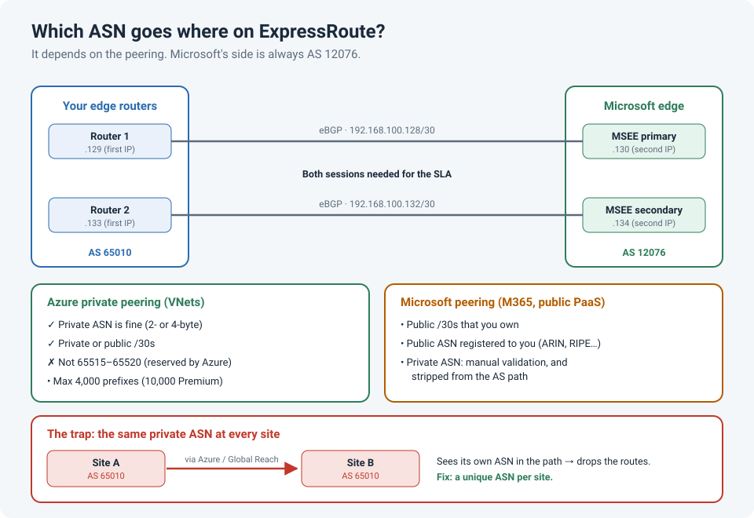

# Which ASN Do I Use for Azure ExpressRoute? Public vs. Private, Explained

We were setting up BGP for a new Azure ExpressRoute circuit, and the provisioning form asked
for a **Peer ASN**. It sounds like a one-minute decision. Instead it turned into a debate:
do we need our own **public** ASN, or can we use a **private** one like we do everywhere
else?

The answer depends on **which peering** you're configuring, and there are a few numbers you
must avoid.

!!! abstract "Key takeaway"
    For **Azure private peering** (your VNets), a **private ASN** is fine, 2-byte or
    4-byte, **except 65515–65520**, which Azure reserves. For **Microsoft peering** (Microsoft
    365 and public Azure services), you need public IPs and normally an ASN **registered to
    you**; a private ASN needs manual validation and is stripped from the path. Microsoft's
    side is always **AS 12076**. And if you have several sites, give each one its **own**
    ASN, or BGP loop prevention can quietly drop routes between them.



## Two peerings, two different rules

An ExpressRoute circuit can carry two kinds of BGP peering. They have different jobs and
different ASN rules:

| | Azure private peering | Microsoft peering |
|---|---|---|
| Reaches | Your VNets (private IPs) | Microsoft 365, and Azure PaaS on public endpoints |
| Your routing subnets | Private or public `/30`s | **Public** `/30`s that you own |
| Your ASN | **Private is fine** (except 65515–65520), or public | Public ASN registered to you; private only with manual validation |
| Microsoft's ASN | 12076 | 12076 |
| Prefix limit (you → Microsoft) | 4,000 (10,000 with Premium) | 200 per session |

Most organizations only use **private peering**, and for that, a private ASN is the normal
choice.

### Why Microsoft peering is stricter

On Microsoft peering you're advertising **public** prefixes to Microsoft, so Microsoft checks
that you really own them. It validates your prefixes and ASN against the internet registries
(ARIN for us in Canada, or RIPE, APNIC, and so on). If you use a private ASN there, Microsoft
needs to validate it manually, and it **removes private ASNs from the AS path**, so you can't
use AS-path prepending with them to influence routing.

## The numbers to avoid

| ASN | Why to avoid it |
|---|---|
| **65515–65520** | Reserved by Azure for internal use. **65515** is also the default ASN of Azure VPN gateways and Azure Route Server, so using it on-premises causes confusing BGP problems |
| **12076** | Microsoft's own ASN on ExpressRoute |
| **64496–64511** | Reserved for documentation; not allowed in the path on Microsoft peering |

Both 2-byte (up to 65535) and 4-byte ASNs are supported, so if you've run out of 2-byte
private ASNs (64512–65534), the 4-byte private range (4200000000–4294967294) works too.

## The trap: the same private ASN at every site

This is the part that matters more than public vs. private. Many networks use the **same**
private ASN everywhere, because each site's router only ever talked to its own ISP or WAN
provider.

Then you connect two sites to Azure, or to each other through Azure with **ExpressRoute
Global Reach**. Site A advertises its routes with AS 65010 in the path. When those routes
arrive at site B, which is **also** AS 65010, site B's router sees its own ASN in the AS path
and drops them. That's standard BGP loop prevention, and it doesn't log anything dramatic.
The routes just never appear.

```
SiteB# show ip bgp neighbors 192.168.100.134 received-routes    ! may need soft-reconfiguration inbound
SiteB# show ip bgp 10.10.0.0                                    ! not in the table: rejected by the AS-path loop check
```

The fixes, from cleanest to messiest:

1. **Give each site its own private ASN.** Plan it before the first circuit goes in.
2. Use `allowas-in` on the affected neighbours, so the router accepts paths containing its
   own ASN. It works, but it weakens loop protection.
3. If a provider runs the BGP for you, ask them to use `as-override`, which replaces your
   ASN in the path with theirs.

## What the configuration looks like

For private peering you give Azure a `/29` (or two `/30`s). On each `/30`, **your** router
takes the first usable IP and Microsoft takes the second. Example using `192.168.100.128/29`,
with AS 65010 on-premises:

```
router bgp 65010
 bgp log-neighbor-changes
 neighbor 192.168.100.130 remote-as 12076          ! primary link, Microsoft side
 neighbor 192.168.100.130 password <md5-key>       ! optional
 neighbor 192.168.100.134 remote-as 12076          ! secondary link
 neighbor 192.168.100.134 password <md5-key>
 !
 address-family ipv4
  network 10.10.0.0 mask 255.255.0.0
  neighbor 192.168.100.130 activate
  neighbor 192.168.100.130 prefix-list TO-AZURE out
  neighbor 192.168.100.130 maximum-prefix 1000 90 warning-only
  neighbor 192.168.100.134 activate
  neighbor 192.168.100.134 prefix-list TO-AZURE out
  neighbor 192.168.100.134 maximum-prefix 1000 90 warning-only
 exit-address-family
!
ip prefix-list TO-AZURE seq 10 permit 10.10.0.0/16
```

!!! warning "Filter what you send"
    If you advertise more than **4,000** prefixes on private peering (10,000 with Premium),
    Azure **drops the BGP session**. An outbound prefix-list, like the one above, stops a
    redistribution mistake from taking the circuit down.

Microsoft needs **both** BGP sessions up for the ExpressRoute SLA to apply, and it doesn't use
HSRP or VRRP. Redundancy comes from the two eBGP sessions.

!!! info "Using a Layer 3 provider?"
    If your connectivity provider offers a **managed Layer 3** ExpressRoute service, the
    provider runs the BGP sessions with Microsoft, and you peer with the provider instead. In
    that case, agree on the ASN with them, and the Azure form may already be filled in.

## How to check it

```
show ip bgp summary                              ! both 12076 neighbours Established?
show ip bgp neighbors 192.168.100.130 advertised-routes
show ip bgp neighbors 192.168.100.130 routes     ! VNet prefixes learned from Azure
```

In Azure, the circuit's private peering blade shows the **route table** and the **ARP
table** for the primary and secondary links. Or use PowerShell:

```powershell
Get-AzExpressRouteCircuitRouteTable -ResourceGroupName rg-net -ExpressRouteCircuitName er-van `
  -PeeringType AzurePrivatePeering -DevicePath Primary
```

## Lessons learned

!!! tip "Takeaways"
    - **Private peering:** a private ASN is fine. Just avoid 65515–65520.
    - **Microsoft peering:** public IPs, and an ASN registered to you if you can.
    - Microsoft's side is always **AS 12076**.
    - Plan a **unique ASN per site** before you connect sites through the cloud.
    - Put an outbound prefix-list on every ExpressRoute neighbour.

## References

- Microsoft Learn: [ExpressRoute routing requirements](https://learn.microsoft.com/azure/expressroute/expressroute-routing)
- Microsoft Learn: [Create and modify peering for an ExpressRoute circuit](https://learn.microsoft.com/azure/expressroute/expressroute-howto-routing-portal-resource-manager)
- Microsoft Learn: [Interoperability in Azure: control plane analysis](https://learn.microsoft.com/en-us/azure/networking/connectivity-interoperability-control-plane)
