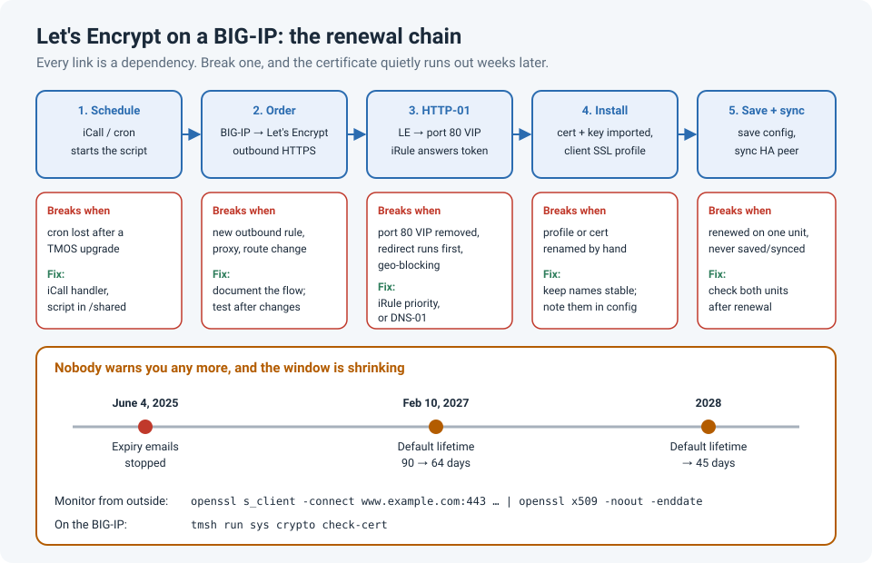

# Let's Encrypt on an F5: When the Renewal Script Is the Weakest Link

We used Let's Encrypt certificates on an F5 BIG-IP. They're free and trusted by every
browser, but they're short-lived, so renewal **has** to be automatic. Ours was a script running
on the F5 itself: every so often it asked Let's Encrypt for a new certificate, proved we owned
the domain, installed the new certificate and key, and updated the SSL profile.

That kind of setup works quietly for months. The problem is that "quietly" includes when it
stops working. The certificate itself keeps serving for weeks, so nobody notices until it
expires and the browser warnings start.

!!! abstract "Key takeaway"
    The certificate is never the problem; the **renewal chain** around it is. On a BIG-IP the
    weak links are the **HTTP-01 challenge** (port 80, iRule order, geo-blocking), the
    **schedule** (cron doesn't survive upgrades; iCall does), **HA sync** and **config save**,
    and **outbound access** to Let's Encrypt. Let's Encrypt stopped sending expiry emails in
    June 2025, so **monitor the expiry date yourself**, from outside, and alert well before it.
    Lifetimes are getting shorter too: 64 days by default from February 2027, and 45 days
    in 2028.



## How the renewal works on a BIG-IP

Most on-box setups wrap an ACME client such as **dehydrated** in a script. F5's community
project **kojot-acme**, for example, installs into `/shared/acme` and runs on the BIG-IP.

| Step | What happens | Depends on |
|---|---|---|
| 1. Schedule | The script starts (cron or iCall) | The schedule still existing |
| 2. Order | It asks Let's Encrypt for a certificate | Outbound HTTPS from the BIG-IP to `acme-v02.api.letsencrypt.org` |
| 3. Challenge (HTTP-01) | Let's Encrypt fetches `http://<name>/.well-known/acme-challenge/<token>`; an iRule on the port-80 virtual server answers | Port 80 reachable from the internet, and the iRule answering first |
| 4. Install | The new certificate and key are imported, and the client SSL profile is updated in a transaction | Profile names unchanged |
| 5. Save and sync | Configuration saved and synced to the HA peer | Config save and config sync working |

Every row is a dependency. A change in any of them, often by someone who has never heard of
the renewal script, breaks the chain.

## The usual ways it breaks

### The HTTP-01 challenge can't get through

- **The port-80 virtual server was removed** or "cleaned up", because "we only use HTTPS".
- **A redirect answers first.** If the port-80 virtual server also has an HTTP-to-HTTPS
  redirect, such as `_sys_https_redirect`, the redirect can win and the challenge never gets
  its response. Give the ACME iRule a lower priority number so it runs first:

```
when HTTP_REQUEST priority 100 {
    if { [HTTP::path] starts_with "/.well-known/acme-challenge/" } {
        # answer the challenge here, then stop other iRules redirecting it
    }
}
```

- **Geo-blocking or IP allow-lists.** Let's Encrypt validates from **several locations around
  the world**, and it doesn't publish their IPs. Block a region at the firewall and validation
  fails. If you can't open port 80 to the internet, use the **DNS-01** challenge instead.

### The schedule disappears

A job in **crontab** lives on the boot volume, and a TMOS upgrade boots a **new** volume. After
the upgrade the script is still in `/shared` (which persists), but nothing runs it. Use an
**iCall** periodic handler instead: it's part of the BIG-IP configuration, so it survives
upgrades and goes into UCS backups.

```
tmsh create sys icall script acme_renew definition { exec /shared/acme/f5acmehandler.sh }
tmsh create sys icall handler periodic acme_renew_daily interval 86400 script acme_renew
tmsh save sys config
```

### HA and config save

- The script renewed the certificate on **one** unit, and the config was never synced. After
  the next failover, the other unit serves the old certificate.
- The script runs on the **standby** unit, which isn't the one receiving the challenge.
- The new certificate was installed but the config **wasn't saved**, so a reboot brings back
  the old one.

### Outbound access and Let's Encrypt changes

- The BIG-IP can't reach Let's Encrypt any more: a new outbound firewall rule, a proxy, or a
  management route change.
- **Rate limits**: a script that fails and retries in a loop can hit Let's Encrypt's limits
  and get blocked for a while, even after you fix the real problem.
- Let's Encrypt itself changes: ACME v1 was retired, chains have changed, and certificate
  lifetimes are getting shorter.

| Let's Encrypt change | When | What it means for you |
|---|---|---|
| Expiry reminder emails stopped | June 4, 2025 | Nobody warns you any more. Monitor it yourself |
| Default lifetime 90 → 64 days | February 10, 2027 | Renew more often. Fixed "every 60 days" schedules break |
| Default lifetime → 45 days | 2028 | Renewal must be fully automatic, and monitored |

## Check it before it expires

From **outside** (what users actually see):

```
echo | openssl s_client -connect www.example.com:443 -servername www.example.com 2>/dev/null \
  | openssl x509 -noout -subject -issuer -enddate
```

On the **BIG-IP**:

```
tmsh run sys crypto check-cert                        # lists expired and soon-to-expire certificates
tmsh list sys crypto cert www.example.com.crt         # one certificate's details, including expiry
grep -i "expire" /var/log/ltm                         # the BIG-IP logs expiry warnings here
```

And test the challenge path yourself, from a machine outside your network:

```
curl -i http://www.example.com/.well-known/acme-challenge/test
```

You should get an answer from the ACME iRule (often a 404 for an unknown token), **not** a
redirect to HTTPS and not a timeout.

!!! tip "Alert when a renewal is overdue, not when it's about to expire"
    A healthy setup renews well before expiry; Let's Encrypt suggests renewing when about a
    third of the lifetime is left. So if a certificate gets within **20 days** of expiry
    (90-day certificates), something has already failed. Alert on that, not on "expires
    tomorrow". Any certificate monitoring tool, or a scheduled `openssl` check like the one
    above, will do.

## Lessons learned

!!! tip "Takeaways"
    - Short-lived certificates are only as reliable as the renewal chain: challenge,
      schedule, install, save and sync.
    - Keep the **port-80** path for `/.well-known/acme-challenge/`, and make sure the ACME iRule
      runs **before** any redirect.
    - Don't geo-block the challenge. If port 80 can't be open, use **DNS-01**.
    - Use **iCall**, not cron, on a BIG-IP; store scripts in `/shared`.
    - Check the certificate on **both** HA units after a renewal, and save the config.
    - Monitor expiry from outside, because Let's Encrypt no longer emails you.

## References

- Let's Encrypt: [Ending support for expiration notification emails](https://letsencrypt.org/2025/01/22/ending-expiration-emails/)
- Linuxiac: [Let's Encrypt to cut certificate lifetimes to 64 days in February 2027](https://linuxiac.com/?p=220883)
- F5 DevCentral: [Automating ACMEv2 Certificate Management on BIG-IP](https://community.f5.com/kb/technicalarticles/automating-acmev2-certificate-management-on-big-ip/328935) (kojot-acme)
- F5 DevCentral: [Automate Let's Encrypt Certificates on BIG-IP](https://community.f5.com/kb/technicalarticles/automate-lets-encrypt-certificates-on-big-ip/293783)
- F5 Community: [Schedule automated UCS backups](https://community.f5.com/discussions/technicalforum/schedule-automated-ucs-backups-on-the-big-ip-system-v16/320412) (cron vs. iCall after upgrades)
- F5 tmsh reference: [sys crypto check-cert](https://clouddocs.f5.com/cli/tmsh-reference/latest/modules/sys/sys_crypto_check-cert.html)
- Let's Encrypt Community: [Firewall geoblocking and Let's Encrypt](https://community.letsencrypt.org/t/firewall-geoblocking-and-letsencrypt/233874)
