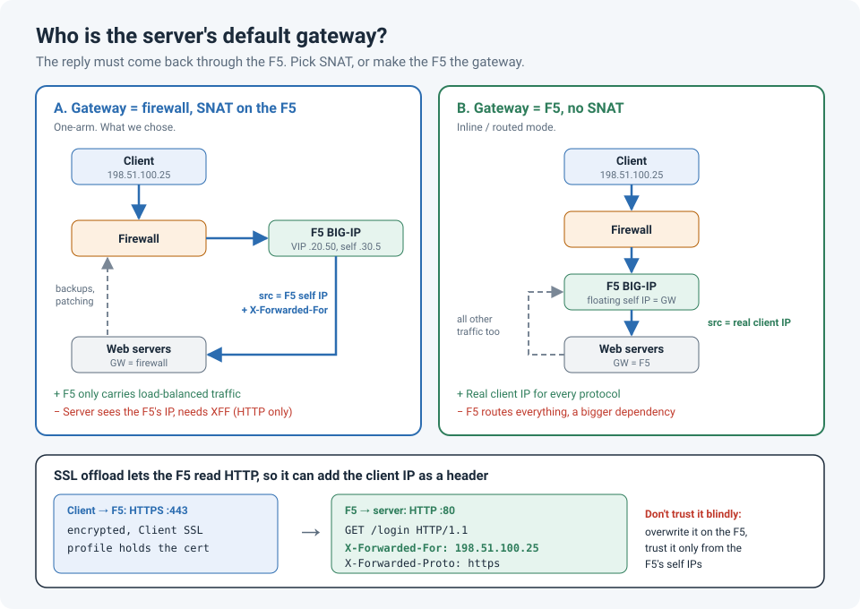

# SSL Offload on an F5: Firewall or Load Balancer as the Server's Gateway, and Why We Needed X-Forwarded-For

We put a web application behind an F5 BIG-IP and let the F5 handle the TLS (SSL offloading).
The load balancing worked on the first try. Then two questions came up that turned out to be
connected:

1. Should the servers' default gateway be the **firewall** or the **F5**?
2. Why did every request in the application logs suddenly come from the **same IP address**?

!!! abstract "Key takeaway"
    If the servers keep the **firewall** as their default gateway, the F5 has to use **SNAT**
    (usually SNAT Automap), or the replies bypass it and the connections break. SNAT hides the
    client's IP, so the servers only see the F5. For HTTP and HTTPS, enable
    **Insert X-Forwarded-For** in the F5's HTTP profile and make the servers log or trust that
    header. If the **F5** is the gateway, you don't need SNAT, but the F5 now routes all of the
    servers' traffic.



## What SSL offloading does

With SSL offloading, the F5 terminates the client's HTTPS session:

| Leg | Protocol | What sees what |
|---|---|---|
| Client → F5 virtual server | HTTPS (443) | The certificate lives on the F5, in a **Client SSL profile** |
| F5 → server | HTTP (80), or HTTPS again if you re-encrypt | The F5 can read and change HTTP headers |

Because the F5 decrypts the traffic, it can do things it couldn't do with plain TCP load
balancing: cookie persistence, HTTP health checks, iRules on URLs and headers, and inserting
headers such as **X-Forwarded-For**. The servers also don't spend CPU on TLS, and you manage
the certificate in one place.

## The real decision: who is the server's default gateway?

A load balancer only works if the **reply comes back through it**. The client sent its
request to the virtual server IP, so it expects the reply from that IP. If the server replies
straight to the client through some other path, the client sees a reply from an address it
never talked to and drops it.

There are two ways to guarantee the return path.

### Option A: Keep the firewall as the gateway, and SNAT on the F5

This is often called **one-arm** mode. The F5 replaces the client's source IP with its own
**self IP** (SNAT Automap) before sending the request to the server. The server replies to the
F5 because, as far as it knows, the F5 is the client.

| Benefits | Costs |
|---|---|
| The F5 only handles load-balanced traffic. Backups, patching, admin and outbound traffic go straight to the firewall | The server sees the **F5's IP**, not the client's |
| The firewall keeps full visibility and policy over the servers | You need X-Forwarded-For (HTTP only) or a proxy protocol to recover the client IP |
| Simple routing, and an F5 problem only affects the load-balanced apps | Heavy traffic through one SNAT IP can run out of source ports; use a SNAT pool with several IPs |

### Option B: Make the F5 the gateway (inline, or routed mode)

The servers' default gateway is a **floating self IP** on the F5. Replies naturally go back
through it, so no SNAT is needed.

| Benefits | Costs |
|---|---|
| The server sees the **real client IP** for every protocol, not just HTTP | **All** server traffic goes through the F5, so you need a forwarding virtual server for outbound and non-load-balanced traffic |
| No SNAT port limits | The F5 becomes a router and a single point of failure for everything on those servers |
| | The firewall loses direct visibility of server traffic unless the F5 forwards it on to the firewall |

We kept the **firewall** as the gateway. We didn't want backups, patching and management
traffic depending on the load balancer, and we wanted the firewall to keep enforcing policy
on those servers. That meant SNAT Automap, and that's where the second problem came from.

## Every request came from the F5

After the cutover, the application's access logs showed one client IP for every user: the
F5's self IP. Anything that depends on the real client address breaks the same way:
logging and reporting, rate limiting, geo rules and IP allow-lists.

The fix was the **Insert X-Forwarded-For** option in the HTTP profile. The F5 adds a header to
each request with the original client IP:

```
GET /login HTTP/1.1
Host: app.example.com
X-Forwarded-For: 198.51.100.25
```

The TCP connection still comes from the F5, but the application can read the client's address
from the header.

!!! info "This only works because of SSL offloading"
    The F5 can only insert a header into traffic it can read. Without offloading (or
    re-encryption), the HTTPS stream is encrypted end to end and the F5 can't add anything.

## Configuration (tmsh)

Using example addresses: virtual server `10.10.20.50`, servers `10.10.30.11` and `10.10.30.12`.

```
# HTTP profile that inserts X-Forwarded-For
create ltm profile http http_xff defaults-from http insert-xforwarded-for enabled

# Client SSL profile with the site's certificate
create ltm profile client-ssl clientssl_app defaults-from clientssl \
    cert-key-chain add { app { cert app.example.com.crt key app.example.com.key chain intermediate.crt } }

# Pool with an HTTP health monitor
create ltm pool pool_app members add { 10.10.30.11:80 10.10.30.12:80 } monitor http

# Virtual server: SSL offload, XFF, SNAT Automap
create ltm virtual vs_app_443 destination 10.10.20.50:443 ip-protocol tcp \
    profiles add { tcp http_xff clientssl_app } pool pool_app \
    source-address-translation { type automap }

save sys config
```

In the GUI, the same option is under **Local Traffic › Profiles › Services › HTTP ›
Insert X-Forwarded-For: Enabled**.

!!! warning "The F5 doesn't remove an X-Forwarded-For the client already sent"
    Insert X-Forwarded-For **adds** a header. If the client (or an attacker) already sent
    one, the server receives two, and an application that trusts the first one can be fooled
    into logging, or allowing, a fake IP. If the application uses the client IP for anything
    security-related, replace the header with an iRule instead (and leave the profile option
    disabled):

    ```
    when HTTP_REQUEST {
        HTTP::header remove X-Forwarded-For
        HTTP::header insert X-Forwarded-For [IP::client_addr]
        HTTP::header replace X-Forwarded-Proto "https"
    }
    ```

    The `X-Forwarded-Proto` line helps too. After offloading, the server only sees plain
    HTTP, so some applications build `http://` redirects or links. That header tells them the
    client actually used HTTPS.

## Making the servers use the header

Inserting the header is only half the job. The web server has to log it, or replace the
source IP with it, and it should only trust it when it comes from the F5.

```
# Apache (mod_remoteip): trust XFF only from the F5's self IPs
RemoteIPHeader X-Forwarded-For
RemoteIPInternalProxy 10.10.30.5 10.10.30.6

# nginx (realip module)
set_real_ip_from 10.10.30.5;
set_real_ip_from 10.10.30.6;
real_ip_header X-Forwarded-For;
```

On **IIS**, add a custom log field: **Logging › Select Fields › Add Field**, source type
*Request Header*, source `X-Forwarded-For`.

## How to check it

On the F5, the server-side leg is plain HTTP, so you can see the header in a capture:

```
# Is traffic hitting the virtual server, and which pool member got it?
tmsh show ltm virtual vs_app_443
tmsh show ltm pool pool_app members

# Current connections: client side and server side, including the SNAT address
tmsh show sys connection cs-server-addr 10.10.20.50

# Watch the inserted header on the way to a server
tcpdump -ni 0.0 -s0 -A 'host 10.10.30.11 and tcp port 80' | grep -i x-forwarded
```

If the capture shows the header but the application still logs the F5's IP, the problem is
on the server side: the log format or the trusted-proxy list.

## Lessons learned

!!! tip "Takeaways"
    - With a load balancer, decide the **return path** first. Firewall as gateway means SNAT;
      F5 as gateway means the F5 routes everything.
    - SNAT hides the client IP. Ask the application team **before** the cutover whether they
      need it for logs, rate limiting, geo rules or allow-lists.
    - X-Forwarded-For only works for HTTP that the F5 can read, which SSL offloading gives you.
    - Don't blindly trust the header. Overwrite it at the F5 and trust it only from the F5's
      self IPs.
    - Add `X-Forwarded-Proto: https` so the application knows the client is on HTTPS.

## References

- F5 DevCentral: [What is HTTP Part V: HTTP Profile Basic Settings](https://community.f5.com/kb/technicalarticles/what-is-http-part-v---http-profile-basic-settings/288535) (Insert X-Forwarded-For, and why it doesn't remove existing headers)
- F5 Glossary: [One-arm configuration](https://www.f5.com/de_de/glossary/one-arm-configuration)
- Apache: [mod_remoteip](https://httpd.apache.org/docs/2.4/mod/mod_remoteip.html)
- nginx: [ngx_http_realip_module](https://nginx.org/en/docs/http/ngx_http_realip_module.html)
