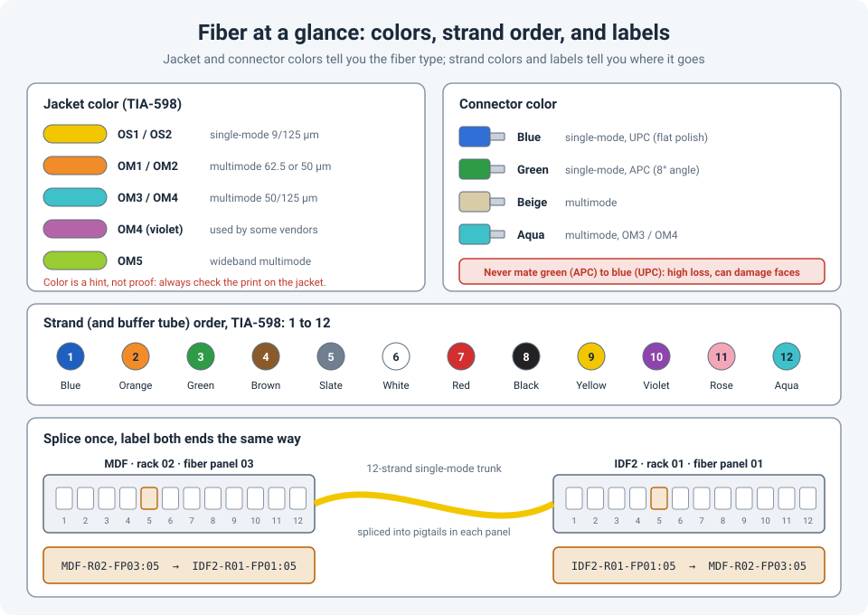

# Fiber Basics on Site: Color Codes, Splicing, Patch Panels and Labels

You're standing in front of a fiber panel with a new optic in your hand. Is this single-mode or
multimode? Which port goes to the other building? Why are there twelve colors? Fiber is simple
once you know the conventions, and painful when nobody followed them.

!!! abstract "Key takeaway"
    **Yellow** jacket means **single-mode**; **orange** or **aqua** (sometimes violet or lime)
    means **multimode**. **Blue** connectors are single-mode UPC, **green** are single-mode APC
    (never mix the two), and **beige or aqua** are multimode. Strands follow a fixed 12-color
    order starting **blue, orange, green**. Trunk cables are usually **spliced** to pigtails
    inside the panel, and every port should carry a label naming **both ends**, the same
    way at each end.



## Single-mode or multimode? Read the colors

**Jacket colors** follow TIA-598:

| Jacket | Type | Core | Typical use |
|---|---|---|---|
| **Yellow** | OS1 / OS2 single-mode | 9 µm | Between buildings, long runs; 10G-LR reaches 10 km |
| **Orange** | OM1 (62.5 µm) / OM2 (50 µm) multimode | 62.5 or 50 µm | Older installations |
| **Aqua** | OM3 / OM4 multimode | 50 µm | Inside buildings and data centers; 10G-SR reaches 300 m (OM3) or 400 m (OM4) |
| **Violet** | OM4, used by some manufacturers | 50 µm | Same as OM4 |
| **Lime green** | OM5 multimode | 50 µm | Short-reach multi-wavelength optics |

**Connector colors** tell you the polish and type:

| Connector | Meaning |
|---|---|
| **Blue** | Single-mode, **UPC** (flat polish) |
| **Green** | Single-mode, **APC** (angled 8° polish) |
| **Beige** | Multimode |
| **Aqua** | Multimode, often OM3 / OM4 |

!!! warning "Green and blue don't mix"
    APC and UPC connectors look almost the same, but the angled face of an APC connector doesn't
    meet a flat UPC face properly. The result is high loss and possible damage to the end
    faces. If one side is green, the other must be green too.

Colors are a strong hint, not proof. The jacket is printed every metre or so with the type,
such as `OS2 9/125` or `OM4 50/125`. Read it, and match the optics to it (see
[SFPs Explained](sfp-types-compatibility.md)).

## The 12-color strand order

Inside a multi-strand cable, every fiber has a color, and the order is standard (TIA-598):

| 1 | 2 | 3 | 4 | 5 | 6 | 7 | 8 | 9 | 10 | 11 | 12 |
|---|---|---|---|---|---|---|---|---|---|---|---|
| Blue | Orange | Green | Brown | Slate | White | Red | Black | Yellow | Violet | Rose | Aqua |

Larger cables group fibers into **buffer tubes** that use the same color order: tube 1 is blue,
tube 2 is orange, and so on. So "tube 2, fiber 3" means the **green** fiber in the **orange**
tube: fiber number 15 in the cable.

In a duplex panel, fibers usually pair up in order: blue and orange on port 1, green and brown
on port 2, and so on. That's why polarity matters at both ends (see
[Fiber Link Won't Come Up? Check the Polarity](fiber-polarity.md)).

## From trunk cable to patch panel port

The long cable between two rooms (the **trunk**) has bare fibers at each end. There are three
common ways to turn them into usable ports:

| Method | How it works | Notes |
|---|---|---|
| **Fusion splicing to pigtails** | Each trunk fiber is welded (fused) to a short **pigtail** with a factory-made connector. The splices sit in a **splice tray** inside the panel. | The most common method. Very low loss, usually well under 0.1 dB per splice. |
| **Mechanical splice** | Fibers are aligned and held in a small mechanical sleeve. | Quicker with less equipment, but higher loss. Mostly for repairs. |
| **Pre-terminated trunks** | The cable arrives with connectors already fitted (often **MPO/MTP**) and plugs into cassettes in the panel. | No splicing on site, but the length must be right before ordering. |

Industry standards (TIA-568) allow up to **0.3 dB per splice** and **0.75 dB per mated
connector pair**. Ask for **test results** for every strand after installation (a loss test,
and ideally an OTDR trace), and keep them with the documentation.

## Port numbering and labeling

Most panels number ports **left to right, top to bottom**, but check the panel itself. Some
number by cassette or by row. The rule that matters is: **both ends must use the same scheme.**

A labeling scheme in the spirit of TIA-606 identifies the location of each end:

```
MDF-R02-FP03:05   →   IDF2-R01-FP01:05
room - rack - fiber panel : port    far end
```

Good labeling habits:

- **Label both ends** of every trunk, port and patch cord, and include the **far end** on the
  label. Someone at either end should know where it goes without tracing it.
- **Use printed labels.** Handwriting fades and gets misread.
- **Keep a record**: a spreadsheet or documentation tool listing each strand, its ports at both
  ends, what's patched to it, and its test results.
- **Update the label when you change the patch.** A wrong label is worse than no label.

## References

- [The Fiber Optic Association: fiber cable and connector color codes](https://www.thefoa.org/tech/ColCodes.htm)
- [The Fiber Optic Association: what loss to expect (TIA-568 limits)](https://www.thefoa.org/tech/loss-est.htm)
- [Cabling Installation & Maintenance: TIA approves lime green for OM5](https://www.cablinginstall.com/data-center/article/16481505/tia-approves-lime-green-as-identifying-color-for-om5-fiber-optic-cable)
