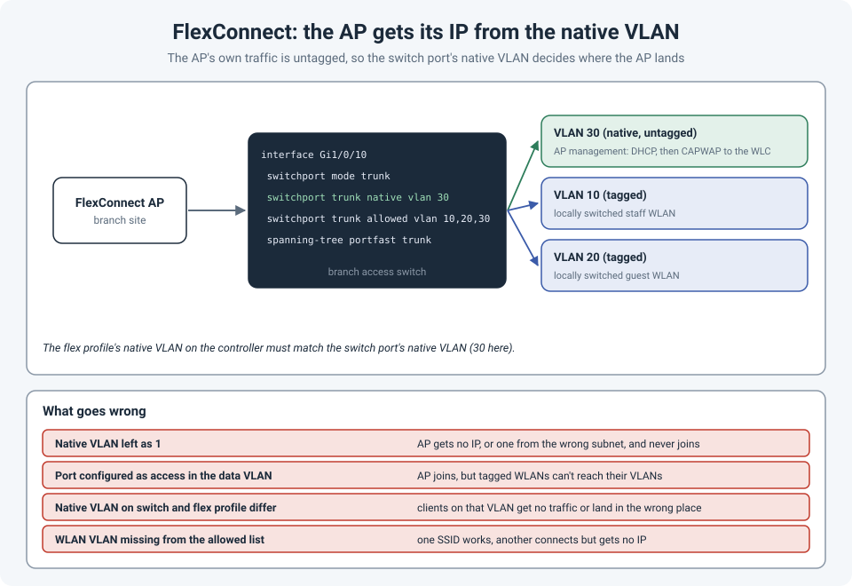

# FlexConnect APs: Why the Native VLAN Matters

Setting up wireless at a branch site with FlexConnect, the access point powered up, its lights
blinked, and it never joined the controller. The cause was the switch port: the AP needed a
**trunk**, with its management VLAN set as the **native VLAN**, so its own untagged traffic
landed in the right place and it could get an IP address.

!!! abstract "Key takeaway"
    A FlexConnect AP sends its **own** traffic (DHCP, then CAPWAP to the controller)
    **untagged**, and the **locally switched** WLANs **tagged**. So the switch port is a trunk
    where the **native VLAN is the AP management VLAN**, and the **allowed VLANs** include every
    VLAN used by locally switched WLANs. The native VLAN in the controller's **FlexConnect
    profile** must match the switch port.



## Local mode vs. FlexConnect

In a campus, APs usually run in **local mode**: all client traffic is tunnelled back to the
wireless controller in CAPWAP, and the controller puts it on the right VLAN. The AP's switch port
only needs a single access VLAN.

At a branch, sending every client packet over the WAN to a controller in the data center and back
is slow and wasteful. **FlexConnect** lets the AP **switch client traffic locally**, straight
onto VLANs at the branch, while the controller still manages the AP and handles control traffic.

That's why the switch port changes: the AP now carries several VLANs itself.

## The switch port

```
interface GigabitEthernet1/0/10
 description FlexConnect AP
 switchport mode trunk
 switchport trunk native vlan 30
 switchport trunk allowed vlan 10,20,30
 spanning-tree portfast trunk
```

- **VLAN 30, native (untagged):** the AP's own management traffic. The AP gets its IP address by
  DHCP here, then builds its CAPWAP tunnel to the controller.
- **VLANs 10 and 20, tagged:** the VLANs the locally switched WLANs map to (staff and guest, for
  example).

On the controller, the **FlexConnect profile** (Catalyst 9800) or the AP's FlexConnect settings
(older AireOS controllers) has a **native VLAN** setting. Set it to the same VLAN as the switch
port's native VLAN, and map each locally switched WLAN to its VLAN ID.

```
wireless profile flex BRANCH-FLEX
 native-vlan-id 30
 vlan-name STAFF
  vlan-id 10
 vlan-name GUEST
  vlan-id 20
```

## What goes wrong

| Mistake | Symptom |
|---|---|
| **Native VLAN left as VLAN 1** (or whatever the switch default is) | The AP gets no IP address, or one from the wrong subnet, and never joins the controller. |
| **Port configured as an access port** in a data VLAN | The AP may join, but locally switched WLANs mapped to other VLANs can't reach them. |
| **Native VLAN differs** between the switch port and the FlexConnect profile | Traffic for that VLAN goes to the wrong place or nowhere. |
| **A WLAN's VLAN missing from the allowed list** | One SSID works, another connects but clients get no IP address. |
| **No DHCP or no route** to the controller in the AP management VLAN | The AP gets an address but can't build its CAPWAP tunnel. |

If **all** the WLANs at a site are centrally switched (tunnelled to the controller), the AP
doesn't need a trunk; an access port in the AP management VLAN is enough. The trunk is needed
because of **local switching**.

## Checking it

On the switch:

```
show interfaces GigabitEthernet1/0/10 trunk           ! native VLAN and allowed VLANs
show mac address-table interface GigabitEthernet1/0/10
show cdp neighbors GigabitEthernet1/0/10 detail        ! the AP's name and IP address
```

On a Catalyst 9800 controller:

```
show ap summary                       ! has the AP joined?
show ap name BR-AP01 config general   ! mode, IP address, flex profile
show wireless profile flex detailed BRANCH-FLEX
```

## References

- [Cisco: Understand FlexConnect on Catalyst 9800 wireless controllers](https://www.cisco.com/c/de_de/support/docs/wireless/catalyst-9800-series-wireless-controllers/213945-understand-flexconnect-on-9800-wireless.html)
- [mrn-cciew: 9800 FlexConnect basics](https://mrncciew.com/2023/01/21/9800-flexconnect-basics/)
- [Cisco: Securing a FlexConnect AP switchport with 802.1X](https://www.cisco.com/c/en/us/support/docs/wireless/wireless-lan-controller-software/200492-Securing-a-flexconnect-AP-switchport-wit.html)
