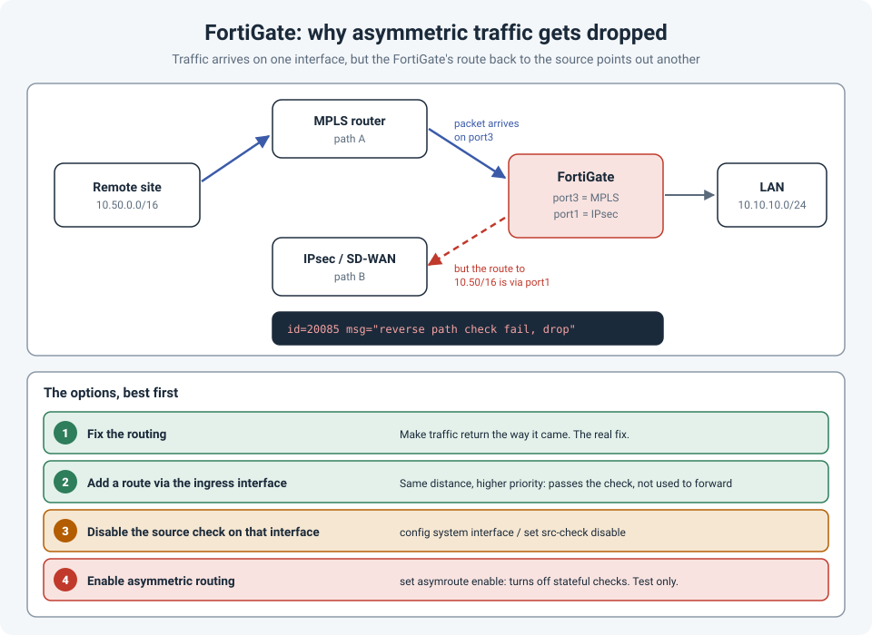

# FortiGate Dropping Asymmetric Traffic: Reverse Path Check Fail

A remote site can't reach a server behind the FortiGate. The routing looks right on the remote
side, the policy on the FortiGate allows the traffic, and the logs show... nothing. The packets
arrive and disappear.

The cause was **asymmetric routing**: traffic from the remote site came in on one FortiGate
interface, while the FortiGate's own route back to that site pointed out a **different**
interface. The FortiGate treats that as a possible spoofed packet and silently drops it.

!!! abstract "Key takeaway"
    A FortiGate checks that the **source** of every new session is reachable through the
    interface the packet arrived on (a **reverse path forwarding**, or RPF, check). If not, it
    drops the packet with `reverse path check fail, drop`, visible only in a **debug flow**. The
    real fix is **symmetric routing**. If that's not possible right away, add a route to the
    source via the ingress interface with the **same distance but a higher priority**, so it
    passes the check without changing forwarding. Disabling the check or enabling `asymroute`
    are last resorts.



## What's happening

In the example, a remote site (10.50.0.0/16) can reach the FortiGate two ways: over an **MPLS**
link connected to `port3`, and over an **IPsec / SD-WAN** path on `port1`.

- The remote site's router sends traffic over **MPLS**, so it arrives on `port3`.
- The FortiGate's routing table says 10.50.0.0/16 is reachable via **port1** (the IPsec path).

When the first packet of a new session arrives, the FortiGate asks: "if I had to send traffic
**back** to this source, would it go out the interface it came in on?" The answer is no, so the
packet fails the RPF check.

By default, FortiGate uses a "feasible path" check: the packet is accepted if **any active route
in the routing table** for that source points to the ingress interface, not only the best one.

## Finding it: debug flow

Nothing shows in the traffic log, because the packet never reaches policy. Use a debug flow,
filtered on the source address:

```
diagnose debug flow filter clear
diagnose debug flow filter saddr 10.50.1.20
diagnose debug flow show function-name enable
diagnose debug flow trace start 20
diagnose debug enable

! reproduce the problem, then:
diagnose debug disable
```

The line to look for:

```
id=20085 trace_id=1 func=fw_forward_handler line=... msg="reverse path check fail, drop"
```

Then check the route back to the source:

```
get router info routing-table details 10.50.1.20
```

## The fixes, best first

### 1. Fix the routing

The real fix is making traffic **return the way it came**. Either send the remote site's traffic
over the path the FortiGate expects, or change the FortiGate's routing so its best route to the
remote site matches the path traffic actually uses. Asymmetric paths also cause problems for
every other stateful device on the way, not just this one.

### 2. Add a route via the ingress interface (same distance, higher priority)

If the asymmetry is intentional or can't be fixed yet, give the FortiGate a route to the source
via the ingress interface that **passes the RPF check but isn't used for forwarding**:

```
config router static
    edit 0
        set dst 10.50.0.0 255.255.0.0
        set device "port3"
        set gateway 192.0.2.1
        set distance 10
        set priority 100
    next
end
```

The important detail is the **same administrative distance** as the existing route, with a
**higher priority value** (lower preference). Both routes stay **active** in the routing table,
so the RPF check passes, but the FortiGate keeps forwarding through the lower-priority route.

A route with a **higher distance** doesn't work for this: it isn't installed in the routing
table while the better route exists, so the RPF check never sees it. Check that both routes
appear in `get router info routing-table all`.

### 3. Disable the source check on that interface

```
config system interface
    edit "port3"
        set src-check disable
    next
end
```

This switches off anti-spoofing on that interface entirely. It works, but you lose a useful
protection, so keep it to interfaces facing trusted, internal paths.

### 4. Enable asymmetric routing (test only)

```
config system settings
    set asymroute enable
end
```

This is a VDOM-wide setting that relaxes the FortiGate's stateful checks for asymmetric traffic.
Fortinet's own guidance is to use it only as a **test** to confirm asymmetric routing is the
cause, not as a permanent fix.

## References

- [Fortinet: Details about FortiOS RPF (reverse path forwarding)](https://community.fortinet.com/t5/FortiGate/Technical-Note-Details-about-FortiOS-RPF-Reverse-Path-Forwarding/ta-p/190100)
- [Fortinet: RPF implementation and strict-src-check](https://community.fortinet.com/fortigate-3/technical-tip-reverse-path-forwarding-rpf-implementation-and-use-of-strict-src-check-enable-disable-96432)
- [Overlapping Subnets Across an IPsec Tunnel](overlapping-subnets-ipsec.md)
