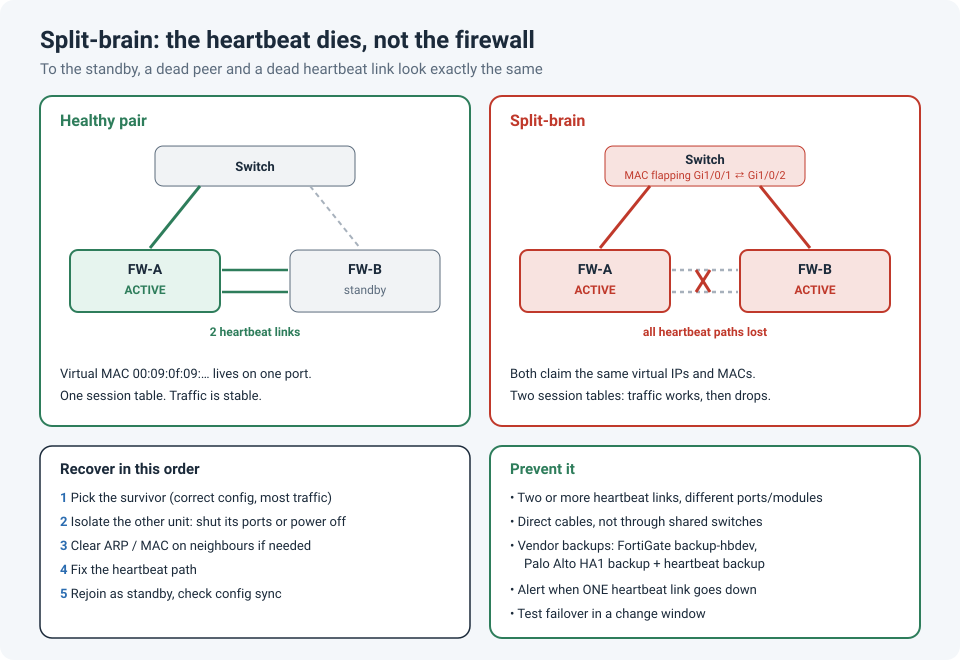

# Split-Brain: When Both Firewalls in an HA Pair Think They're in Charge

High availability is supposed to be the boring part of a firewall design. Two units, one
active and one standby, and if the active one dies, the standby takes over.

Then the heartbeat between them stopped. Each firewall concluded the other one was dead, and
**both became active**. That's split-brain, and it causes a worse outage than losing one
firewall completely.

!!! abstract "Key takeaway"
    An HA pair decides who is alive using **heartbeat** links. If every heartbeat path fails
    while both units are still running, each unit becomes active and claims the **same
    virtual IP and MAC addresses**. Switches see the MACs flapping and traffic bounces
    between two firewalls with different session tables. Recover by **isolating one unit**
    before you fix the heartbeat, and prevent it with at least **two independent heartbeat
    paths**, plus an alert the moment one of them goes down.



## How HA decides who is alive

In an active/passive pair, the units constantly exchange **heartbeats** (hellos) over
dedicated links. As long as the standby hears them, it stays standby. If the heartbeats stop
for longer than a threshold, the standby assumes the active unit has failed and takes over:
it starts answering for the **virtual IPs** and sends gratuitous ARPs with the cluster's
**virtual MAC** addresses, so the switches and routers move traffic to it.

That logic is correct when the active unit really is dead. The problem is that a dead peer
and a dead **heartbeat link** look exactly the same from the other side.

| What fails | What the standby sees | What happens |
|---|---|---|
| The active firewall | No heartbeats | Correct failover |
| Only the heartbeat link(s), both units healthy | No heartbeats | **Both units go active: split-brain** |

## What split-brain looks like

Split-brain is confusing because nothing is completely down. Instead, everything is
**intermittent**:

- Some sessions work and others drop, and the same user may see both within a minute.
- Your SSH or GUI session to the firewall connects, drops, and reconnects to a unit with a
  different uptime.
- Both units report themselves as primary/active.
- The upstream and downstream switches log the cluster's virtual MAC **flapping** between
  the two firewalls' ports:

```
%SW_MATM-4-MACFLAP_NOTIF: Host 0009.0f09.0000 in vlan 10 is flapping between port Gi1/0/1 and port Gi1/0/2
```

The firewall isn't the only thing confused. Each unit has its own session table, so when a
switch sends a packet to the "other" firewall, that unit has never seen the session and drops
it, or builds a new one with different NAT. Routing protocols on the firewalls can also flap,
because both units try to form adjacencies with the same router ID.

!!! tip "Recognize the virtual MAC"
    The cluster's virtual MAC is the fastest clue. FortiGate FGCP virtual MACs start with
    `00:09:0f:09`, and Palo Alto's start with `00:1b:17:00`. If a switch reports one of these
    flapping between two ports, suspect split-brain first.

## How to confirm it

Check the HA state on **each** unit, through its console or management IP rather than the
cluster IP (which may land on either one):

```
# FortiGate
get system ha status               # does each unit list itself as Primary, with one member?
diagnose sys ha history read       # look for "lost heartbeat" and new elections
diagnose sniffer packet any "ether proto 0x8890" 4   # are heartbeat packets arriving at all?
```

```
# Palo Alto
show high-availability state       # local and peer state; peer shows unknown or down
show high-availability all         # HA1, HA1-backup and heartbeat-backup link status
```

```
! Cisco ASA
show failover                      # this unit's state, the peer's state, failover link status
```

```
! The switches between the firewalls
show logging | include MACFLAP
show mac address-table address 0009.0f09.0000
```

## Recovering without making it worse

The tempting move is to plug the heartbeat back in straight away. Don't, at least not yet.
When the units hear each other again, they hold an election, and the winner becomes the
source of the configuration (FortiGate syncs it straight away; on Palo Alto the next
synchronization does). If someone made changes on the unit that **loses** the election during
the split, those changes can be overwritten.

1. **Pick the survivor.** Choose the unit that's carrying the most traffic and has the
   correct configuration.
2. **Isolate the other unit.** Shut its data ports on the switches, or power it off. This
   stops the MAC flapping immediately, and traffic stabilizes on one firewall.
3. **Clear stale entries** on neighbours if traffic doesn't settle: `clear arp` (or
   `clear ip arp <ip>`) on routers, and `clear mac address-table dynamic` for the affected
   VLANs.
4. **Find and fix the heartbeat failure.** A cable, an optic, a switch port, a switch that
   carried the heartbeat VLAN and rebooted, or an upgrade that left the units on different
   firmware.
5. **Bring the isolated unit back** with the heartbeat working, let it join as standby, and
   confirm the configuration is in sync:

```
# FortiGate
get system ha status
diagnose sys ha checksum cluster   # checksums must match on both units
```

```
# Palo Alto
show high-availability state-synchronization
request high-availability sync-to-remote running-config   # only from the correct unit, if needed
```

## Designing the heartbeat so it can't all fail at once

Split-brain needs **every** heartbeat path to fail while both units keep running. So the fix
is making sure no single failure can take out all the paths.

- **At least two heartbeat links**, on different physical ports, and ideally on different
  modules or network processors.
- **Direct cables between the two units** where possible. A heartbeat that goes through a
  switch also fails when that switch reboots, gets an STP change, or someone prunes the VLAN.
  If you have to use switches, use a dedicated VLAN that carries nothing else and isn't
  shared with other clusters.
- **Use the vendor's backup mechanisms:**

| Vendor | Feature |
|---|---|
| FortiGate | Several heartbeat interfaces with priorities (`set hbdev "port3" 50 "port4" 50`); FortiOS 7.6+ adds `set backup-hbdev` |
| Palo Alto | **HA1 backup** on a separate port and subnet, and **heartbeat backup** over the management interface |
| Cisco ASA | A dedicated failover link; hellos on monitored data interfaces stop both units going active if only the failover link fails |

- **Alert on a single heartbeat link going down.** With two links, losing one is invisible to
  users. If nobody notices, you're one failure away from split-brain. Send the HA link-down
  logs or SNMP traps somewhere a person will see them.
- **Test failover** in a change window: pull a heartbeat cable on purpose and confirm the
  pair stays healthy, then fail the active unit and confirm a clean takeover.

## Lessons learned

!!! tip "Takeaways"
    - To the standby, a dead peer and a dead heartbeat look the same. Plan for the second one.
    - Split-brain looks **intermittent**, not down. Flapping virtual MACs on the switches are
      the giveaway.
    - Isolate one unit first, then fix the heartbeat, then rejoin. Rejoining with the wrong
      winner can overwrite good configuration.
    - Two independent heartbeat paths, direct cables where possible, and an alert when one
      fails.

## References

- Fortinet Community: [Technical Tip: High Availability Split Brain](https://community.fortinet.com/t5/FortiGate/Technical-Tip-High-Availability-Split-Brain/ta-p/214842)
- Fortinet Community: [Best practices for heartbeat interfaces in FGCP](https://community.fortinet.com/t5/FortiGate/Technical-Tip-Best-practices-for-Heartbeat-interfaces-in-FGCP/ta-p/192732)
- Fortinet Community: [Mitigation of split-brain issue when heartbeat interface is down](https://community.fortinet.com/t5/FortiGate/Technical-Tip-Mitigation-of-split-brain-issue-when-heartbeat/ta-p/358545)
- Palo Alto Networks: [HA Links and Backup Links](https://docs.paloaltonetworks.com/pan-os/9-1/pan-os-admin/high-availability/ha-concepts/ha-links-and-backup-links.html)
