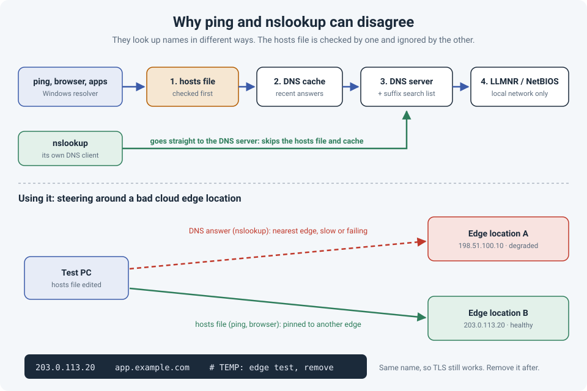

# Ping and nslookup Disagree? The Hosts File, and a Bad Cloud Edge

Two commands, same name, different answers. `ping app.example.com` goes to one IP,
`nslookup app.example.com` shows another. It looks like DNS is broken, but usually both
commands are working exactly as designed. They just look up names in different ways.

I've used that difference on purpose: when one of a cloud provider's **edge locations** was
having problems, a hosts file entry let me send a test machine to a different edge and prove
where the problem was.

!!! abstract "Key takeaway"
    `ping`, browsers and most applications use the **Windows resolver**, which checks the
    **hosts file** and its **cache** before asking DNS. `nslookup` skips both and asks the DNS
    server directly. That's why they can disagree. The same behavior makes the hosts file a
    precise troubleshooting tool: pin one name to one IP on one machine, with no DNS change.
    Use it for testing, label the entry, and **remove it when you're done**.



## Why ping and nslookup give different answers

When an application asks Windows to resolve a name, Windows tries, in order:

1. The **hosts file** (`C:\Windows\System32\drivers\etc\hosts`). Its entries are loaded into
   the DNS cache, so they always win.
2. The **DNS cache**: recent answers, still within their TTL.
3. The **DNS servers**, trying your DNS **suffix** list for short names.
4. **LLMNR** and **NetBIOS**: local-network fallbacks for names DNS doesn't know.

`nslookup` doesn't use any of that. It has its own DNS client and sends the query straight to
the DNS server. That's useful, because it shows what DNS *really* says, but it isn't what your
applications see.

| If they disagree because of... | You'll see |
|---|---|
| A **hosts file** entry | `ping` uses the hosts IP, `nslookup` shows the DNS answer |
| An **old cached answer** | `ping` uses the old IP until the TTL runs out or you flush the cache |
| A **DNS suffix** | `ping server1` resolved `server1.corp.example`, `nslookup` tried a different full name |
| **LLMNR or NetBIOS** | `ping` finds a local machine that DNS has no record for |
| **IPv6** | `ping` prefers IPv6 when available; `nslookup` lists both, so compare with `ping -4` |

To see what applications actually get, use PowerShell:

```
Resolve-DnsName app.example.com              # uses the hosts file and cache, like ping
Resolve-DnsName app.example.com -DnsOnly     # DNS only, like nslookup
ipconfig /displaydns                         # what's in the cache (hosts entries show up here too)
```

## The field story: a bad cloud edge location

A cloud-hosted service started having problems for our users, and the cause turned out to be
one of the provider's edge locations.

Large cloud and CDN services serve users from **edge locations** close to them. DNS answers
with the IP of the nearest edge, so users in different regions get different IPs for the same
name. If the edge near you is having problems, everyone near you has problems, even though
the service is "up".

To prove it, I needed one machine to use a **different** edge, without changing DNS for
everyone:

1. **Find another edge's IP.** I resolved the name from a location in another region (a remote
   site or a cloud VM elsewhere works). That returned a different IP: another edge.
2. **Pin the name on one test machine.** Open Notepad **as administrator**, edit
   `C:\Windows\System32\drivers\etc\hosts`, and add one line:

    ```
    203.0.113.20    app.example.com    # TEMP: edge test, remove after the ticket is closed
    ```

3. **Flush and confirm.**

    ```
    ipconfig /flushdns
    ping app.example.com              # should now show 203.0.113.20
    nslookup app.example.com          # still shows the normal DNS answer
    ```

4. **Test the application.** Through the other edge it worked. Same application, same user, same
   network: the only change was the edge location, which points clearly at the edge rather than
   at our network.
5. **Remove the entry** once the edge issue is resolved, and flush the cache again.

Why does HTTPS still work when you send a name to a different IP? The browser still uses the
original **name**, so it sends the right hostname (SNI) and the certificate still matches. You've
only changed which server answers.

!!! tip "Test without touching the hosts file"
    `curl` (included in Windows 10 and later) can send one request to a specific IP for a
    name, which is cleaner for a quick check:

    ```
    curl -v --resolve app.example.com:443:203.0.113.20 https://app.example.com/
    ```

    The `-v` output shows which IP it connected to and the TLS handshake.

## Traps to watch for

- **Forgotten entries.** A hosts entry stays forever. Months later, the provider changes IPs and
  that one machine breaks while everyone else is fine. Always add a comment with the reason and
  date, and remove it as soon as the test is over. This is the same problem as any temporary fix
  quietly becoming permanent.
- **Browser caches.** Browsers keep their own DNS cache. After editing the file, restart the
  browser (in Chrome you can also clear it at `chrome://net-internals/#dns`).
- **Proxies.** If the browser uses a web proxy, the **proxy** resolves the name, and your hosts
  file is ignored for that traffic. `ping` will look right while the browser still goes to the
  old edge.
- **Anycast services.** Some providers use the **same IP** at every edge (anycast), and routing
  decides which edge you reach. The hosts file can't choose an edge for those, because there's
  only one IP to choose.
- **Permissions and security tools.** Editing needs administrator rights, and some endpoint
  security tools block or revert hosts file changes, because malware also likes to edit it.
- **Not a fix for everyone.** The hosts file proves the problem or keeps one critical machine
  working. For a real workaround across users, use DNS or the provider's own controls.

## Quick reference

| Task | Command |
|---|---|
| Edit the hosts file | Notepad as administrator: `C:\Windows\System32\drivers\etc\hosts` |
| Format | `IP-address  hostname  # comment`, one entry per line, no wildcards |
| Clear the Windows DNS cache | `ipconfig /flushdns` |
| See what applications get | `Resolve-DnsName name` or `ping name` |
| See what DNS says | `nslookup name` or `Resolve-DnsName name -DnsOnly` |
| Test one IP without editing anything | `curl -v --resolve name:443:IP https://name/` |
| Linux / macOS equivalent | `/etc/hosts` |

## References

- [Microsoft: Resolve-DnsName](https://learn.microsoft.com/en-us/powershell/module/dnsclient/resolve-dnsname)
- [Microsoft: nslookup](https://learn.microsoft.com/en-us/windows-server/administration/windows-commands/nslookup)
- [curl documentation: --resolve](https://curl.se/docs/manpage.html#--resolve)
- [Life of a Packet: DNS, Step by Step](dns-life-of-packet.md)
