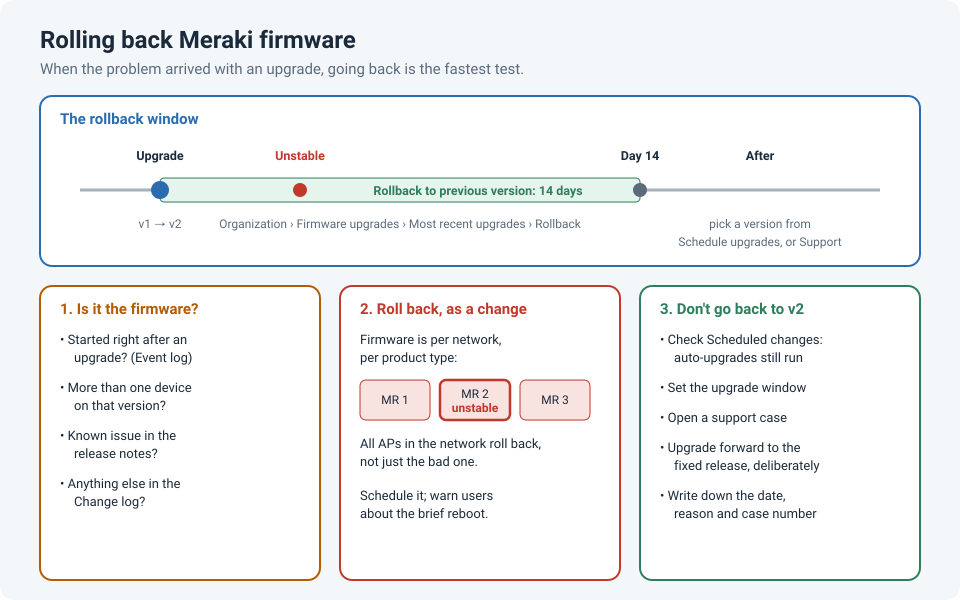

# When the Fix Is Going Backwards: Rolling Back Meraki Firmware

Meraki devices update themselves from the cloud, which is usually a good thing: you get fixes
without lifting a finger. But new firmware occasionally brings new bugs. I've had Meraki
devices that turned unstable, and after checking the config, the cabling and the uplinks, what
actually fixed them was **going back to the previous firmware**.

It feels wrong, because we're trained to fix problems by upgrading. But when the problem
arrived **with** an upgrade, a rollback is the fastest way to prove it, and to get users
working again while Meraki fixes the bug.

!!! abstract "Key takeaway"
    If a Meraki device became unstable **after a firmware upgrade**, roll back from
    **Organization › Firmware upgrades › Most recent upgrades › Rollback**. You can do that
    for **14 days** after the upgrade, and only to the **previous** version. Firmware is set
    **per network and product type**, so the rollback applies to every device of that type in
    the network, not just the one misbehaving. Then open a support case, watch for the fixed
    release, and check **Scheduled changes** so the next automatic upgrade doesn't put you
    straight back on the buggy version.

## First, is it really the firmware?

Before rolling anything back, check whether the timing fits:

| Question | Where to look |
|---|---|
| Did the instability start right after an upgrade? | **Organization › Firmware upgrades › Most recent upgrades**, compared with the device's **Event log** |
| Is it one device, or every device on that version? | One device on a version that's fine everywhere else points to hardware, cabling or power. Several points to firmware |
| Is it a known issue? | The release notes for that version (**Known issues**), and the Meraki Community |
| Did anything else change at the same time? | **Organization › Change log** |

If the problem started with the upgrade and shows up on more than one device, a rollback is a
reasonable test, and much faster than a long troubleshooting session.

## How a Meraki rollback works

From the Meraki documentation:

1. Go to **Organization › Monitor › Firmware upgrades**.
2. Under **Most recent upgrades**, open the upgrade entry.
3. Click **Rollback**, give a reason, and choose to do it **now** or **schedule** it.

The limits:

- **14 days.** Rollback is available for 14 days after the upgrade completed.
- **Previous version only.** You go back to the version the devices ran before that upgrade,
  not to any older version.
- **One network or the whole batch.** If the upgrade covered several networks, you can roll
  back just one, or all of them.
- **After 14 days**, choose a different version from **Schedule upgrades** (where the
  available Recommended, GA and beta releases are listed), or ask **Meraki Support**.

!!! warning "A rollback isn't per device"
    Meraki firmware is set **per network, per product type** (MR, MS, MX…). Rolling back the
    access points in a network rolls back **all** the access points in that network, including
    the ones that were fine. Plan it like any other change: schedule it, and tell users their
    Wi-Fi or switch ports will drop briefly while devices reboot.

There's also a safety net built in: if a device can't get back to the Meraki cloud after an
upgrade, it **automatically reverts** to its previous firmware.

## Don't get upgraded straight back

This is the step that's easy to forget. Meraki schedules upgrades automatically, and
cancelling one scheduled upgrade doesn't stop future ones. After a rollback:

- Check **Organization › Firmware upgrades › Scheduled changes** for anything that will move
  the network back to the version you just left.
- Set the network's **upgrade window** (Network-wide › General) to a time that suits you.
- **Open a support case** with the details. Support can confirm whether it's a known bug, and
  they can manage upgrades for you.
- Watch the release notes for the version that **fixes** it, then upgrade to that one,
  deliberately, in a change window.

A rollback is a temporary fix, and temporary fixes have a habit of becoming permanent (see
[Temporary Fixes That Quietly Become Permanent](temporary-fixes.md)). Note the date, the
reason and the case number somewhere you'll see them again.

## Lessons learned

!!! tip "Takeaways"
    - When instability starts **with an upgrade**, test the rollback early.
    - Meraki lets you roll back for **14 days**, to the **previous** version only.
    - Rollbacks apply to the **whole network** for that product type, so plan them as a change.
    - Check **Scheduled changes** afterwards, or the next automatic upgrade undoes your fix.
    - Open a case, then upgrade **forward** to the fixed release when it's out.

## References

- Meraki Documentation: [Managing Firmware Upgrades](https://documentation.meraki.com/General_Administration/Firmware_Upgrades/Managing_Firmware_Upgrades)
- Meraki Documentation: [Cisco Meraki Firmware FAQ](https://documentation.meraki.com/Platform_Management/Product_Information/Compatibility_and_Firmware/Firmware_Upgrades/Cisco_Meraki_Firmware_FAQ)
