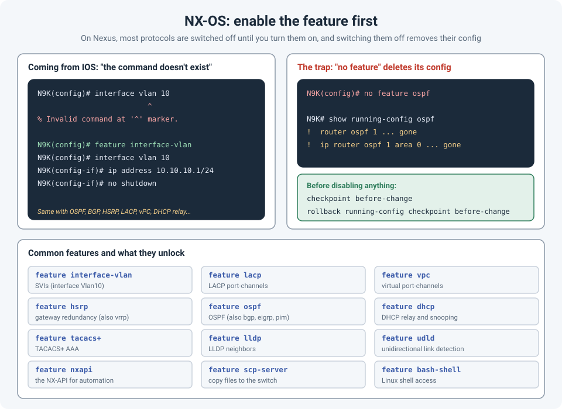

# Nexus Basics: Enable the Feature First (and Be Careful Turning It Off)

The first time you configure a Cisco Nexus switch after years of IOS, something odd happens. You
type `interface vlan 10`, a command you've typed a thousand times, and the switch tells you it
doesn't exist.

It does exist. It just isn't switched on yet.

!!! abstract "Key takeaway"
    NX-OS is modular: most protocols and services are **disabled by default**, and their
    commands don't appear until you enable them with `feature <name>` (for example
    `feature interface-vlan`, `feature lacp`, `feature ospf`). Use `show feature` to see what's
    enabled. And be careful in the other direction: `no feature <name>` **removes that feature's
    configuration**, so take a checkpoint before disabling anything.



## Why NX-OS works this way

NX-OS runs each feature as its own process. Instead of loading everything, the switch enables only
what's needed for basic connectivity, and you turn on the rest. Cisco's guidance is to keep
features disabled unless you need them: fewer running processes means less memory and CPU used,
and less attack surface.

Until a feature is enabled, its **configuration and show commands aren't available**. That's why
the CLI says the command is invalid, rather than "feature not enabled".

```
N9K(config)# interface vlan 10
                         ^
% Invalid command at '^' marker.

N9K(config)# feature interface-vlan
N9K(config)# interface vlan 10
N9K(config-if)# ip address 10.10.10.1/24
N9K(config-if)# no shutdown
```

## Checking what's enabled

```
show feature                              ! every feature and its state
show feature | include enabled            ! only the enabled ones
show running-config | include ^feature    ! the feature lines in the config
```

The state can be `enabled`, `disabled`, or `enabled (not-running)`: enabled, but its process
won't start until you configure something that uses it.

## The features you'll need most

| Command | What it unlocks |
|---|---|
| `feature interface-vlan` | SVIs (`interface Vlan10`) |
| `feature lacp` | LACP port-channels (`channel-group 10 mode active`) |
| `feature vpc` | Virtual port-channels across two Nexus switches |
| `feature hsrp` / `feature vrrp` | First-hop gateway redundancy |
| `feature ospf`, `feature bgp`, `feature eigrp`, `feature pim` | Routing protocols and multicast |
| `feature dhcp` | DHCP relay (`ip dhcp relay address`) and DHCP snooping |
| `feature tacacs+` | TACACS+ for AAA |
| `feature lldp` | LLDP neighbor discovery (CDP is on by default) |
| `feature udld` | Unidirectional link detection |
| `feature nxapi` | NX-API, for automation and scripts |
| `feature scp-server` | Copying files to the switch with SCP |
| `feature bash-shell` | Access to the Linux shell underneath NX-OS |

Two habits that save time:

- **Put the feature lines at the top of your templates.** A config pasted onto a fresh Nexus
  fails line by line if the features aren't enabled first.
- **Check licensing.** On some Nexus platforms, certain features (often the routing protocols)
  need the right license tier. If `feature` refuses to enable something, check the license
  before anything else.

## The trap: `no feature` is not a pause button

On IOS, you might shut down a process or remove one line and put it back later. On NX-OS,
**disabling a feature removes its configuration**. Run `no feature ospf` and every OSPF process,
every `ip router ospf` line on every interface, and all the related settings are gone from the
running config. Turn the feature back on and you get an empty OSPF, not your old one.

The same goes for features like `interface-vlan` (your SVIs disappear), `hsrp`, `vpc` and
`lacp`. On a production switch, that's an outage.

Before disabling a feature, even to "reset" it while troubleshooting:

```
checkpoint before-change                              ! save a restore point
show running-config ospf > bootflash:ospf-backup.txt  ! keep a copy of that feature's config

! ... make the change ...

rollback running-config checkpoint before-change                   ! put it all back
```

Checkpoints and rollback are among the most useful NX-OS tools in general. Take one before any
significant change, the same way you'd arm `reload in` on a remote switch (see
[Safe Changes on Remote Switches](safe-remote-changes.md)).

## References

- [Cisco: Enabling and Disabling Features (NX-OS CLI Management Best Practices)](https://cisco.com/en/US/docs/switches/datacenter/sw/best_practices/cli_mgmt_guide/features.html)
- [Cisco Nexus 9000 Series NX-OS Interfaces Configuration Guide](https://www.cisco.com/c/en/us/td/docs/switches/datacenter/nexus9000/sw/7-x/interfaces/configuration/guide/b_Cisco_Nexus_9000_Series_NX-OS_Interfaces_Configuration_Guide_7x/b_Cisco_Nexus_9000_Series_NX-OS_Interfaces_Configuration_Guide_7x_chapter_011.html)
