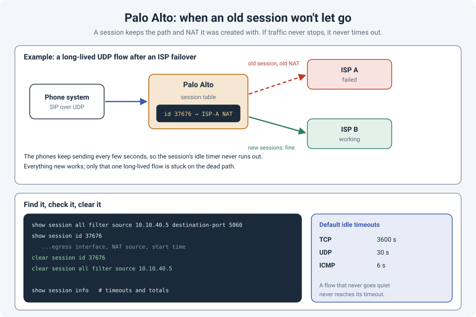

# Palo Alto Stuck Sessions: When an Old Session Won't Let Go

Everything looks fixed. The ISP is back, the route is correct, the NAT rule is updated, new
connections work. But one thing still doesn't: the phones won't register, or one tunnel stays
down, or a single server can't send its logs.

The firewall wasn't broken. It was **remembering**. The traffic was still matching a **session**
created before the change, and that session still had the old path and the old NAT. Clearing
the session fixed it instantly.

!!! abstract "Key takeaway"
    A Palo Alto firewall decides the route, NAT and policy **when a session is created**, and
    keeps using those decisions for the life of the session. A session only ends when it closes
    or sits **idle** past its timeout (by default **3600 s** for TCP, **30 s** for UDP). A flow
    that **never goes quiet** (SIP, VPN keepalives, syslog, monitoring) never times out, so it
    keeps the old path forever. Find it with `show session all filter ...` and clear it with
    `clear session id <id>`.



## Why sessions get stuck

A stateful firewall doesn't evaluate every packet from scratch. The first packet of a flow
creates a **session**, and the session records the decisions made at that moment: ingress and
egress interface, NAT translation, and the matching rule. Later packets just follow the session.

That's efficient, and it's usually invisible. It becomes a problem when something changes
**while a session is still alive**:

| What changed | What the old session still does |
|---|---|
| **ISP failover** | Keeps sending out the failed ISP, with the old public NAT address |
| **NAT rule change** | Keeps the old translation |
| **Routing change** (new path, new next hop) | Keeps the old egress interface |
| **Server or VIP moved** | Keeps sending to the old destination |

A Palo Alto firewall can re-check existing sessions against the **security policy** after a
policy change (the "Rematch Sessions" setting), but the NAT and forwarding decisions stay with
the session.

The sessions that cause trouble are the ones that **never go idle**:

- **SIP** phones and trunks sending registrations and keepalives every few seconds
- **IPsec** with NAT traversal (UDP 4500) between two peers
- **Syslog**, **SNMP traps** and monitoring traffic sent constantly from the same source port
- Long-lived **TCP** connections like database replication

Each new packet resets the idle timer, so the session never reaches its timeout. After an ISP
failover, new connections go out the working ISP, while the phones stay stuck on the dead one
indefinitely.

## Finding the session

Filter by what you know: source, destination, port, application.

```
show session all filter source 10.10.40.5 destination-port 5060
```

Then look at the details of a specific session:

```
show session id 37676
```

Check the **egress interface**, the **NAT source address** and the **start time**. A session
that started before the failover or change, still pointing at the old interface or NAT
address, is your stuck session.

`show session info` shows overall session counts and the configured timeouts.

## Clearing it

```
clear session id 37676
```

Or clear everything matching a filter:

```
clear session all filter source 10.10.40.5 destination-port 5060
```

The next packet creates a **new** session, with the current route, NAT and policy.

Clearing is safe for the flow itself (the application reconnects or re-registers), but it does
interrupt it briefly. Two cautions:

- **Filter carefully.** `clear session all` without a filter drops every session on the firewall.
- **Clear it on purpose, as part of the change.** If a change affects NAT, routing or an ISP
  path, add "clear the affected sessions" to the change plan, rather than waiting for users to
  report it.

!!! tip "Not just Palo Alto"
    Every stateful firewall works this way. On a FortiGate the equivalent is filtering with
    `diagnose sys session filter` and clearing with `diagnose sys session clear`; on a Cisco ASA,
    `clear conn`. The habit is the same: after a path or NAT change, check for sessions that
    started before it.

## References

- [Palo Alto Networks LIVEcommunity: clearing sessions from the CLI](https://live.paloaltonetworks.com/t5/general-topics/can-t-clear-session-from-cli/td-p/39460)
- [Tracking Down a Machine, and Why Moving Cables Seems Not to Work](tracking-a-machine.md)
