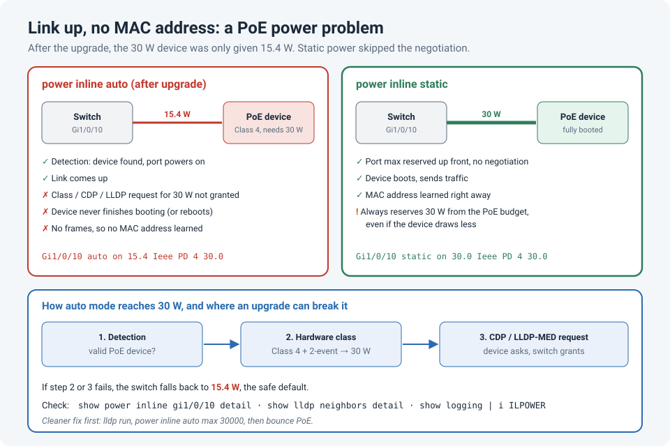

# Link Up, No MAC Address: The PoE Device That Only Got 15 W After a Firmware Upgrade

We upgraded the firmware on a Cisco access switch. Everything came back, except one
PoE-powered device. Its port showed **up/up**, but the switch never learned a MAC address on
it. No traffic, no ARP, nothing to troubleshoot from the device side.

It took a lot of troubleshooting to find, because everything we looked at on the port
seemed fine. What finally fixed it was one command on the interface:

```
interface GigabitEthernet1/0/10
 power inline static
```

Before that command, the port was giving the device **15.4 W**. After it, the device got the
full **30 W**, finished booting, and its MAC address appeared straight away.

!!! abstract "Key takeaway"
    "Link up but no MAC address" on a PoE port can be a **power** problem. A device that needs
    PoE+ (30 W) but gets only 15.4 W may bring its Ethernet link up and then never finish
    booting, or keep rebooting. In `auto` mode, the switch decides the power from the
    device's **class** and from **CDP/LLDP power negotiation**, and a firmware upgrade can
    change that behaviour. `power inline static` skips the negotiation and reserves the
    port's maximum power up front. Check **`show power inline`** early whenever a PoE device
    misbehaves, especially after an upgrade.



## Why "link up" doesn't mean "device working"

A PoE device's Ethernet PHY often powers up early, so the switch sees a link within seconds.
But the rest of the device, such as the CPU, radios, a camera heater or a downstream switch,
may need more power than the port is giving. With 15.4 W, a 30 W device can:

- bring the link up and then stall during boot, so it never sends a frame (no MAC learned)
- start up, draw more than it was given, get cut off, and reboot in a loop
- run in a **low-power mode** with features disabled (common with access points)

From the switch, the first two just look like a port that's up and silent.

## How PoE decides how much power to give

In the default `power inline auto` mode, the switch works it out in steps:

| Step | What happens | Result |
|---|---|---|
| 1. Detection | The switch checks for a valid PoE signature | Port powers on |
| 2. Hardware classification | The device signals its **class** (0–4 for PoE/PoE+) | Class 0–3: up to 15.4 W. Class 4 (PoE+) can get 30 W here if the switch uses **2-event** classification; otherwise it starts at 15.4 W |
| 3. CDP/LLDP negotiation | After booting, the device asks for its exact power over CDP or LLDP-MED | The switch can raise the allocation, often to 30 W |

So a 30 W device can depend on step 2 or step 3 working. If either one changes, for example
because the new firmware handles classification differently, LLDP isn't enabled, or there's a
bug in negotiation, the switch falls back to **15.4 W**, the safe default for any PoE device.

`power inline static` changes the approach. The switch **pre-allocates** the port's maximum
power (30 W on a PoE+ port, or the value you set with `max`) as soon as it detects a device,
without waiting for the class or negotiation.

We're not alone in seeing this after upgrades. Cisco Community threads describe the same
pattern: Catalyst 2960-XR switches that gave endpoints 15.4 W instead of 30 W after one
upgrade, and Catalyst 9300 ports stuck at 15 W, with LLDP negotiation as the common thread.

## How to spot it quickly

The telltale sign is a **Class 4** device that's only been given **15.4 W**:

```
Switch# show power inline gi1/0/10

Interface  Admin  Oper       Power   Device              Class Max
                             (Watts)
---------- ------ ---------- ------- ------------------- ----- ----
Gi1/0/10   auto   on         15.4    Ieee PD             4     30.0
```

After `power inline static`:

```
Gi1/0/10   static on         30.0    Ieee PD             4     30.0
```

For more detail:

```
show power inline gi1/0/10 detail        ! allocated vs. drawn power, and the negotiation used (CDP, LLDP or none)
show lldp neighbors gi1/0/10 detail      ! did the device request power over LLDP-MED?
show cdp neighbors gi1/0/10 detail       ! same for CDP
show logging | include ILPOWER           ! repeated power on/off events = the device is rebooting
show mac address-table interface gi1/0/10
```

If `detail` shows the device drawing close to its allocation, or the logs show
`%ILPOWER-5-IEEE_DISCONNECT` followed by `%ILPOWER-7-DETECT` every minute or two, the device
is running out of power.

## The fixes, from cleanest to bluntest

**1. Make negotiation work** (keeps the switch's power budget accurate):

```
lldp run
!
interface GigabitEthernet1/0/10
 lldp transmit
 lldp receive
 power inline auto max 30000
```

Then make the device renegotiate, without touching the rest of the port configuration:

```
interface GigabitEthernet1/0/10
 power inline never
 power inline auto
```

**2. Use static power** (what fixed ours):

```
interface GigabitEthernet1/0/10
 power inline static max 30000
```

**3. Check the release notes and bug search tool** for the new firmware. If it's a known PoE
or LLDP bug, a different release may fix it for every port, not just the one you noticed.

!!! warning "Static power comes out of the budget whether the device uses it or not"
    `power inline static` reserves the full amount for that port permanently. Use it on a few
    ports and it doesn't matter. Use it on every port of a 48-port switch and you can run out
    of PoE budget, and other devices won't get power. Check the totals with `show power
    inline` (the *Available*, *Used* and *Remaining* lines at the top).

## Add PoE to your upgrade checks

A port that's up but silent is easy to miss in post-upgrade checks, because "all ports up"
looks like success. Before any switch upgrade, save the PoE state, and compare it afterwards:

```
show power inline | redirect flash:pre-upgrade-poe.txt
show mac address-table dynamic | redirect flash:pre-upgrade-mac.txt
```

After the upgrade, run the same commands and look for any port whose **allocated power
dropped**, or any PoE port with **no MAC address**.

And if you do use `power inline static` as the fix, write it down in the change record with
the reason. Otherwise, it's the kind of workaround that quietly becomes permanent (see
[Temporary Fixes That Quietly Become Permanent](temporary-fixes.md)).

## Lessons learned

!!! tip "Takeaways"
    - **Link up with no MAC address** on a PoE port: check the power before the VLAN.
    - A **Class 4** device showing **15.4 W** in `show power inline` is the giveaway.
    - In `auto` mode, full PoE+ power depends on classification and CDP/LLDP negotiation,
      and firmware upgrades can change both.
    - `power inline static` bypasses negotiation, but costs PoE budget. Fixing LLDP is cleaner.
    - Put `show power inline` in your pre- and post-upgrade checks.

## References

- Meraki Documentation: [Low Power Mode on Cisco Switches](https://documentation.meraki.com/MR/Other_Topics/Low_Power_Mode_on_Cisco_Switches) (LLDP for PoE+ negotiation, and the `power inline` commands)
- Cisco Community: [Issue with PoE negotiation after upgrading Catalyst 2960-XR](https://community.cisco.com/t5/switching/issue-with-poe-neg-after-upgrading-catalyst-2960xr/td-p/5023984)
- Cisco Community: [9300 switch with PoE negotiation issues](https://community.cisco.com/t5/switching/9300-switch-with-poe-negotiation-issues/m-p/4779765)
