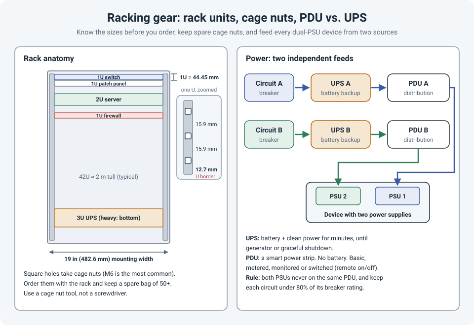

# Racking Gear: Rack Sizes, Cage Nuts, and PDU vs. UPS

Most networking training starts at the console prompt. In real life, the job often starts
earlier: a new switch in a box, a rack that may or may not fit it, a bag of cage nuts that's
somehow always short by two, and a power strip that may or may not be the right one.

None of this is hard, but getting it wrong costs time on site, and sometimes an outage.

!!! abstract "Key takeaway"
    Racks are measured in **U** (1U = 44.45 mm) and use a **19 in** (482.6 mm) mounting width,
    but cabinets vary a lot in **depth**, so check device depth before ordering. Keep a
    generous supply of **spare cage nuts and screws** in the right thread, and install them
    with a tool. A **UPS** keeps things running when power fails; a **PDU** only distributes
    power. Feed every dual-PSU device from **two independent sources** (A and B), and size each
    side to carry the **whole** load on its own.

## Rack sizes: what the numbers mean

| Term | What it means |
|---|---|
| **U (rack unit)** | Height: 1U = 44.45 mm (1.75 in). A typical switch is 1U, a server 1U to 4U. |
| **19 in rack** | The standard mounting width between the rails (482.6 mm across the mounting ears). |
| **42U, 45U, 48U** | Usable height. A 42U cabinet is roughly 2 m tall. |
| **Width** | Cabinets are usually **600 mm** or **800 mm** wide. The 800 mm ones leave room on the sides for cable management, which network racks need. |
| **Depth** | Commonly **600 to 1200 mm**. Switches are shallow; servers can need 1000 mm or more once you add cables and rear PDUs. |
| **2-post vs. 4-post** | 2-post open frames suit light, shallow gear like patch panels and switches. Deep or heavy gear needs 4 posts and rails. |

Before ordering a rack or a device, check:

- **Device depth** against the rack's usable depth, plus space for cables and a rear PDU.
- **Rail kit range**: rails support a minimum and maximum distance between the front and rear
  posts. A rail kit that doesn't fit the rack is a common site-visit surprise.
- **Airflow direction.** Most data center switches can be ordered as **port-side intake** or
  **port-side exhaust**. Match it to the room's hot and cold aisles, and use blanking panels in
  empty spaces so hot air doesn't loop back to the front.
- **Weight**: heavy gear (UPS units, big servers) goes at the **bottom**. It keeps the rack
  stable and makes lifting safer.

## Cage nuts: small part, big delay

Most 4-post racks have **square holes**, and the screws don't go into the rack directly; they go
into a **cage nut**: a square nut held in a spring-steel cage that clips into the hole.

What I've learned the hard way:

- **Always have plenty of extras.** Cage nuts get dropped into floor tiles, bent, cross-threaded
  and left behind. Equipment often ships with exactly enough, or with the wrong thread. A spare
  bag of 50 costs almost nothing compared to an extra trip to site.
- **Match the thread.** **M6** is the most common, but you'll also see **10-32** and **12-24**,
  especially on North American racks and equipment. An M6 screw in a 10-32 nut will not end
  well.
- **Find the U boundary.** Each U has three holes. The spacing is 15.9 mm, 15.9 mm, then a
  shorter **12.7 mm** gap; that short gap is where one U ends and the next starts. Most rails
  are also printed with U numbers. Mount devices on the U boundaries, or you'll waste space.
- **Use a cage nut tool.** Prying them in and out with a flat screwdriver works until the
  screwdriver slips into your hand.
- **Get a second person** for anything heavy. Hold the device while the first two screws go
  in, and support the back of long devices until the rails or rear brackets are secured.

## PDU vs. UPS

They both have power outlets, and that's where the similarity ends.

| | **UPS** (uninterruptible power supply) | **PDU** (power distribution unit) |
|---|---|---|
| **Job** | Keeps devices running when utility power fails, and cleans up power problems | Distributes power from one input to many outlets |
| **Battery** | Yes | No |
| **Protects against** | Outages, sags, surges (depending on type) | Nothing; it's a well-built power strip |
| **Runtime** | Minutes, enough to ride out a short outage, start a generator, or shut down cleanly | None |
| **Variants** | Standby (basic), line-interactive (common in small rooms), online double-conversion (data centers) | Basic, metered (shows the load), monitored (load over the network), switched (turn outlets on and off remotely) |

A **switched PDU** is worth it for remote sites: power-cycling a hung device from your desk
beats driving there.

## A and B power feeds

Most switches, firewalls and servers in a rack have **two power supplies**. That only helps if
each one is fed from a **different** source:

- PSU 1 to **PDU A**, PSU 2 to **PDU B**, on **different circuits** (ideally through different
  UPS units).
- **Never** plug both PSUs into the same PDU. It looks redundant and isn't.
- Devices with a **single** power supply can use an **automatic transfer switch (ATS)** to get
  the same protection.

The part that's easy to miss: when one feed fails, the **other side carries everything**. So
size each side to handle the **whole rack's load** on its own. In North America, electrical
codes generally limit continuous load to **80%** of the circuit breaker's rating, so on a 30 A
circuit that's 24 A. With A and B feeds, the **combined** load of both sides should stay under
that 24 A, which means each side normally runs at around half of it.

Metered or monitored PDUs make this easy to check. Look at them before you add the next device,
not after the breaker trips.

## References

- [EIA-310: rack and panel standard (overview)](https://en.wikipedia.org/wiki/19-inch_rack)
- [Schneider Electric (APC) White Paper 1: The Different Types of UPS Systems](https://www.se.com/ww/en/download/document/SPD_SADE-5TNM3Y_EN/)
