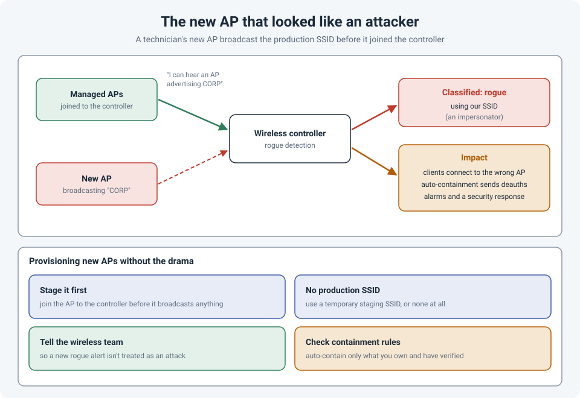

# The New AP That Looked Like an Attacker: Rogue Detection and the Production SSID

A technician was setting up a new access point. Before it had joined our wireless controller,
it was already broadcasting the **production SSID**. To the wireless system, that looked exactly
like an attack: an unknown AP, not under management, advertising our network name.

It was treated as a **rogue** AP, and it caused disruption.

!!! abstract "Key takeaway"
    A wireless controller treats any AP it doesn't manage, but that advertises **your SSID**, as a
    possible **impersonator** (an "evil twin"). That's exactly what an attacker would do, so it's
    exactly what the system is built to catch. Provision new APs so they **join the controller
    before they broadcast anything**, use a **temporary staging SSID** if they need one, tell the
    wireless team about the work, and be careful with **automatic containment**.



## How rogue detection works

Managed APs don't just serve clients; they also **listen**. They report every AP they can hear
back to the controller. Anything that isn't one of the controller's own APs is a **rogue**.

Most rogues are harmless: the coffee shop next door, a printer's Wi-Fi Direct network, a hotspot
on someone's phone. The controller sorts them with **classification rules**, and one of the most
important conditions is:

> **Is this unknown AP using one of our SSIDs?**

An unmanaged AP broadcasting your network name is the classic **evil twin** attack: users'
devices connect to it automatically because the name matches, and an attacker can try to capture
their traffic or credentials. So an AP like that is usually classified as **malicious**, raises an
alarm, and may trigger **containment**.

**Containment** means the managed APs send de-authentication frames to clients associated with the
rogue, knocking them off it. Cisco 9800 controllers have auto-containment options such as "rogue
using our SSID". Useful against a real attacker, disruptive when the "attacker" is your own
technician.

## Why a new AP does this

Depending on the platform and how it was prepared, a new AP can broadcast an SSID before it's
under management:

- It was **pre-configured** (in standalone or autonomous mode, or on a different controller or
  cloud dashboard) with the production SSID to "save time".
- It was **moved** from another site or controller and still had its old configuration.
- It was set up as a **temporary standalone AP** to get users online quickly.

## Provisioning without the drama

- **Join first, broadcast second.** Connect the AP to the network so it joins the controller (or
  cloud dashboard) and gets its configuration from there. Don't configure SSIDs on the AP itself.
- **Never use the production SSID on an unmanaged AP.** If something needs testing before joining,
  use a clearly named temporary SSID, and remove it afterwards.
- **Tell the wireless and security teams** before installation work, so a new rogue alert is
  checked rather than treated as an incident.
- **Review containment settings.** Automatic containment should only target what you've verified.
  There's also a legal side: containing networks you **don't own** can be illegal. In 2014, the US
  FCC fined Marriott $600,000 for sending de-authentication frames to guests' personal hotspots at
  a conference venue.

## Checking rogues on a Catalyst 9800

```
show wireless wps rogue ap summary                 ! all rogues, and the auto-contain settings
show wireless wps rogue ap detailed <mac-address>  ! classification, who heard it, channel, signal
show wireless wps rogue client summary             ! clients associated to rogues
```

The detailed output shows whether the rogue is flagged as an **impersonator** (using your SSID),
which managed APs can hear it and how strongly. That's how you find it physically: the managed AP
hearing it at the highest signal is usually nearby.

## References

- [Cisco: Identify and locate a rogue AP or client on Catalyst 9800](https://www.cisco.com/c/en/us/support/docs/wireless/catalyst-9800-series-wireless-controllers/221688-identify-and-locate-a-rogue-ap-client-on.html)
- [mrn-cciew: Rogue classification](https://mrncciew.com/2013/06/02/rogue-classification/)
- [Infosecurity Magazine: Marriott fined $600K for blocking guest Wi-Fi](https://www.infosecurity-magazine.com/news/marriott-slapped-with-600k-fine/)
