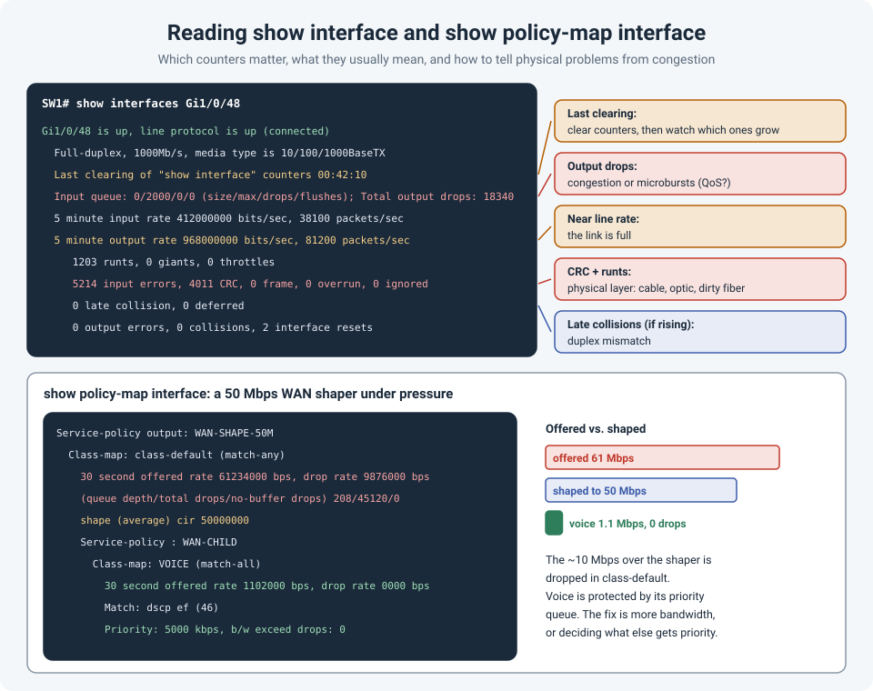

# Reading show interface and show policy-map interface: What's Normal and What's Not

`show interface` is probably the most-run command in networking, and also one of the most
skimmed. "It's up/up, so it's fine." But the counters underneath tell you whether a link is
healthy, damaged, or simply full. And when QoS is involved, `show policy-map interface` tells
you which traffic is being dropped, and why.

!!! abstract "Key takeaway"
    A counter only means something if you know **how fast it's growing**: clear the counters,
    then watch. **CRC errors and runts** point to the **physical layer** (cable, optic, dirty
    fiber). **Late collisions** point to a **duplex mismatch**. **Output drops** point to
    **congestion**, often microbursts, not a broken link. In `show policy-map interface`,
    compare the **offered rate** with the shaper or policer, and check **which class** is
    dropping: drops in the bulk class during peaks may be normal, drops in the **priority** class
    are not.



## Part 1: show interface

### First, how long have these counters been counting?

```
Last clearing of "show interface" counters 00:42:10
```

A total of 4,000 CRC errors means very different things over 40 minutes or over two years. The
best approach is to **clear, wait, and compare**:

```
clear counters GigabitEthernet1/0/48
! wait a few minutes, or reproduce the problem
show interfaces GigabitEthernet1/0/48 | include rate|errors|drops|CRC|collision
```

### What each counter usually means

| Counter | What it is | Usually means |
|---|---|---|
| **CRC** | Frames that arrived damaged (failed the checksum) | **Physical layer**: bad or long cable, faulty optic, dirty fiber connector, interference. Also the far side's duplex mismatch. |
| **Input errors** | Total of all receive errors | Look at the breakdown (CRC, frame, runts, giants, overrun, ignored) to see which one is growing. |
| **Runts** | Frames shorter than the 64-byte minimum | Collisions or a duplex mismatch, or a physical fault. |
| **Giants** | Frames larger than the configured MTU | An **MTU mismatch**, for example jumbo frames on one side only. |
| **Overrun / ignored** | The interface couldn't keep up with incoming frames | Hardware or buffer limits during heavy bursts. |
| **Late collisions** | Collisions after the first 64 bytes of a frame | Almost always a **duplex mismatch** (one side full, the other half), or a cable that's far too long. |
| **Collisions** | Normal on half-duplex links only | On a full-duplex link, there should be **none**. |
| **Total output drops** | Frames the switch couldn't send because the output queue was full | **Congestion**: the link is busy, or **microbursts** (short traffic spikes that average rates don't show). |
| **Interface resets** | The interface was reset | Link flaps, keepalive failures, or a faulty cable or optic. |
| **Input / output rate** | Average traffic over the load interval (5 minutes by default) | Compare with the link speed. A 5-minute average can hide short peaks. |

Two rules of thumb:

- **Errors are about the link. Drops are about the load.** CRC and runts mean something is
  physically wrong; replacing the cable or cleaning the fiber fixes them. Output drops mean too
  much traffic for the link or the queue; replacing the cable changes nothing.
- **Shorten the averaging window** when chasing bursts, so the rate isn't averaged over five
  minutes:

    ```
    interface GigabitEthernet1/0/48
     load-interval 30
    ```

For a quick view across all ports:

```
show interfaces counters errors        ! Catalyst: errors per port
show interface counters errors         ! Nexus
```

On fiber links, check the light levels too (see
[Fiber Link Won't Come Up? Check the Polarity](fiber-polarity.md)):

```
show interfaces GigabitEthernet1/0/48 transceiver detail
```

## Part 2: show policy-map interface

When a QoS policy is applied to an interface, `show interfaces` only shows the total. To see
**which class** of traffic is being dropped, look at the policy itself.

A common example: a 100 Mbps WAN handoff, where the provider only allows 50 Mbps. A parent
policy **shapes** everything to 50 Mbps, and a child policy gives voice a **priority** queue:

```
Router# show policy-map interface GigabitEthernet0/0/0 output

 GigabitEthernet0/0/0

  Service-policy output: WAN-SHAPE-50M

    Class-map: class-default (match-any)
      30 second offered rate 61234000 bps, drop rate 9876000 bps
      Match: any
      Queueing
      queue limit 208 packets
      (queue depth/total drops/no-buffer drops) 208/45120/0
      shape (average) cir 50000000, bc 200000, be 200000

      Service-policy : WAN-CHILD

        Class-map: VOICE (match-all)
          30 second offered rate 1102000 bps, drop rate 0000 bps
          Match: dscp ef (46)
          Priority: 5000 kbps, burst bytes 125000, b/w exceed drops: 0
```

How to read it:

- **Offered rate vs. the shaper.** About 61 Mbps is arriving, the shaper allows 50 Mbps, so
  about 10 Mbps is being dropped (`drop rate 9876000 bps`). The queue is full (`queue depth 208`
  of a limit of 208).
- **Which class is dropping?** The drops are in the bulk traffic. Voice is offered 1.1 Mbps,
  well inside its 5 Mbps priority allowance, with **0 drops**. QoS is doing exactly its job:
  protecting voice while the link is saturated.
- **The real problem** isn't QoS. The site needs more than 50 Mbps at busy times, or some
  traffic (backups, updates) needs to move out of the busy hours.

Warning signs to look for:

| What you see | What it means |
|---|---|
| **Drops in the priority (voice/video) class** | The priority traffic is exceeding its allowance. Calls will break up. Either the allowance is too small or non-voice traffic is being marked as priority. |
| **Traffic landing in class-default that shouldn't** | The match statements don't match what you expect (wrong DSCP, or traffic re-marked upstream). |
| **No-buffer drops** | The device ran out of buffers, not just queue space: a hardware or platform limit. |
| **Policer "exceeded" or "violated" counts** | Traffic over a policed rate is being dropped or re-marked, rather than queued. |

Like interface counters, these are cumulative. Clear them before testing:

```
clear counters GigabitEthernet0/0/0
```

!!! info "On switches, the command differs"
    This output is from an IOS-XE router. On Catalyst 9000 switches, queueing happens in
    hardware, and the per-queue drop counters are in platform commands such as
    `show platform hardware fed switch active qos queue stats interface Gi1/0/48`.

## References

- [Cisco: Troubleshooting Ethernet Collisions](https://www3-realm.cisco.com/en/US/products/hw/modules/ps2033/products_tech_note09186a008009446d.shtml)
- [NetworkLessons: Cisco IOS show interface explained](https://networklessons.com/troubleshooting/cisco-ios-show-interface-explained)
- [SFPs Explained: Types, Reach, and How to Check Compatibility](sfp-types-compatibility.md)
