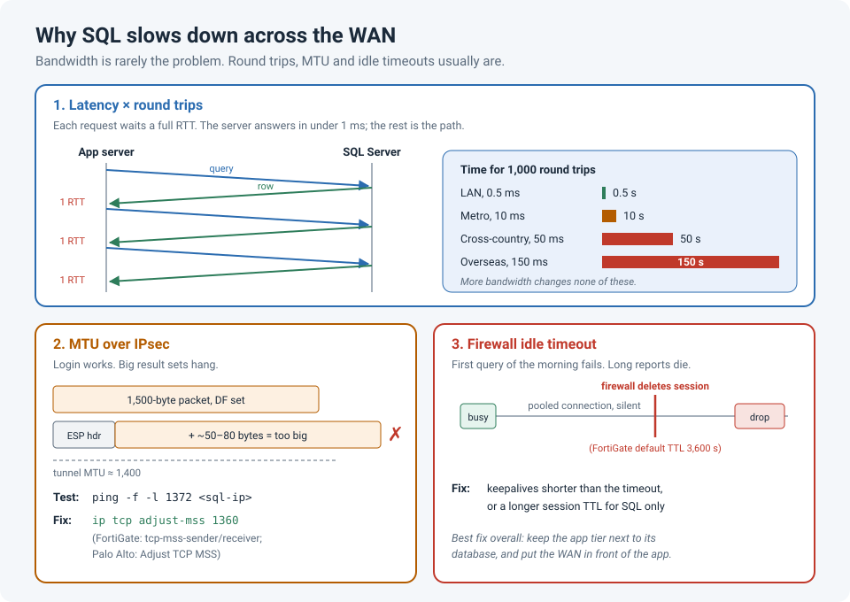

# Why SQL Hates the WAN: Latency, Round Trips, MTU and Idle Timeouts

Few tickets are as predictable as this one: "The application is slow, and it's the network."
The application works fine in the data centre. But once its database traffic crosses a WAN
link, an IPsec tunnel, or even just an extra firewall, screens that loaded in a second take
a minute. Sometimes queries hang, or connections drop overnight.

The link isn't full, and ping looks fine. So what's going on?

!!! abstract "Key takeaway"
    SQL traffic is **chatty**: an application often makes hundreds or thousands of small
    request/response round trips per screen. Each one pays the full **round-trip time**, so
    50 ms of latency × 2,000 round trips = **100 seconds**, no matter how much bandwidth you
    have. Over IPsec, also check **MTU/MSS** (small queries work, big result sets hang), and
    on firewalls, check **idle session timeouts** (long-running or pooled connections die).
    The real fix for chattiness is in the application: fewer round trips, or moving the app
    next to the database.



## Problem 1: latency × round trips

Database traffic between an application and SQL Server (the **TDS** protocol) is a
conversation: the client asks, the server answers, then the client asks again. Many
applications make it worse by fetching data **row by row**, or running one query per item in
a loop.

On a LAN, a round trip takes well under a millisecond, so nobody notices. Across a WAN,
every round trip costs the full RTT:

| Round trips per screen | LAN (0.5 ms) | Metro WAN (10 ms) | Cross-country (50 ms) | Overseas (150 ms) |
|---|---|---|---|---|
| 100 | 0.05 s | 1 s | 5 s | 15 s |
| 1,000 | 0.5 s | 10 s | 50 s | 150 s |
| 5,000 | 2.5 s | 50 s | 250 s | 750 s |

More bandwidth doesn't help at all, because the link is mostly **idle**, waiting for the next
question. Microsoft's own support engineers described exactly this case: a client
retrieving data over an 80 ms WAN, where the server answered each request in well under a
millisecond and almost all the time was spent waiting on the network, with roughly 100 round
trips adding about 8 seconds.

!!! info "Proving it's latency, not the server"
    Capture on **both** ends at the same time and compare the time gaps. If the server
    replies within a millisecond of receiving each request, but the client waits a full RTT
    between packets, the delay is the path, not SQL Server and not the client.

```
# Windows, on the app server: is the RTT what you think it is?
pathping -q 50 sqlserver01
Test-NetConnection sqlserver01 -Port 1433 -InformationLevel Detailed

# Capture on the app server and the SQL server at the same time
pktmon filter add -p 1433
pktmon start --capture --pkt-size 0
pktmon stop
pktmon etl2pcap PktMon.etl -o sql.pcapng      # open in Wireshark, compare time deltas
```

In Wireshark, **Statistics › Conversations** shows how many packets one screen generated,
and the **Time** column (set to "Seconds since previous displayed packet") shows where the
waiting is.

### The other latency limit: TCP window

Big result sets hit a second limit. TCP can only have one **window** of data in flight
before it waits for an acknowledgment. Maximum throughput is roughly window ÷ RTT:

| Window | RTT | Max throughput |
|---|---|---|
| 64 KB | 5 ms | ~105 Mbps |
| 64 KB | 50 ms | ~10.5 Mbps |
| 1 MB | 50 ms | ~168 Mbps |

Modern Windows scales the window automatically, but some firewalls, WAN optimizers and older
devices strip the **window scaling** option from the TCP handshake. Then the window is stuck
at 64 KB and a 1 Gbps link behaves like 10 Mbps. Check the SYN and SYN-ACK in a capture: both
should carry a `WS=` option.

## Problem 2: MTU and MSS over the IPsec tunnel

Symptom: you can connect and log in, and small queries work, but a **large result set or a
big insert hangs** until it times out.

IPsec adds around 50–80 bytes of headers to every packet. A full-sized 1,500-byte packet no
longer fits in the tunnel's MTU. If the packets have **DF** (don't fragment) set, and the
"fragmentation needed" ICMP message never makes it back (blocked by a firewall, which is
common), the large packets are silently dropped. Small packets get through, so everything
**looks** healthy.

SQL Server's default network packet size is **4,096 bytes**, so any real result set is sent
as full-sized TCP segments, and it's the first thing to break.

**Test the path MTU from Windows** (the payload plus 28 bytes of headers equals the packet
size):

```
ping -f -l 1472 10.20.30.40     # 1,500-byte packet: fails over most tunnels
ping -f -l 1372 10.20.30.40     # 1,400 bytes: should work
```

**Fix it by clamping the TCP MSS** on the tunnel, so endpoints agree on smaller segments and
never need to fragment:

```
! Cisco IOS / IOS-XE, on the tunnel interface
interface Tunnel10
 ip mtu 1400
 ip tcp adjust-mss 1360
```

```
# FortiGate, on the firewall policy that matches the SQL traffic
config firewall policy
    edit 25
        set tcp-mss-sender 1360
        set tcp-mss-receiver 1360
    next
end
```

On Palo Alto, enable **Adjust TCP MSS** on the interface's **Advanced** tab
(Network › Interfaces › Ethernet).

!!! warning "Don't start by changing SQL Server's packet size"
    You'll find advice to lower SQL Server's `network packet size` to fit the MTU. Fix the
    network first: clamp the MSS on the tunnel. It protects every application, not just this
    one, and it doesn't need a DBA.

## Problem 3: firewall idle timeouts

Symptom: the application works all day, but the first query each morning fails, or a
long-running report dies after exactly an hour.

Applications keep **pooled** SQL connections open for hours, and long queries can leave a
connection silent while the server works. Firewalls delete sessions that have been idle
longer than their timeout (on FortiGate, the default TCP session TTL is 3,600 seconds). The
next packet on that connection arrives at a firewall with no session for it, and it's
dropped. The client then waits for a TCP timeout before reporting an error.

Fixes, in order of preference:

1. Make sure **TCP keepalives** are shorter than the firewall's idle timeout. SQL Server sends
   keepalives on its connections (the **KeepAlive** value under SQL Server Network
   Configuration › Protocols › TCP/IP), and many drivers have their own settings.
2. Raise the idle timeout for **SQL traffic only**, not globally:

```
# FortiGate: a custom service with a longer session TTL
config firewall service custom
    edit "MSSQL-1433"
        set tcp-portrange 1433
        set session-ttl 14400
    next
end
```

On Cisco ASA, use `set connection timeout idle 4:00:00` in a policy map for that traffic
class, and on Palo Alto, set a longer TCP timeout on a custom application or service.

## Lessons learned

!!! tip "Takeaways"
    - SQL slowness across a WAN is usually **latency × round trips**, not bandwidth. Count
      the round trips in a capture before you buy a bigger circuit.
    - Prove it with **simultaneous captures** on both ends.
    - Check **window scaling** in the TCP handshake; without it, throughput is capped.
    - Over IPsec, clamp the **MSS**. Small queries working and big ones hanging is the
      classic MTU sign.
    - Firewalls drop idle sessions. Keepalives or a longer per-service timeout fix it.
    - The best fix is often architectural: keep the application tier **next to** its
      database, and put the WAN between the user and the app, where traffic is far less
      chatty.

## References

- Microsoft: [Why does it take too long to retrieve data from SQL Server over a WAN connection?](https://learn.microsoft.com/en-us/archive/blogs/nettracer/why-does-it-take-too-long-to-retrieve-data-from-sql-server-over-a-wan-connection)
- Microsoft Learn: [TCP/IP properties (Protocols tab): Keep Alive](https://learn.microsoft.com/en-us/sql/tools/configuration-manager/tcp-ip-properties-protocols-tab)
- Microsoft Learn: [Configure the network packet size server configuration option](https://learn.microsoft.com/en-us/sql/database-engine/configure-windows/configure-the-network-packet-size-server-configuration-option)
