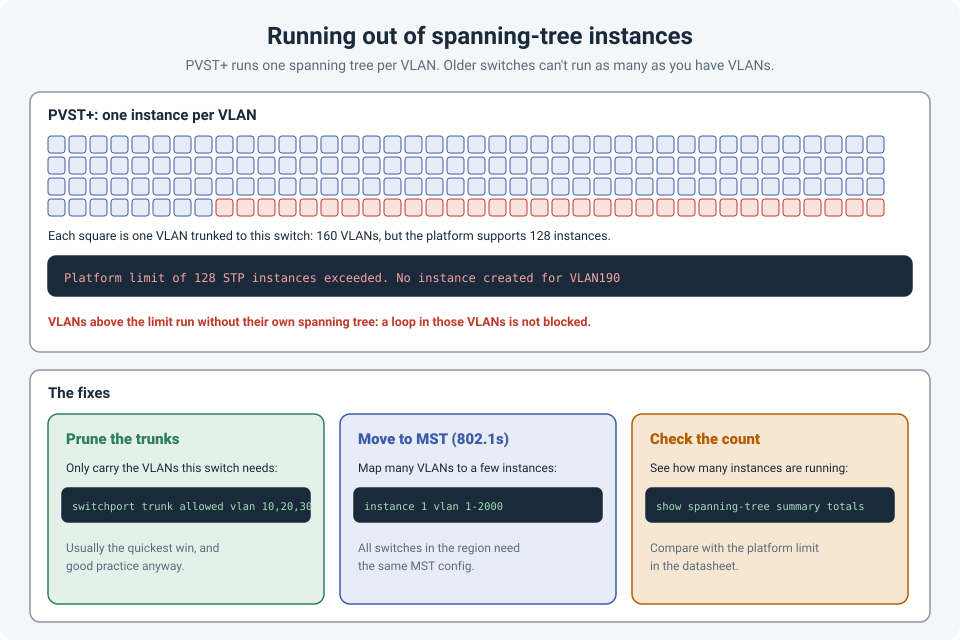

# When an Old Switch Runs Out of Spanning-Tree Instances

On an older switch, we ran into a limit that's easy to miss: it supported far fewer
**spanning-tree instances** than the number of VLANs in use. Any VLAN beyond the limit runs
**without its own spanning tree**.

It's an easy limit to forget, because nothing breaks right away.

!!! abstract "Key takeaway"
    Cisco's default, **PVST+** (or Rapid PVST+), runs **one spanning-tree instance per VLAN**.
    Many switches support only a limited number of instances (**128** is common), even when they
    support many more VLANs. Above the limit, the switch logs an error and **doesn't create an
    instance** for the extra VLANs, so a loop in those VLANs wouldn't be blocked. The fix is
    usually to **prune trunks** to only the VLANs each switch needs, or to move to **MST**, which
    maps many VLANs to a few instances.



## Why the limit exists

With **PVST+**, every VLAN gets its own spanning tree: its own root bridge, its own port states,
its own BPDUs. That's flexible (you can load-balance VLANs across uplinks by changing roots per
VLAN), but each instance costs CPU and memory.

So platforms publish a limit. On many Catalyst access switches, it's **128 instances in PVST+ or
Rapid PVST+**, and **65 instances in MST**, where the number of VLANs per MST instance is
unlimited. Always check the limit for your exact model in its configuration guide or datasheet.

## What happens when you exceed it

The switch creates instances until it reaches the limit, then logs a message like:

```
Platform limit of 128 STP instances exceeded. No instance created for VLAN190
```

The VLANs beyond the limit still pass traffic, but **without spanning tree protecting them**. If
someone creates a loop in one of those VLANs (a cable between two wall ports, a misconfigured
uplink), nothing blocks it. That's a broadcast storm waiting to happen, and it would be very hard
to diagnose.

How it usually happens: a core trunk is set to **allow all VLANs**, VLANs are added over the
years, and one day an older access switch on the end of that trunk receives more VLANs than it can
handle, most of which it doesn't even use.

## Checking it

```
show spanning-tree summary totals     ! number of active instances
show vlan brief                       ! VLANs that exist on the switch
show interfaces trunk                 ! VLANs allowed and active on each trunk
```

Compare the instance count with your platform's limit. Note that a switch creates instances for
VLANs that are **active** on it, which includes VLANs allowed on its trunks.

## The fixes

### 1. Prune the trunks (usually the quickest win)

An access switch rarely needs every VLAN in the network. Allow only the ones it uses, on **both**
ends of the trunk:

```
interface GigabitEthernet1/0/48
 switchport trunk allowed vlan 10,20,30,99
```

Remember the `add` keyword when adding a VLAN later, or you'll replace the list instead of
extending it (see [Safe Changes on Remote Switches](safe-remote-changes.md)):

```
 switchport trunk allowed vlan add 40
```

Pruning also cuts unnecessary broadcast traffic, so it's good practice anyway.

### 2. Move to MST (802.1s)

**Multiple Spanning Tree** maps many VLANs onto a small number of instances:

```
spanning-tree mode mst
spanning-tree mst configuration
 name CAMPUS
 revision 1
 instance 1 vlan 1-2000
 instance 2 vlan 2001-4094
```

Two instances, covering every VLAN. The catch: every switch in the same MST region must have an
**identical** MST configuration (name, revision and VLAN mapping), so it's a design change, best
planned and rolled out carefully, not a quick fix during an incident.

## References

- [Cisco Community: spanning-tree instance maximum](https://community.cisco.com/t5/switching/spanning-tree-instance-maximum/m-p/2241779/highlight/true)
- [Hitting the Route Limit on an Old Switch](switch-max-routes.md)
