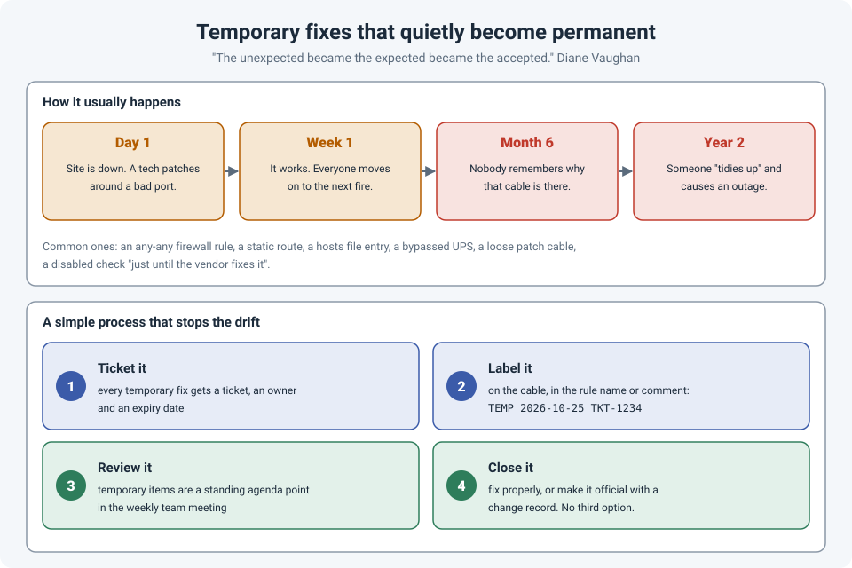

# Temporary Fixes That Quietly Become Permanent

A site is down. A technician on site needs it working **now**. So a cable gets patched around a
bad switch port, an "allow any" rule goes into the firewall, a static route is added "just for
tonight".

Temporary fixes are sometimes unavoidable, and that's fine. The problem is what happens next:
usually, **nothing**. The site works, everyone moves on to the next fire, and the temporary fix
quietly becomes part of the network. Months later, nobody remembers why it's there, and it causes
the next outage.

!!! abstract "Key takeaway"
    Avoid temporary fixes when you can, but when you can't, treat each one as **unfinished
    work**, not a solution. Give it a **ticket, an owner and an expiry date**, **label** it where
    it lives (cable, rule name, config comment), **review** open temporary items in the weekly team
    meeting, and **close** every one, either by fixing it properly or by making it official
    through a change record. A temporary fix without an expiry date is a permanent fix nobody
    designed.



## Why temporary becomes permanent

- **It works.** Once the pressure is gone, there's no outage pushing anyone to finish the job.
- **Nobody owns it.** The technician who made it has gone home, the engineer who approved it is
  on the next incident, and no ticket says it needs follow-up.
- **The knowledge disappears.** The reason it was done lives in someone's memory, or a chat
  thread that scrolls away.
- **Removing it feels risky.** "Don't touch it, it works" wins, and every month that passes makes
  it scarier to change.

## The normalization of deviance

Sociologist Diane Vaughan studied how NASA came to launch the Challenger shuttle despite known
problems with its O-rings. Her explanation wasn't one bad decision but a slow drift. Erosion of the
O-rings was at first unexpected, then seen again, then rationalized as acceptable. In Michael
Roberto's summary of her work, "the unexpected became the expected became the accepted."

She called it the **normalization of deviance**: small departures from the standard, each one
reasonable at the time, gradually become the new normal until nobody sees them as departures at
all.

Networks drift the same way. The "temporary" any-any rule becomes "that's just how the firewall
is". The patched-around port becomes "that switch has always been like that". Each step is small;
the accumulated risk is not.

## Common temporary fixes that stick

| Temporary fix | The risk later |
|---|---|
| An **any-any** or wide-open firewall rule | A permanent security hole that audits may not catch |
| A **static route** added during an outage | Overrides dynamic routing and breaks the next design change |
| A **cable patched around** a faulty port | Undocumented physical paths that confuse the next person |
| A **hosts file** entry on a server | Breaks when the real IP changes (see [Ping and nslookup Disagree?](hosts-file-troubleshooting.md)) |
| A **disabled check** "until the vendor fixes it" | The fix arrives, but the check stays disabled |
| A device **bypassing the UPS** or redundancy | The next power event takes it down |

## A simple process that stops the drift

### 1. Ticket it

Every temporary fix gets a ticket **before the end of the day**, with:

- what was done and why,
- who owns the follow-up,
- an **expiry date**: the date by which it must be fixed properly or made official.

### 2. Label it where it lives

The person who finds it later won't be reading your ticket system first. Put the information where
they'll see it:

```
! On a firewall rule or interface:
description TEMP 2026-10-25 TKT-1234 bypass for site outage, remove by 2026-11-08
```

A label on the patch cable, a comment in the config, a note in the rule name. Anywhere it lives,
it should say **TEMP**, the date and the ticket.

### 3. Review it

Make open temporary items a **standing agenda point** in the weekly team meeting. Five minutes:
what's still open, what's overdue, who's doing what. Things that are looked at every week don't
quietly disappear.

### 4. Close it

There are only two acceptable endings:

- **Fix it properly**, and remove the temporary measure.
- **Make it official**: if the "temporary" solution turns out to be the right one, run it through
  a normal change, document it, and remove the TEMP label.

What isn't acceptable is the third option: leaving it, unlabelled, forever.

## Avoiding them in the first place

- **Plan the rollback and the follow-up into every change**, so the change window ends with the
  network in a known, documented state (see [Safe Changes on Remote Switches](safe-remote-changes.md)).
- **Keep spares on site** (optics, cables, a spare switch), so "temporary" isn't the only option.
- **Give technicians a quick way to reach the network team**, so a temporary workaround is agreed,
  not improvised (see [Ask Early](../layer8-softskills/ask-for-help-early.md)).

## References

- Vaughan, D. (1996). *The Challenger Launch Decision: Risky Technology, Culture, and Deviance at NASA*. University of Chicago Press.
- Roberto, M. A. *The Art of Critical Decision Making*. The Great Courses (course guidebook), Lecture 18: "Normalizing Deviance".
- [Google SRE Book: Eliminating Toil](https://sre.google/sre-book/eliminating-toil/)
