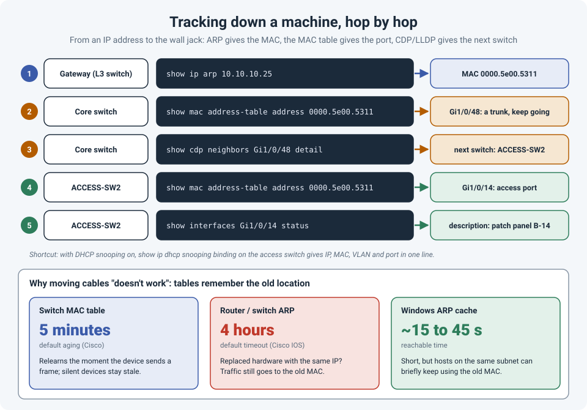

# Tracking Down a Machine, and Why Moving Cables Seems Not to Work

"Which port is this device on?" comes up all the time: a compromised laptop to isolate, a
printer nobody can find, a camera that needs a new VLAN. The answer is always the same
hop-by-hop walk: IP to MAC, MAC to port, port to the next switch, until you reach the access
port.

The same tables that make this possible also cause one of the most confusing situations in
troubleshooting: you move a cable, nothing changes, so you move another one, and another.
Often the first move was right; the tables just hadn't caught up.

!!! abstract "Key takeaway"
    To find a device: get its **MAC** from the **ARP** table on its gateway, find the **port**
    in the **MAC address table**, and if that port is an uplink, use **CDP/LLDP** to find the
    next switch and repeat. You've found it when the MAC sits on an **access port**. And when
    you move cables or swap hardware, remember the tables are **caches**: the MAC table ages out
    after **5 minutes** and Cisco's ARP table after **4 hours** by default. Clear or check them
    before deciding a change didn't work.



## Step by step: from IP address to wall jack

Example: the device is **10.10.10.25** in VLAN 10.

**1. Get the MAC address from the gateway's ARP table**

```
GW# show ip arp 10.10.10.25
Protocol  Address        Age (min)  Hardware Addr   Type   Interface
Internet  10.10.10.25          3    0000.5e00.5311  ARPA   Vlan10
```

If the gateway is a firewall: `get system arp` on a FortiGate, `show arp all` on a Palo Alto.
If the ARP entry is missing, ping the IP from the gateway first to make the device answer.

**2. Find the MAC in the MAC address table**

```
CORE# show mac address-table address 0000.5e00.5311
Vlan    Mac Address       Type        Ports
----    -----------       --------    -----
  10    0000.5e00.5311    DYNAMIC     Gi1/0/48
```

**3. Is that port an uplink? Find the next switch**

```
CORE# show cdp neighbors Gi1/0/48 detail
! or
CORE# show lldp neighbors Gi1/0/48 detail
```

This gives the neighbor's name and management IP. If the port is part of a port-channel,
`show etherchannel summary` shows its member ports; check CDP on one of them. Connect to the
next switch and repeat step 2.

**4. Stop at the access port**

You've arrived when the MAC is on a port that **isn't a trunk** and has **no switch** behind
it:

```
ACCESS-SW2# show interfaces Gi1/0/14 status
Port      Name               Status       Vlan  Duplex  Speed Type
Gi1/0/14  Patch panel B-14   connected    10    a-full  a-1000 10/100/1000BaseTX
```

From there, the port description, the patch panel labels and the cabling records take you to
the wall jack. This is where good labeling pays off.

!!! tip "Shortcuts"
    - With **DHCP snooping** enabled, `show ip dhcp snooping binding` on the access switch gives
      the IP, MAC, VLAN and port in one line.
    - `show power inline` lists which ports are powering a device and, on many switches, what
      kind of device it is: handy for finding phones, APs and cameras.
    - The first half of a MAC address (the **OUI**) identifies the manufacturer. Look it up in
      the IEEE registry to tell a printer from a laptop.

!!! warning "Many MACs on an access port?"
    If an "access" port shows lots of MAC addresses, there's probably an **unmanaged switch**
    (or a virtualization host) behind it. Your device is somewhere behind that, and the trail
    continues on foot.

## The cache trap: why moving cables "doesn't work"

Switches and routers don't look anything up live; they use **tables** they've learned, and
those tables keep old entries for a while.

| Table | Default lifetime | What goes wrong |
|---|---|---|
| **MAC address table** (switch) | **5 minutes** (300 s) on Cisco | Usually updates as soon as the device sends a frame from its new port. But a **silent** device (one that only listens) can stay "on" the old port until the entry ages out. |
| **ARP table** (router, L3 switch, firewall) | **4 hours** on Cisco IOS | If you **replace a device** but keep its IP, the gateway keeps sending traffic to the **old MAC** until the entry expires or is cleared. |
| **ARP cache** (Windows hosts) | Tens of seconds | Short, but other hosts on the same subnet can still use the old MAC briefly after a swap. |

That's the trap. During an outage, someone moves a cable or swaps a device. It doesn't work
**immediately**, so they move something else. Then something else. By the time the tables
catch up, nobody knows which change fixed it, or which ones broke something new.

What helps:

- **Change one thing, then check the tables** before deciding it didn't work:

    ```
    show mac address-table address 0000.5e00.5311
    show ip arp 10.10.10.25
    ```

- **Clear the stale entries** instead of waiting:

    ```
    clear mac address-table dynamic address 0000.5e00.5311
    clear ip arp 10.10.10.25
    ```

    On a FortiGate: `execute clear system arp table`. On a Palo Alto: `clear arp all`. On
    Windows (as administrator): `arp -d *`.

- **Make the device talk.** Many devices send a **gratuitous ARP** when their link comes up,
  which updates neighbors immediately, but not all do. A ping from the device (or to it from the
  gateway) refreshes the entries.

- **Check the timers** if you're unsure:

    ```
    show mac address-table aging-time
    show interfaces Vlan10 | include ARP Timeout
    ```

This is really part of a bigger troubleshooting habit: **one change at a time, verify, then
move on.** It's slower for the first five minutes and much faster for the next hour.

## References

- [Cisco: Unicast Flooding in Switched Campus Networks (ARP and MAC aging timers)](https://www.cisco.com/c/en/us/support/docs/switches/catalyst-6000-series-switches/23563-143.html)
- [IEEE Registration Authority: MAC address (OUI) lookup](https://regauth.standards.ieee.org/standards-ra-web/pub/view.html#registries)
- [RFC 826: An Ethernet Address Resolution Protocol](https://www.rfc-editor.org/rfc/rfc826)
