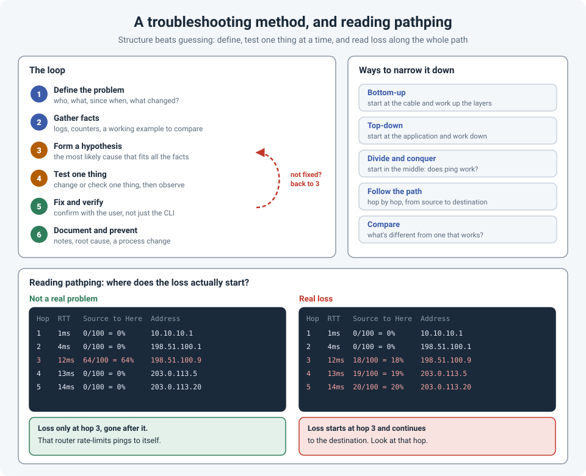

# How I Troubleshoot: A Method, and Reading pathping and WinMTR Properly

Under pressure, troubleshooting easily turns into guessing: reboot this, change that, try
something else. Sometimes it works. Often it wastes an hour, changes three things at once, and
leaves nobody sure what actually fixed it.

A method doesn't make you slower. It makes you faster, because every step either finds the
problem or rules something out.

!!! abstract "Key takeaway"
    **Define** the problem precisely (who, what, since when, what changed), **gather facts**,
    form **one hypothesis**, **test one thing**, then **verify** with the user and **document**
    it. Narrow things down with a deliberate approach: bottom-up, top-down, divide and conquer,
    follow the path, or compare with something that works. For path problems, use **pathping**
    or **WinMTR**, and remember: loss at one hop that **disappears at later hops** is usually a
    router ignoring pings, not real loss. Real loss **continues all the way to the destination**.



## The loop

### 1. Define the problem

"The internet is slow" isn't a problem definition. Ask:

- **Who** is affected? One user, one site, everyone?
- **What** exactly fails? One application, all web traffic, only voice calls?
- **Since when?** Did it start suddenly, or has it always been like this?
- **What changed?** A change, an update, a new device, a moved cable. This one question solves
  a surprising number of problems.

### 2. Gather facts

Logs, interface counters, monitoring graphs, error messages, and if possible a **working
example** to compare with: a user at the same site who's fine, or the same application from
another office.

### 3. Form a hypothesis

The most likely cause that fits **all** the facts. If it doesn't explain everything you've seen,
it's probably not the answer.

### 4. Test one thing

Change or check **one** thing, then observe. If you change three things at once and it works,
you don't know which one fixed it, or whether the other two broke something else.

And remember that caches may hide the result for a while (see
[Tracking Down a Machine](tracking-a-machine.md)).

### 5. Fix and verify

Verify with the **user**, not just the CLI. "BGP is up" isn't the same as "the application works".

### 6. Document and prevent

What was the cause, what fixed it, and what changes so it doesn't happen again? A fix that's only
in your head will be needed again by someone who doesn't have it.

If the test in step 4 didn't fix it, go back to step 3. That's not failure: you've ruled
something out (see [Calm in the Outage Call](../layer8-softskills/calm-incident-updates.md)).

## Ways to narrow it down

| Approach | How it works | Good for |
|---|---|---|
| **Bottom-up** | Start at layer 1 (cable, light levels, link status) and work up | Physical or new installations |
| **Top-down** | Start at the application and work down | Problems that affect one application |
| **Divide and conquer** | Start in the middle: does a ping work? Does DNS resolve? | Most problems: one test cuts the possibilities in half |
| **Follow the path** | Check each hop from the source to the destination | Routing, firewall and WAN problems |
| **Compare** | What's different between this and one that works? | "It works for them but not for me" |

## pathping and WinMTR: where does the loss start?

A single `ping` tells you there's loss. A `traceroute` shows the path. Neither tells you **where**
the loss starts. That's what **pathping** (built into Windows) and **WinMTR** (a free Windows
tool; `mtr` on Linux and macOS) are for: they ping **every hop** on the path, many times, and
show the loss and latency at each one.

### pathping

```
pathping -n 203.0.113.20
```

- `-n` skips DNS lookups, which makes it much faster.
- By default it sends **100** pings to every hop, **250 ms** apart. On a path with 10 hops,
  that takes a few minutes, so be patient.
- `-q 50` sends fewer pings for a quicker result; `-h 20` limits the number of hops.

The output has two loss columns:

- **Source to Here**: loss from you to that hop.
- **This Node/Link**: loss attributed to that hop, or to the link leading into it.

### WinMTR

WinMTR does the same thing continuously, in a window: **Sent, Recv, Loss %, Best, Avg, Worst,
Last** for every hop. Let it run for a few minutes while the problem is happening, then use
**Export** to save the results. It's exactly what an ISP asks for in a ticket.

On Linux or macOS:

```
mtr -rwc 100 203.0.113.20     # report mode, wide output, 100 cycles
```

### Reading the results without being fooled

The most common mistake is to blame the first hop that shows loss.

Many routers **rate-limit or deprioritize ICMP** sent **to themselves**, to protect their CPU,
while forwarding your actual traffic perfectly. So:

- **Loss at one hop that disappears at the next hops is not real.** If hop 3 shows 64% loss but
  hops 4 and 5, and the destination, show 0%, hop 3 is simply ignoring some pings. Traffic is
  passing through it fine. Microsoft's own documentation makes this point.
- **Real loss continues to the destination.** If loss starts at hop 3 and every hop after it,
  including the destination, shows similar loss, the problem is at hop 3 or the link into it.
- **The same goes for latency.** A latency spike at one hop that doesn't carry on to later hops
  is the router answering slowly, not a slow path. A jump that **stays** for all later hops is
  real, for example a long-distance link.
- **Check both directions.** The return path can be different from the outbound path. Loss on
  the way back won't show clearly from one side. Running the test from both ends helps.

!!! tip "Test with the traffic that's failing"
    pathping and WinMTR use ICMP by default. If only one application is failing, ICMP can look
    perfect while that application's traffic is blocked or rate-limited. Use a test that matches
    the problem: `Test-NetConnection 203.0.113.20 -Port 443` in PowerShell, for example, checks
    whether a TCP port actually answers.

## References

- [Microsoft: pathping command reference](https://learn.microsoft.com/en-us/windows-server/administration/windows-commands/pathping)
- [Microsoft: Test-NetConnection](https://learn.microsoft.com/en-us/powershell/module/nettcpip/test-netconnection)
- [Life of a Packet: DNS, Step by Step](dns-life-of-packet.md)
