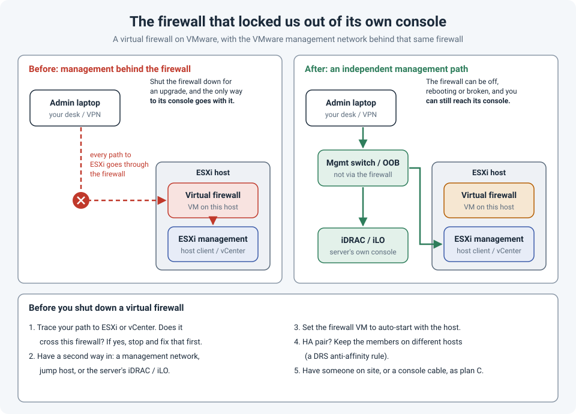

# The Virtual Firewall That Locked Us Out of Its Own Console

Virtual firewalls are great: no hardware to ship, quick to deploy, easy to snapshot. But they
create a trap that physical firewalls don't.

We had a firewall running as a VM on a VMware host. The plan was routine: shut it down for an
upgrade, bring it back, check traffic. The moment it went down, we lost access to the VMware
host too, because **the VMware management network sat behind that same firewall**. No access to
the host meant no VM console, and no VM console meant no way to see or fix the firewall.

The firewall was the door, and we'd locked the key inside the room.

!!! abstract "Key takeaway"
    If the management of the platform a firewall runs on (ESXi, vCenter, the server's iDRAC or
    iLO) is only reachable **through** that firewall, any shutdown, failed upgrade or bad rule
    locks you out of the very console you need to fix it. Before you touch a virtual firewall,
    **trace your path to its console**. Make sure there's a **management path that doesn't
    depend on it**, set the VM to **auto-start**, keep HA members on **different hosts**, and
    have a physical fallback.



## How the trap gets built

Nobody designs this on purpose. It usually grows like this:

1. A virtual firewall is deployed on an ESXi host, often at a small site where there's only one
   host.
2. Over time, the firewall becomes the gateway for **everything** at that site, including the
   management VLAN where the ESXi host, vCenter and the server's iDRAC/iLO live.
3. It works perfectly, every day, until the firewall isn't there.

Then any of these locks you out:

- Shutting the firewall down for an **upgrade** or maintenance.
- An upgrade that **fails** and leaves the VM stuck at boot.
- A **policy change** that blocks your own management traffic.
- The **host reboots** and the firewall VM doesn't start again on its own.

And the dependencies are often deeper than the network path:

- **vCenter** may itself be a VM whose traffic goes through the firewall.
- Logging in to vCenter with **domain accounts** needs a domain controller, possibly also behind
  the firewall.
- Your **VPN** to reach the site may terminate on that firewall.

At that point, the only ways back in are physical: someone on site, a local console on the
server, or a network path that doesn't depend on the firewall. If none of those were prepared,
you wait.

## Breaking the circular dependency

### 1. Give management its own path

The ESXi management interface, vCenter and the server's out-of-band controller (iDRAC, iLO)
should be reachable **without** going through the virtual firewall:

- Route the management VLAN on a **core switch** or a separate small router, not on the virtual
  firewall.
- Or use a **dedicated out-of-band network**: a management switch with its own internet link or
  LTE modem, and a separate VPN or console server.
- Make sure at least one **jump host** or admin workstation can reach that network directly.

### 2. Use the server's own console

The physical server's **iDRAC** (Dell) or **iLO** (HPE) gives you a remote console of the host
itself, even when ESXi's own management is unreachable. From there you can reach the ESXi
console (DCUI) and, if the ESXi Shell is enabled, start the firewall VM by hand:

```
vim-cmd vmsvc/getallvms              # find the firewall VM's ID
vim-cmd vmsvc/power.getstate 12      # check its state
vim-cmd vmsvc/power.on 12            # power it on
```

That only works if iDRAC/iLO is on a network you can still reach, which brings you back to
point 1.

### 3. Make the firewall start on its own

If the host reboots (after a power cut, for example), the firewall VM must come back without
anyone touching it. In the ESXi Host Client, go to **Manage > System > Autostart**, enable
autostart, and put the firewall VM **first** in the order. From the ESXi shell:

```
vim-cmd hostsvc/autostartmanager/enable_autostart true
vim-cmd hostsvc/autostartmanager/update_autostartentry 12 "PowerOn" 120 1 "systemDefault" "systemDefault" "systemDefault"
```

Note that when a host is part of a vSphere HA cluster, HA handles VM restarts instead; check how
your environment is set up.

### 4. Separate HA members

If the virtual firewall runs as an **HA pair**, the two members must be on **different hosts**,
or a single host failure takes out both. In a DRS cluster, create a **VM-VM anti-affinity rule**
("separate virtual machines") for the pair. Upgrading one member at a time, while the other
carries traffic, also keeps your management path alive during the change.

### 5. Keep local credentials ready

Store the **local** ESXi root password and the firewall's local admin account in your password
vault. When domain controllers or the authentication server are unreachable, domain logins won't
work.

## The pre-change checklist

Before shutting down, upgrading or making a risky change to a virtual firewall:

- [ ] **Trace the path** from your laptop to the ESXi host, vCenter and iDRAC/iLO. Does any of it
      cross this firewall? If yes, fix that first, or plan for it.
- [ ] **Test the second way in** before the change, not during the outage.
- [ ] **Autostart** is enabled for the firewall VM (or vSphere HA restart is configured).
- [ ] **HA members** are on different hosts; upgrade one at a time.
- [ ] **Snapshot or backup** of the firewall configuration, as the vendor recommends.
- [ ] **Local credentials** for ESXi and the firewall are available.
- [ ] **Someone on site**, or a console cable and a laptop, as a last resort for small sites.

This is the same idea as arming `reload in` before working on a remote switch (see
[Safe Changes on Remote Switches](safe-remote-changes.md)): before you touch the thing that
connects you, make sure you can get back in if it breaks.

## References

- [Broadcom: Automating the start and stop of virtual machines on vCenter/ESXi](https://knowledge.broadcom.com/external/article/390139)
- [Broadcom: Understanding the DRS rule to separate virtual machines](https://knowledge.broadcom.com/external/article/394815)
- [Cisco: Out-of-band best practices](https://www.cisco.com/c/en/us/solutions/collateral/service-provider/out-of-band-best-practices-wp.html)
