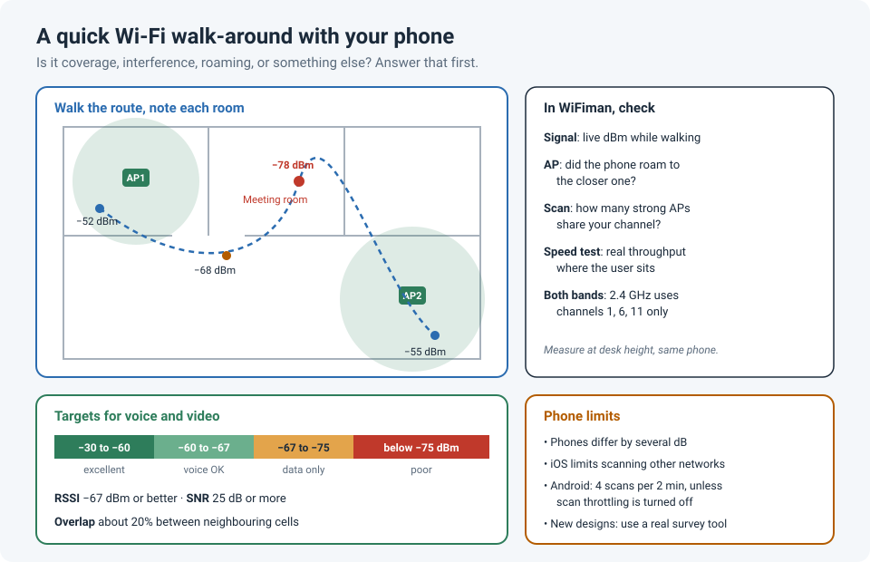

# A Wi-Fi Survey from Your Pocket: Quick Checks with WiFiman

"The Wi-Fi is bad in the meeting room." Most wireless tickets start like that, and most of the
time you don't have a professional survey kit in your bag. You do have a phone.

I've used Ubiquiti's free **WiFiman** app for quick walk-around surveys: check the signal
where the user sits, see which access point they're connected to, look at what else is on
the same channel, and run a speed test. It doesn't replace a real survey tool, but it answers
the first question, "is this a coverage problem or something else?", in a few minutes.

!!! abstract "Key takeaway"
    Walk the area with WiFiman and look at **signal strength**, **which AP** you're on, the
    **channels** around you, and a **speed test**. Aim for **−67 dBm or better** with an
    **SNR of 25 dB** where people use voice or video, and about **20% overlap** between cells
    for roaming. Remember the limits: a phone isn't a calibrated survey adapter, **iOS**
    restricts scanning other networks, and **Android** throttles scans unless you turn that
    off in Developer options.

## What WiFiman gives you

WiFiman works on any Wi-Fi network, not just Ubiquiti's, though some features need UniFi
gear.

| Feature | What it's good for | Notes |
|---|---|---|
| **Signal** graph | Live signal strength of the network you're connected to, while you walk | Works anywhere |
| **Scan** (nearby networks) | Which APs and SSIDs you can hear, on which channels, how strong | Best on Android; iOS limits what apps can see |
| **Speed test** | Real throughput from where you're standing | Also shows the Wi-Fi standard, signal and channel width |
| **Floor Plan** mapper | A colour-coded coverage map as you walk the room | Needs a phone with LiDAR, per Ubiquiti |
| **Device discovery** | Devices on the network you're connected to | |
| **Bluetooth** scan | Nearby Bluetooth devices and their signal | Handy for finding a noisy device |
| UniFi extras | Roaming between APs, latency, Teleport VPN | Need a UniFi gateway |

## A quick walk-around survey

1. **Start where the user works**, at the height they work (on the desk, not held up in the
   air). Note the signal, which AP you're on, and run a speed test.
2. **Walk the route between rooms** with the Signal graph open. Watch for the signal sliding
   down without the phone roaming to a closer AP: that's a "sticky client" or an AP spacing
   problem.
3. **Run a Scan.** Count how many APs you hear on the **same channel** with a strong signal.
   Several strong ones on the same channel means they're sharing airtime (co-channel
   interference), even if each one looks fine on its own.
4. **Check both bands.** 2.4 GHz travels further but only has three non-overlapping channels
   (1, 6, 11). 5 GHz is where most of the capacity is.
5. **Write it down**: room, signal, AP, channel, speed. Five rooms of notes is often enough to
   see the pattern.

## The numbers to look for

These targets come from Cisco's Wi-Fi phone design guidance, which is a good bar for anything
real-time like voice or video calls:

| Measurement | Target | What it means if you miss it |
|---|---|---|
| Signal (RSSI) | **−67 dBm or stronger** | Lower data rates, retries, choppy calls |
| Signal-to-noise ratio (SNR) | **25 dB or more** | The signal isn't clearly above the background noise |
| Cell overlap | **About 20%** with neighbouring APs | Roaming drops calls or stalls while the client searches |
| 2.4 GHz channels | **1, 6, 11 only** | Overlapping channels interfere with each other |

A rough guide to signal strength:

| RSSI | In practice |
|---|---|
| −30 to −60 dBm | Excellent |
| −60 to −67 dBm | Good, fine for voice and video |
| −67 to −75 dBm | OK for browsing and email, not for calls |
| Below −75 dBm | Poor: expect drops and slow speeds |

!!! info "Remember: dBm is negative"
    −60 dBm is **stronger** than −70 dBm. Every 3 dB is roughly double (or half) the power,
    and every 10 dB is ten times.

## Where a phone app stops being enough

- **Phones aren't survey adapters.** Different phones report different signal levels in the
  same spot, sometimes by several dB. Compare readings from the **same phone**, and treat the
  numbers as a guide, not a measurement.
- **iOS restricts Wi-Fi scanning.** Apple doesn't let third-party apps freely scan nearby
  networks, so the iPhone version shows less than Android. Use an Android phone for channel
  and neighbour checks.
- **Android throttles scans.** Since Android 9, an app in the foreground can only scan **four
  times every two minutes**. On Android 10 and later you can turn this off in
  **Settings › Developer options › Networking › Wi-Fi scan throttling** (it applies to all
  apps, so turn it back on afterwards).
- **It's a passive check.** It shows what the phone hears. It doesn't predict coverage for a
  new design, measure non-Wi-Fi interference like microwaves, or validate a large site.
  For those, use a proper tool such as Ekahau, or your vendor's survey service.

## Lessons learned

!!! tip "Takeaways"
    - A phone app answers the first question quickly: is it coverage, interference, roaming,
      or something else entirely?
    - Measure where and how people actually work, and write the results down per room.
    - Aim for **−67 dBm**, **25 dB SNR**, and about **20% overlap** for anything real-time.
    - Use the **same phone** for comparisons, an **Android** phone for scans, and turn off
      **scan throttling** while you survey.
    - For new designs or critical sites, use a real survey tool.

## References

- Ubiquiti Help Center: [WiFiman](https://help.ui.com/hc/en-us/articles/205204150)
- GIGAZINE: [WiFiman review: Wi-Fi, mobile and Bluetooth analysis](https://www.gigazine.net/gsc_news/en/20251004-wifiman-wi-fi-mobile-bluetooth-analyze)
- Cisco Wireless IP Phone 8821 deployment guide: [site survey requirements](https://manualslib.com/manual/1225636/Cisco-8821.html?page=24) (−67 dBm, 25 dB SNR, 20% overlap)
- WiFiAnalyzer wiki: [Android Wi-Fi scanning throttling](https://github.com/VREMSoftwareDevelopment/WiFiAnalyzer/wiki/Android-Wi%E2%80%90Fi-scanning-throttling)
