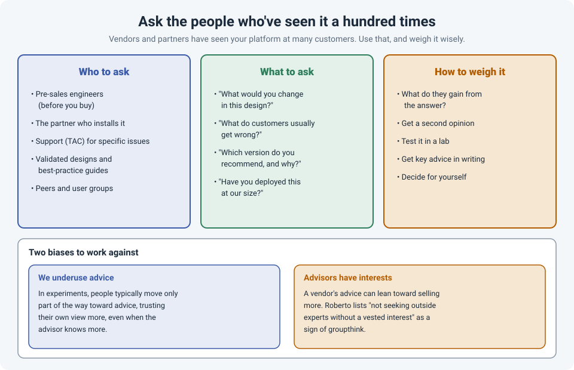

# Ask the People Who've Seen It a Hundred Times: Vendors, Partners and Design Reviews

When you deploy a new firewall, a wireless controller or a data center switch, it's usually your
first time with that exact platform in that exact design. For the vendor's engineers and the
partner who installs it, it might be the hundredth.

They know the bugs that aren't in the release notes yet, the firmware version everyone settles
on, the design choice that works in the lab and causes problems at scale, and the mistake most
customers make in the first month. That knowledge is often available for the price of asking.

!!! abstract "Key takeaway"
    Ask vendors and partners for their **recommendations, experience and a review of your
    design**, before you build it, not after it breaks. Ask open questions like "**what would you
    change?**" and "**what do customers usually get wrong?**", send the design ahead of time,
    and get key advice in writing. Then weigh it: advisors can have a stake in the answer, so
    check **what they gain**, get a **second opinion** on big decisions, and **test** in a lab.
    The decision is still yours.

## Who to ask

| Who | Best for |
|---|---|
| **Pre-sales / systems engineers** | Design questions before you buy: sizing, licensing, which model fits |
| **The partner or integrator** | Real deployment experience across their customers; practical "gotchas" |
| **Vendor support (TAC)** | Specific technical problems, bugs, recommended versions |
| **Validated designs and best-practice guides** | The vendor's tested reference designs (Cisco Validated Designs, vendor deployment guides) |
| **Peers and user groups** | Unfiltered experience from people running the same platform, without a sales interest |

## What to ask

Closed questions get yes-or-no answers. Open questions get experience:

- "**What would you change** in this design?"
- "**What do customers usually get wrong** with this platform?"
- "**Which software version** do you recommend, and why that one?"
- "**Have you deployed this at a similar size**? What surprised you?"
- "**What would you test** before going live?"
- "**What's the upgrade path** in three years?"

## How to get good answers

- **Send the design in advance.** A diagram, the requirements and the constraints. A reviewer who
  has seen it for ten minutes before the call gives far better feedback.
- **Ask early.** A design review before ordering hardware costs nothing to act on. The same advice
  after go-live costs a change window.
- **Be honest about your concerns.** "We're not sure about running HA across two buildings" gets a
  more useful answer than presenting a design as finished.
- **Get key recommendations in writing.** An email summary after the call ("you recommended
  version X and separate management VRFs") protects both sides and helps the next engineer.

Asking isn't a sign that you don't know what you're doing. Research by Brooks, Gino and
Schweitzer (2015) found that people who ask for advice are seen as **more** competent, not less,
as long as the question is sensible (see [Ask Early](ask-for-help-early.md)).

## How to weigh the advice

Two biases pull in opposite directions.

**We underuse advice.** In experiments on advice-taking, people typically move only **part of
the way** toward an advisor's view and stick closer to their own, even when the advisor knows
more. In networking, that's the engineer who asks TAC which version to run, then installs the
newest one anyway.

**Advisors have interests.** A vendor or partner may benefit from a bigger model, an extra
license or a professional services engagement. That doesn't make the advice wrong, but it's
worth noticing. In *The Art of Critical Decision Making*, Michael Roberto lists a warning sign of
groupthink: a group that "does not seek outside experts who do not have a vested interest in the
matter." Vendor advice is valuable, but it isn't fully independent.

So:

- **Ask what they gain** from the recommendation. If it costs more, ask what you'd lose with the
  cheaper option.
- **Get a second opinion** on big decisions: another partner, a peer at another company, a user
  group. Combining independent opinions is consistently more accurate than relying on one.
- **Test in a lab** what you can.
- **Decide for yourself.** You know your network, your team and your constraints. Advice is an
  input to the decision, not the decision. (See [WRAP](wrap-decisions.md) for a way to make it.)

## How strong is the evidence?

| Claim | Source | Evidence strength |
|---|---|---|
| Asking for advice increases perceived competence | Brooks, Gino & Schweitzer, 2015 | **Moderate.** Several experiments |
| People underweight advice and favor their own judgment | Research on advice-taking (reviewed by Bonaccio & Dalal, 2006) | **Moderate to strong.** Consistent across many studies |
| Combining independent opinions improves accuracy | Yaniv, 2004, and research on the "wisdom of crowds" | **Moderate to strong** |
| Groups that don't seek independent outside views make worse decisions | Janis's groupthink research, summarized by Roberto | **Moderate.** Based largely on case studies |

## References

- Roberto, M. A. *The Art of Critical Decision Making*. The Great Courses (course guidebook), Lecture 9: "Groupthink: Thinking or Conforming?"
- Brooks, A. W., Gino, F., & Schweitzer, M. E. (2015). [Smart people ask for (my) advice: Seeking advice boosts perceptions of competence](https://doi.org/10.1287/mnsc.2014.2054). *Management Science*, 61(6), 1421–1435.
- Bonaccio, S., & Dalal, R. S. (2006). Advice taking and decision-making: An integrative literature review, and implications for the organizational sciences. *Organizational Behavior and Human Decision Processes*, 101(2), 127–151.
- Yaniv, I. (2004). The benefit of additional opinions. *Current Directions in Psychological Science*, 13(2), 75–78.
- Janis, I. L. (1982). *Groupthink: Psychological Studies of Policy Decisions and Fiascoes*. Houghton Mifflin.
