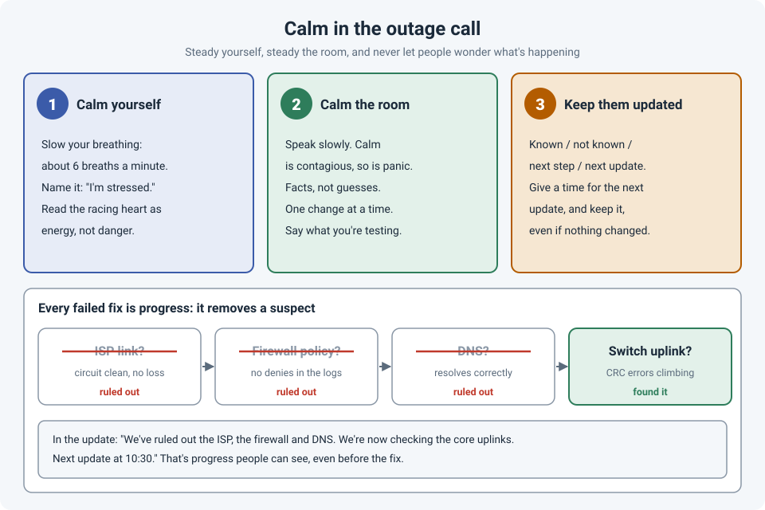

# Calm in the Outage Call: Staying Steady and Keeping People Updated

Something important is down. The call has twenty people on it, a manager asking for an ETA
every five minutes, and you're the one with the CLI open. Your heart is racing, the first fix
didn't work, and the second one didn't either.

How you handle the next hour matters as much as your technical skill. A calm engineer makes
better decisions and keeps the room working **with** them instead of against them. And
calm isn't a personality trait; it's something you can practise.

!!! abstract "Key takeaway"
    **Calm yourself** first: slow your breathing, name the stress, and treat the adrenaline as
    energy to use. **Calm the room**: speak slowly, share facts rather than guesses, and make one
    change at a time. **Keep people updated** on a schedule, even when nothing has changed,
    because not knowing is more stressful than bad news. And remember that **every fix that
    doesn't work rules something out**: that's progress, and you can say so.

## 1. Calm yourself

You can't steady a room while your own head is spinning. Three tools that take seconds:

- **Slow your breathing.** Breathing slowly (around six breaths a minute: in for about four
  seconds, out for about six) is linked to lower physiological arousal and a calmer state. A
  minute of it before you unmute helps.
- **Name it.** Saying, even silently, "I'm stressed right now" sounds too simple to work, but
  putting feelings into words (**affect labeling**) has been shown to dampen the brain's
  emotional response.
- **Reframe the adrenaline as energy.** "Calm down" rarely works when your heart is pounding.
  In experiments, people who told themselves "I'm excited" before a stressful task performed
  better than those who tried to calm down. A racing heart is your body getting ready to work.

## 2. Calm the room

Emotions spread through groups. In a classic experiment (Barsade, 2002), one person's mood,
pleasant or tense, spread to the rest of the group and changed how well the group cooperated.
On an outage call, **you are that person**, in either direction.

- **Speak slowly and plainly.** A calm voice lowers the temperature of the call more than any
  words do.
- **Facts, not guesses.** "I think it's the firewall" sends ten people chasing the firewall.
  "Traffic stops at the firewall; I'm checking its logs now" gives them something real.
- **One change at a time, out loud.** "I'm going to bounce this port. Watch the monitoring for
  the next two minutes." It keeps everyone aligned and stops two people changing things at once.
- **Ask for what you need.** A second pair of eyes, someone to handle the updates, the vendor
  on the line. That's not weakness; it's how big incidents get solved (see
  [Ask Early](ask-for-help-early.md)).
- **Don't hunt for blame.** "Who changed this?" can wait. "What changed?" can't (see
  [When Something Breaks, Ask "What" and "How"](process-not-people.md)).

On a big incident, it helps to split the roles: one person **fixes**, another person
**communicates**. Large operations teams formalize this, with an incident commander, a
communications lead and the people doing the hands-on work.

## 3. Keep people updated, even when nothing has changed

The people waiting (users, managers, the business) can't see the CLI. All they have is
silence, and silence feels like nobody is working on it.

Research backs this up. In a study by de Berker and colleagues (2016), people were **more
stressed when they didn't know whether** they'd get a painful shock than when they knew they
definitely would. Uncertainty itself is stressful. And in studies of "operational transparency"
(Buell and Norton, 2011), people valued a service more when they could **see the work** being
done for them, even when they had to wait longer.

So updates aren't a distraction from fixing the problem. They're part of the fix.

A simple update structure:

| Part | Example |
|---|---|
| **What we know** | Users at the main office can't reach the internet. Other sites are fine. |
| **What we've ruled out** | The ISP circuit, the firewall policy and DNS are all working normally. |
| **What we're doing now** | Checking the core switch uplinks, where we're seeing errors. |
| **Next update** | 10:30, or sooner if anything changes. |

Rules that make updates work:

- **Always give the time of the next update, and keep it.** Even if the update is "no change
  yet, still working on the uplinks." A missed update undoes the trust the last one built.
- **No ETA you can't back up.** "We'll know more after this test, in about 15 minutes" is
  honest. "It'll be fixed in 15 minutes" is a promise you probably can't keep.
- **Plain language.** "CRC errors on the core uplink" means nothing to most people. "A faulty
  connection between two of our main switches" does.

## Every failed fix is a step forward

This is the mindset that keeps me steady on long calls: **a fix that doesn't work isn't a
failure; it's a test that ruled something out.** Troubleshooting is a process of elimination.
Each hypothesis you disprove shrinks the list of places the problem can be.

It changes how the call feels, for you and for everyone listening:

- Instead of "that didn't work either," say "**we've ruled out** the ISP and the firewall."
- Keep a visible list of what's been checked, so nobody suggests the same thing twice.
- Pick tests that **split the problem in half** where you can (is it only one site, one VLAN,
  one application?). Each answer removes a big chunk of possibilities.

Progress you can name is progress people can see, even before the fix.

!!! tip "After the call"
    Adrenaline doesn't switch off when the incident ends. Take a few minutes before jumping
    into the next task, thank the people who helped, and write down the timeline while it's
    fresh. Your future self, and the post-incident review, will be grateful.

## How strong is the evidence?

| Claim | Source | Evidence strength |
|---|---|---|
| Moods spread through groups and change how they work together | Barsade, 2002 | **Moderate.** Controlled experiment; consistent with wider research on emotional contagion |
| Uncertainty about a bad outcome is more stressful than certainty | de Berker et al., 2016 | **Moderate.** Lab study with physiological stress measures |
| Seeing the work being done increases perceived value, even with waiting | Buell & Norton, 2011 | **Moderate.** Several experiments; online and service settings |
| Reframing anxiety as excitement improves performance | Brooks, 2014 | **Limited to moderate.** Several experiments; replications have been mixed |
| Putting feelings into words reduces emotional reactivity | Lieberman et al., 2007 | **Moderate.** Brain imaging and behavioral studies |
| Slow breathing is linked to calmer physiological states | Zaccaro et al., 2018 (systematic review) | **Limited to moderate.** Consistent findings, small studies |
| Each disproven hypothesis narrows the search | Logic of troubleshooting | **Not a research claim**, just how elimination works |

## References

- Barsade, S. G. (2002). [The ripple effect: Emotional contagion and its influence on group behavior](https://doi.org/10.2307/3094912). *Administrative Science Quarterly*, 47(4), 644–675.
- de Berker, A. O., Rutledge, R. B., Mathys, C., et al. (2016). [Computations of uncertainty mediate acute stress responses in humans](https://pmc.ncbi.nlm.nih.gov/articles/PMC4820542). *Nature Communications*, 7, 10996.
- Buell, R. W., & Norton, M. I. (2011). [The labor illusion: How operational transparency increases perceived value](https://doi.org/10.1287/mnsc.1110.1376). *Management Science*, 57(9), 1564–1579.
- Brooks, A. W. (2014). [Get excited: Reappraising pre-performance anxiety as excitement](https://pubmed.ncbi.nlm.nih.gov/24364682/). *Journal of Experimental Psychology: General*, 143(3), 1144–1158.
- Lieberman, M. D., Eisenberger, N. I., Crockett, M. J., et al. (2007). Putting feelings into words: Affect labeling disrupts amygdala activity in response to affective stimuli. *Psychological Science*, 18(5), 421–428.
- Zaccaro, A., Piarulli, A., Laurino, M., et al. (2018). [How breath-control can change your life: A systematic review on psycho-physiological correlates of slow breathing](https://doi.org/10.3389/fnhum.2018.00353). *Frontiers in Human Neuroscience*, 12, 353.
- Google. [Site Reliability Engineering: Managing Incidents](https://sre.google/sre-book/managing-incidents/).
