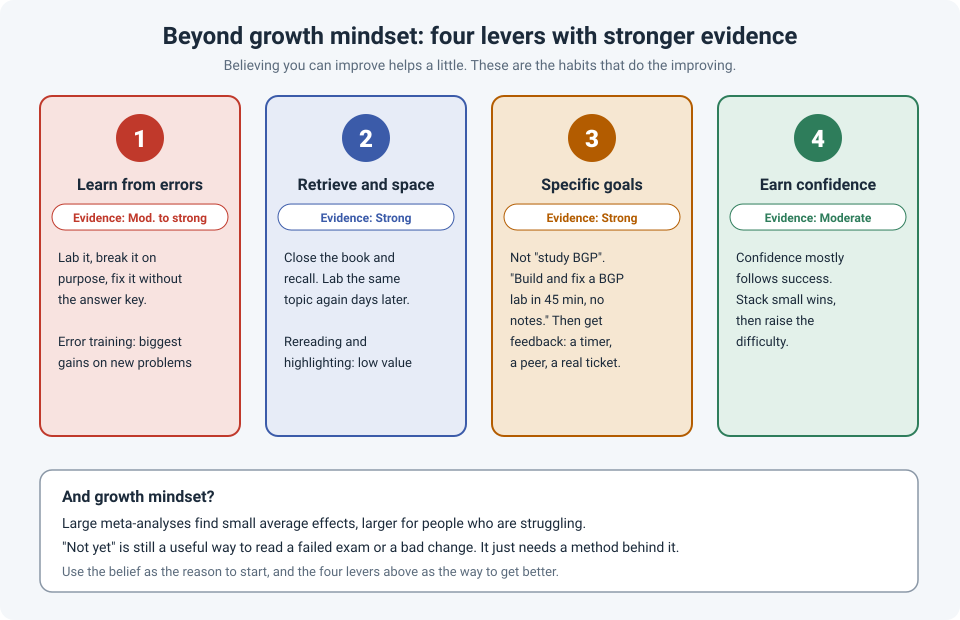

# Beyond Growth Mindset: What Actually Makes Engineers Better

Network engineering means constantly being a beginner again: a new vendor, a new platform, a new
certification, a new way an outage can happen. So it's natural to look for the mindset that
helps you keep learning.

The most popular answer is **growth mindset**, Carol Dweck's idea that believing your abilities
can be developed helps you develop them. It's a nice idea, but when it was tested at scale the
effects turned out to be **small**. Believing you can improve doesn't do the improving.

The better question is: **what actually makes people get better?** There's stronger evidence for
four specific habits.

!!! abstract "Key takeaway"
    Belief alone does little. What works better: **learn from errors on purpose** (break things
    in a lab and fix them), **practise recalling** instead of rereading, and **space it out**,
    set **specific goals with feedback** instead of "study BGP", and **build confidence
    through real wins**, because confidence mostly follows success, not the other way around.
    "Not yet" is still a useful way to read a failure, as long as a method comes with it.

## First, the honest part about growth mindset

- **The link is weak.** In two 2018 meta-analyses, Sisk and colleagues found only a weak
  relationship between mindset and academic achievement, and very small average effects from
  mindset programs. Macnamara and Burgoyne (2022) found similar results, with effects shrinking
  further in the most rigorous studies.
- **It isn't nothing.** A large, pre-registered national experiment (Yeager et al., 2019) found a
  short mindset program improved grades for **lower-achieving** students, depending on the
  school environment.
- **Work evidence is thin.** Almost all of this research is on students.

So growth mindset is a reasonable starting attitude, especially when you're struggling. But if
you want to get better at networking, your time is better spent on the following.

## 1. Learn from errors on purpose

Most training tries to prevent mistakes: follow the steps, copy the config, get it right.
**Error management training** does the opposite. Learners are told that errors are a normal
and useful part of learning, and they're encouraged to explore, make mistakes and work out
how to fix them.

A meta-analysis of 24 studies by Keith and Frese (2008) found error management training
beat error-avoidant training overall (d = 0.44). The difference was largest on
**new problems that didn't look like the training** (d = 0.80), which is exactly what real
outages are.

In practice:

- **Break your lab on purpose.** Misconfigure an MTU, shut a neighbor's interface, swap a VLAN,
  then troubleshoot it without looking at the change you made.
- **Don't copy configs.** Typing a working lab guide teaches syntax. Getting it wrong and fixing
  it teaches the protocol.
- **Review real mistakes the same way.** After an incident, ask "what did this teach us about
  how the system works?" (see [When Something Breaks, Ask "What" and "How"](process-not-people.md)).

## 2. Retrieve and space, instead of rereading

In a major review of ten common study techniques, Dunlosky and colleagues (2013) rated only two
as **high utility**:

- **Practice testing (retrieval):** pulling information out of memory, through flashcards,
  practice questions, or explaining a topic without notes.
- **Distributed practice (spacing):** spreading study over days and weeks instead of cramming.

Rereading, highlighting and summarizing, the things most of us do, were rated **low utility**.
They feel productive because the material becomes familiar, but familiar isn't the same as
being able to recall it at 2 a.m.

In practice:

- After reading a chapter, **close it and write down** what you remember, then check.
- **Rebuild the same lab from memory** a few days later, then again a week later.
- **Mix topics** in practice sessions (OSPF, then BGP, then STP) instead of one topic for hours. This is called interleaving; the review rated it moderate utility.

## 3. Set specific goals, and get feedback

Goal-setting is one of the most consistently supported findings in work psychology. Across
decades of studies, Locke and Latham (2002) found that **specific, challenging goals** lead to
better performance than "do your best", especially when people get **feedback** on their
progress.

| Vague goal | Specific goal |
|---|---|
| "Study BGP this week" | "Build an eBGP lab with two ISPs and fail one over in under 45 minutes, without notes" |
| "Get better at troubleshooting" | "Solve three troubleshooting labs this week; time each one and note where I got stuck" |
| "Learn the new firewall" | "Configure a site-to-site VPN on it in the lab by Friday, then explain it to a colleague" |

Feedback can be a timer, a practice exam score, a colleague reviewing your config, or a real
ticket you close on your own.

## 4. Earn confidence through real wins

Confidence in your ability to do a specific task (psychologists call it **self-efficacy**) is
clearly linked to performance: a meta-analysis by Stajkovic and Luthans (1998) found a
correlation of about 0.38 at work.

But the direction matters. Research that follows the same people over time (Sitzmann and Yeo,
2013) suggests self-efficacy is **mostly a result of past performance**, not a strong driver of
future performance. In plain terms: **confidence follows competence**.

So don't wait to feel confident. Build it:

- **Stack small wins.** Start with tasks slightly beyond what you can do now, succeed, then
  raise the difficulty.
- **Take the real work.** Volunteer for the change or the unfamiliar platform, with a safety net
  and someone to ask (see [Ask Early](ask-for-help-early.md)).
- **Keep a record.** A simple list of problems you've solved is real evidence on the days you
  feel like you don't know anything.

## So where does growth mindset fit?

As a starting point. The "not yet" reading of a failed exam or a change that went wrong is
still healthier than "I'm just not good at this". It just needs a method behind it:

| Situation | Fixed reading | Growth reading | The method that makes it work |
|---|---|---|---|
| Failed a certification exam | "I'm not good at this." | "Not yet." | Retrieval practice and spacing on the weak topics |
| My change caused an outage | "I'm a bad engineer." | "What can I learn?" | Treat it as error training: rebuild and break it in a lab |
| A platform I've never used | "Not my area." | "I can learn it." | A specific goal: "a working VPN on it by Friday" |

!!! warning "Don't turn it into blame"
    "You just need a growth mindset" is not feedback. If someone is struggling, look at what
    they need: training, time, a mentor, a lab, a better process.

## How strong is the evidence?

| Claim | Source | Evidence strength |
|---|---|---|
| Mindset is only weakly linked to achievement; programs have small average effects | Sisk et al., 2018; Macnamara & Burgoyne, 2022 | **Strong** evidence that the effects are **small** |
| A short mindset program helped lower-achieving students, depending on context | Yeager et al., 2019 | **Moderate to strong.** Large, pre-registered; small effects |
| Error management training improves performance, most on new problems | Keith & Frese, 2008 (24 studies) | **Moderate to strong.** Meta-analysis; mostly software and lab tasks |
| Retrieval practice and spacing outperform rereading and highlighting | Dunlosky et al., 2013 | **Strong.** Decades of lab and classroom research |
| Specific, challenging goals with feedback improve performance | Locke & Latham, 2002 | **Strong.** Hundreds of studies across settings |
| Self-efficacy is linked to work performance, but mostly follows past performance | Stajkovic & Luthans, 1998; Sitzmann & Yeo, 2013 | **Moderate.** The link is solid; which way it runs is debated |

## References

- Dweck, C. S. (2006). *Mindset: The New Psychology of Success*. Random House.
- Sisk, V. F., Burgoyne, A. P., Sun, J., Butler, J. L., & Macnamara, B. N. (2018). [To what extent and under which circumstances are growth mind-sets important to academic achievement? Two meta-analyses](https://doi.org/10.1177/0956797617739704). *Psychological Science*, 29(4), 549–571.
- Yeager, D. S., Hanselman, P., Walton, G. M., et al. (2019). [A national experiment reveals where a growth mindset improves achievement](https://doi.org/10.1038/s41586-019-1466-y). *Nature*, 573, 364–369.
- Macnamara, B. N., & Burgoyne, A. P. (2022). Do growth mindset interventions impact students' academic achievement? A systematic review and meta-analysis with recommendations for best practices. *Psychological Bulletin*.
- Keith, N., & Frese, M. (2008). [Effectiveness of error management training: A meta-analysis](https://www.humanw.tu-darmstadt.de/media/orgpsy/preversioneffectivenessoferrormanagement.pdf). *Journal of Applied Psychology*, 93(1), 59–69.
- Dunlosky, J., Rawson, K. A., Marsh, E. J., Nathan, M. J., & Willingham, D. T. (2013). [Improving students' learning with effective learning techniques](https://doi.org/10.1177/1529100612453266). *Psychological Science in the Public Interest*, 14(1), 4–58.
- Locke, E. A., & Latham, G. P. (2002). [Building a practically useful theory of goal setting and task motivation](https://doi.org/10.1037/0003-066X.57.9.705). *American Psychologist*, 57(9), 705–717.
- Stajkovic, A. D., & Luthans, F. (1998). Self-efficacy and work-related performance: A meta-analysis. *Psychological Bulletin*, 124(2), 240–261.
- Sitzmann, T., & Yeo, G. (2013). A meta-analytic investigation of the within-person self-efficacy domain: Is self-efficacy a product of past performance or a driver of future performance? *Personnel Psychology*, 66(3), 531–568.
