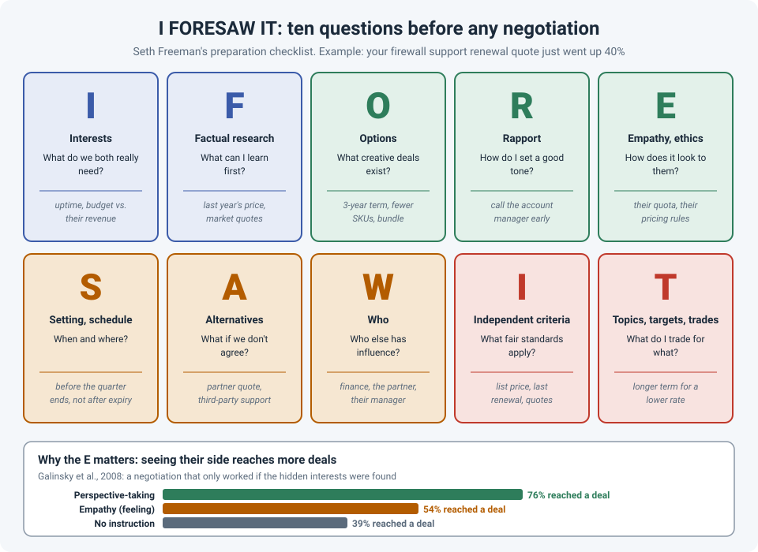

# I FORESAW IT: Preparing for Any Negotiation in Ten Questions

Most engineers don't think of themselves as negotiators. But we negotiate all the time: a
support renewal with a vendor, a delivery date with an ISP, a change window with the business,
a budget for new hardware, who owns a problem between two teams.

And most of us prepare for those conversations far less than we'd prepare for a change window.
We know what we want, maybe jot down a few arguments, and hope it goes well.

Seth Freeman, who teaches negotiation at NYU and Columbia, built a checklist to fix that. It's a
ten-letter mnemonic, **I FORESAW IT**, where each letter is a question to answer **before** the
conversation.

!!! abstract "Key takeaway"
    Before an important negotiation, work through **I FORESAW IT**: **I**nterests, **F**actual
    research, **O**ptions, **R**apport, **E**mpathy and ethics, **S**etting and schedule,
    **A**lternatives, **W**ho, **I**ndependent criteria, and **T**opics, targets and trades. It
    doesn't give you the answer; it gives you the questions that let you find it. The empathy
    step is backed by research: in one study, negotiators who considered the other side's
    perspective reached a deal **76%** of the time, versus **39%** without instruction.

## The example: a renewal quote that went up 40%

Your firewall support contract expires in six weeks. The renewal quote just arrived, and it's
**40% higher** than last year. The easy reactions are to accept it ("we can't run without
support") or to send an angry email. Neither is a plan.

Here's the same situation, prepared with I FORESAW IT.

## The ten questions

| Letter | Question | In the renewal example |
|---|---|---|
| **I**nterests | What do **we** really need? What do **they** need? What do we **share**? | We need support, firmware access and a predictable budget. The vendor (or partner) needs revenue, a renewal on time, and to keep us as a customer. We both want the firewalls supported without a gap. |
| **F**actual research | What can I find out first? | Last year's price and what changed, the list price, quotes from other partners, whether some devices are end-of-life and don't need full coverage. |
| **O**ptions | What creative deals could work? | A multi-year term for a lower rate, dropping coverage on spares, moving to a different support tier, combining it with a planned purchase, a different partner. |
| **R**apport, reactions | How do I set a good tone, and how will I respond if it goes badly? | Call the account manager early, before it's urgent. Plan a calm reply if they say "the price is the price". |
| **E**mpathy, ethics | How does this look from their side? Is my approach fair? | The account manager may have little room on price but more on terms. Their quota and pricing rules are real constraints. |
| **S**etting, schedule | When and where should this happen? | Weeks before expiry, not the day after. Near the end of their quarter, when closing deals matters most to them. On a call, not by email. |
| **A**lternatives | What will we do if we don't agree? What will they do? | A quote from another partner, third-party support, or self-support for low-risk devices. For them: losing a renewal and possibly the next hardware deal. |
| **W**ho | Who else has influence on this? | Our finance team, our manager, the partner, their manager or regional sales lead. |
| **I**ndependent criteria | What fair standards can we point to? | Last year's price, the list price, other partners' quotes, published support-tier pricing. |
| **T**opics, targets, trades | What do I want, and what can I trade for it? | Target: no more than 10% above last year. Trade: a longer term or earlier commitment, in exchange for a lower rate. |

You don't need to fill in every row for every conversation. Even three letters (say, **I**nterests,
**A**lternatives and **I**ndependent criteria) put you in a far better position than walking in
unprepared.

## Why the letters matter

A few of these ideas come from decades of negotiation research and practice:

- **Interests, not positions.** "We won't pay more than last year" is a position. "We need a
  predictable budget" is an interest, and there are many ways to satisfy it. This idea goes back
  to Fisher and Ury's *Getting to Yes*.
- **Alternatives give you confidence.** Knowing your best option if there's no deal (what Fisher
  and Ury call your **BATNA**) is what lets you say no to a bad offer calmly. If you have no
  alternative, the first job is to create one: get that second quote.
- **Independent criteria keep it fair.** Arguing over opinions turns personal. Pointing to
  something neither side controls (a list price, a market quote, last year's contract) keeps it
  about the problem.
- **Empathy, done the right way.** In experiments by Galinsky and colleagues (2008), negotiators
  asked to **think about the other side's perspective** (what they want and why) reached a deal
  76% of the time in a negotiation where the solution depended on discovering hidden interests.
  Those asked to **feel** for the other side reached 54%, and those with no instruction 39%.
  Understanding their position helped more than sympathizing with it.

Freeman's own cautionary example is an executive who looked prepared (he'd researched the market
carefully) but had never prepared for the **conversation** itself. He kept making concessions,
the other side kept asking for more, and the deal that came out of it was badly one-sided.
Research on the market isn't the same as preparing for the talk.

## Using it at work

I FORESAW IT works for any conversation where two sides want different things:

- **An ISP** that keeps pushing back a circuit delivery date.
- **A change window** that the business wants on Tuesday afternoon.
- **Hardware budget** for replacing end-of-life switches.
- **Another team** that thinks a problem is yours (see
  ["It's the Network"](us-vs-them-teams.md)).

It pairs well with [WRAP](wrap-decisions.md) for the decision itself, and with
[TALK](talk-conversations.md) for the conversation.

!!! tip "Fifteen minutes is enough"
    For most work negotiations, a quarter of an hour with this list and a blank page is enough
    preparation. Write a few words next to each letter, then pick your target and your
    alternative before you pick up the phone.

## How strong is the evidence?

| Claim | Source | Evidence strength |
|---|---|---|
| Considering the other side's perspective increases deals when interests are hidden | Galinsky et al., 2008 | **Moderate.** Several experiments, including a negotiation with a 76% vs. 39% deal rate |
| Focusing on interests rather than positions, and knowing your BATNA, improves outcomes | Fisher & Ury, *Getting to Yes*; wider negotiation research | **Moderate.** Widely supported principles; based on practice and many studies |
| I FORESAW IT as a complete checklist improves results | Freeman | **Practical framework.** Built from negotiation research and teaching, not tested as a package |

## References

- Freeman, S. *The Art of Negotiating the Best Deal*. The Great Courses (course guidebook), Lecture 14: "The Power of Preparation: I Foresaw It".
- Freeman, S. *The Ready and Able Negotiator*.
- Fisher, R., Ury, W., & Patton, B. *Getting to Yes: Negotiating Agreement Without Giving In*. Penguin.
- Galinsky, A. D., Maddux, W. W., Gilin, D., & White, J. B. (2008). [Why it pays to get inside the head of your opponent: The differential effects of perspective taking and empathy in negotiations](https://willmaddux.web.unc.edu/wp-content/uploads/sites/15846/2019/01/Psych-Science-PT-Negotiations.pdf). *Psychological Science*, 19(4), 378–384.
