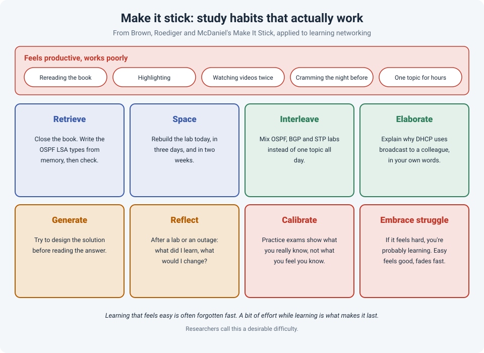

# Make It Stick: How to Actually Remember What You Study

Every network engineer has done it: read a chapter on OSPF, highlighted half of it, felt good,
and a week later couldn't explain the difference between LSA types 3 and 5. The time was spent,
but the knowledge didn't stay.

*Make It Stick* (2014), by Peter Brown and cognitive scientists Henry Roediger and Mark McDaniel,
pulls together decades of research on how people really learn. The surprising part is how many
of our most common study habits are among the least effective.

!!! abstract "Key takeaway"
    **Rereading, highlighting and cramming feel productive but fade fast.** What works:
    **retrieve** (test yourself instead of rereading), **space** your practice over days and
    weeks, **interleave** different topics, **explain** things in your own words, try to
    **solve before you're shown**, **reflect**, and use practice tests to **calibrate** what you
    really know. Learning that feels a bit hard is usually learning that lasts.

## The illusion of knowing

Rereading feels like learning because the material becomes **familiar**. You recognize every
sentence, so it feels like you know it. But recognizing something on the page isn't the same as
being able to **recall** it when you need it, in an exam question or at 2 a.m. during an outage.

In a classic study by Roediger and Karpicke (2006), students either reread a passage several
times or read it once and then practised **recalling** it. The rereaders felt more confident.
A week later, the students who had practised recalling it remembered **much more**.

In her course *How We Learn*, psychologist Monisha Pasupathi calls one common belief a myth: that
when learning is going well, we feel confident and clear. Confusion and frustration are often
part of the process, and sometimes necessary before a new level of understanding.

## The techniques

| Technique | What it means | For a network engineer |
|---|---|---|
| **Retrieve** | Pull information out of memory instead of putting it back in | Close the book and write down the OSPF LSA types, then check. Do flashcards, practice questions, or draw a topology from memory. |
| **Space** | Spread practice over time instead of cramming | Rebuild the same lab today, in three days and in two weeks. A little forgetting between sessions makes the next recall more effective. |
| **Interleave** | Mix different topics or problem types | Alternate OSPF, BGP and STP labs instead of a whole day of one. It feels slower, but you learn to recognize **which** tool a problem needs. |
| **Elaborate** | Connect new material to what you already know, in your own words | Explain to a colleague why DHCP starts with a broadcast. Relate a new feature to one you already use. |
| **Generate** | Try to solve a problem before being shown the answer | Design the solution to a lab scenario before reading the guide's answer, even if you get it wrong. |
| **Reflect** | Look back at what happened and what you learned | After a lab, or an outage: what worked, what didn't, what would I do differently? |
| **Calibrate** | Check what you really know against an objective measure | Use practice exams to find your weak areas, instead of trusting how confident you feel. |

## Why "hard" is good

Researcher Robert Bjork calls these **desirable difficulties**. Recalling something is harder than
rereading it. Spaced practice means you've partly forgotten it. Interleaving feels messier than
working through one topic at a time. But that effort is what makes the memory stronger and more
flexible.

The catch: because these methods feel harder, people consistently **underrate** them. In studies
of interleaving, most learners believed blocked practice (one topic at a time) had worked better,
even when their test results showed the opposite.

## What about learning styles?

The idea that some people are "visual learners" and others "auditory learners", and should be
taught that way, is very popular. The research doesn't support it. A major review (Pashler et
al., 2008) found no adequate evidence that matching teaching to a person's preferred learning
style improves results. Pasupathi's course covers the same question and reaches a similar
conclusion.

What **does** help everyone is using more than one form: reading about a protocol, drawing it,
and building it in a lab, rather than picking just one.

## A study plan for a certification

Putting it together for an exam like a CCNP:

1. **Read a section once**, then close the book and **write down** what you remember.
2. **Lab it**, ideally before reading the step-by-step guide.
3. **Make flashcards** for facts that just need memorizing (timers, default values, LSA types).
4. **Review on a schedule**: the next day, a few days later, then weekly. Mix in older topics.
5. **Take practice exams early**, not just at the end, to see where you really stand.
6. **Teach it**: explain a topic to a colleague, or write it up. (This website is partly that.)

This builds on the second habit in [Beyond Growth Mindset](growth-mindset.md), which covers the
broader research on what makes engineers get better.

## How strong is the evidence?

| Claim | Source | Evidence strength |
|---|---|---|
| Retrieval practice improves long-term retention more than rereading | Roediger & Karpicke, 2006; Dunlosky et al., 2013 | **Strong.** Many experiments in labs and classrooms |
| Spaced practice beats massed practice (cramming) | Cepeda et al., 2006 (meta-analysis of hundreds of experiments); Dunlosky et al., 2013 | **Strong** |
| Interleaving improves learning to tell problem types apart | Kornell & Bjork, 2008; Dunlosky et al., 2013 | **Moderate.** Strongest for related categories and problem types |
| Rereading and highlighting are low-value techniques | Dunlosky et al., 2013 | **Strong** evidence of low benefit |
| Matching teaching to "learning styles" improves learning | Pashler et al., 2008 | **Not supported** |

## References

- Brown, P. C., Roediger, H. L., & McDaniel, M. A. (2014). *Make It Stick: The Science of Successful Learning*. Harvard University Press.
- Pasupathi, M. *How We Learn*. The Great Courses (course guidebook).
- Roediger, H. L., & Karpicke, J. D. (2006). Test-enhanced learning: Taking memory tests improves long-term retention. *Psychological Science*, 17(3), 249–255.
- Dunlosky, J., Rawson, K. A., Marsh, E. J., Nathan, M. J., & Willingham, D. T. (2013). [Improving students' learning with effective learning techniques](https://doi.org/10.1177/1529100612453266). *Psychological Science in the Public Interest*, 14(1), 4–58.
- Cepeda, N. J., Pashler, H., Vul, E., Wixted, J. T., & Rohrer, D. (2006). [Distributed practice in verbal recall tasks: A review and quantitative synthesis](https://www.yorku.ca/ncepeda/publications/CPVWR2006.html). *Psychological Bulletin*, 132(3), 354–380.
- Kornell, N., & Bjork, R. A. (2008). Learning concepts and categories: Is spacing the "enemy of induction"? *Psychological Science*, 19(6), 585–592.
- Pashler, H., McDaniel, M., Rohrer, D., & Bjork, R. (2008). Learning styles: Concepts and evidence. *Psychological Science in the Public Interest*, 9(3), 105–119.
