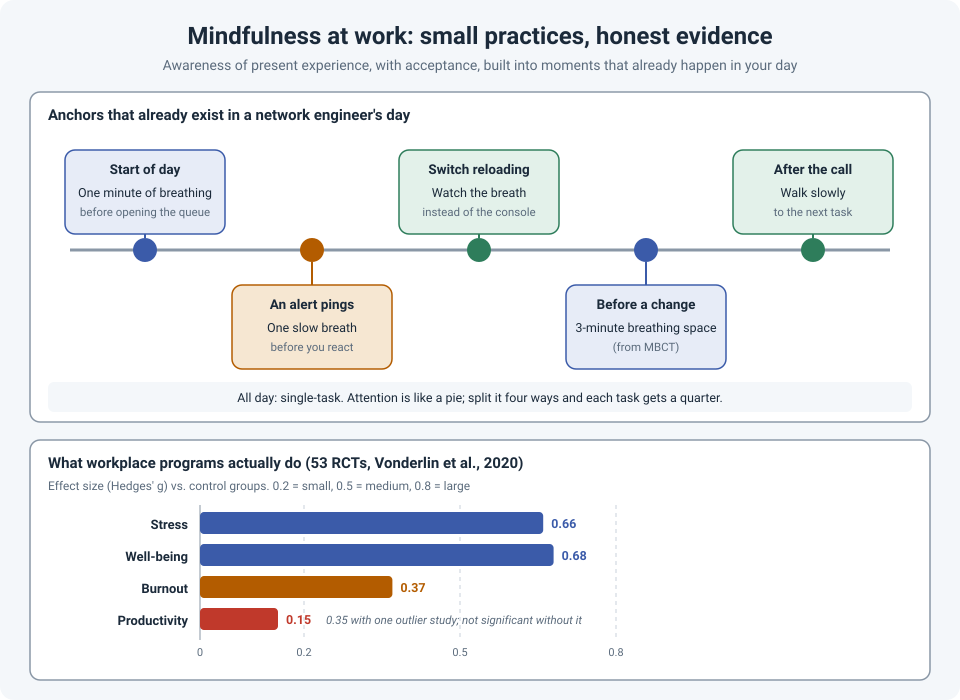

# Mindfulness for Engineers: Small Practices, Honest Evidence

Our days are built for distraction: alerts, tickets, chat messages, a phone that buzzes in the
middle of a config change. By the afternoon, it's easy to feel like you've been busy all day and
present for none of it.

Mindfulness has a reputation problem. To some people it sounds like incense and retreats; to
others it's sold as a cure for everything. The useful version is smaller and more practical
than either, and the research on it is better than for many workplace trends, though not as
strong as the marketing suggests.

!!! abstract "Key takeaway"
    Mindfulness is **awareness of present experience, with acceptance**: noticing what's
    happening right now (in your body, your mind and your work) without immediately fighting it.
    You don't need an hour a day. Attach small practices to moments that already exist: a breath
    before reacting to an alert, watching your breathing while a switch reloads, a three-minute
    pause before a change. Large reviews show workplace mindfulness programs reduce **stress**
    with a **moderate** effect and **burnout** with a **smaller** one, but they're not a fix for
    a workload that's simply too heavy.

## What mindfulness actually is

Psychologist Ronald Siegel, in his course *The Science of Mindfulness*, defines it in a phrase
that's worth remembering: **awareness of present experience, with acceptance**.

- **Awareness**: noticing what's actually happening, rather than running on autopilot.
- **Present experience**: what's here now, not the replay of yesterday's outage or the worry
  about tomorrow's change.
- **With acceptance**: not "I like this", but "this is what's here", without adding a second
  layer of frustration on top.

Our default isn't mindful. In a well-known study (Killingsworth and Gilbert, 2010), people's
minds were wandering away from what they were doing almost **half the time**, and they reported
being **less happy** while their minds wandered, even when the activity itself was dull.

## Single-tasking

Siegel describes attention as a **pie**: try to do two things at once and each gets half of it;
four things, and each gets a quarter. What feels like multitasking is mostly rapid switching,
and each switch has a cost.

For engineers, single-tasking is the most practical form of mindfulness there is:

- **During a change**, close chat and email. A typo in an ACL costs more than a late reply.
- **During an outage call**, if you're the one at the CLI, let someone else take the questions
  (see [Calm in the Outage Call](calm-incident-updates.md)).
- **For deep work**, like designing or studying, block time and silence notifications.

## Small practices for real workdays

Siegel describes a range of practice: **informal** practice woven into ordinary activities,
**formal** practice (setting time aside to meditate), and **intensive** retreats. His advice for
most people is to pick a few everyday activities and use them as reminders. A network
engineer's day already has plenty of those:

| Moment | Practice |
|---|---|
| **Start of the day** | Before opening the ticket queue, one minute of breathing. Notice how you're arriving: rushed, tired, calm. |
| **An alert or message pings** | One slow breath before you look. Siegel describes a version of this for phone calls, based on Thich Nhat Hanh's "telephone meditation": let it ring once or twice, and breathe first. |
| **A switch is reloading** | Those minutes of boot messages are a gift. Watch your breathing instead of the console. |
| **Before a change window** | The **three-minute breathing space** from mindfulness-based cognitive therapy (MBCT): a minute noticing what's going on in your mind and body, a minute on the breath, a minute widening attention to the whole body. |
| **Walking to the data room** | Walk at a normal pace and notice the walking: feet, legs, breath. It's a reset between tasks. |
| **After an outage call** | A few minutes of decompression before jumping into the next ticket. |

### Noticing thoughts, without obeying all of them

In *Practicing Mindfulness*, Mark Muesse describes a step beyond simply letting thoughts go:
noticing **what kind** of thought just arose, then choosing whether to follow it.

On a stressful call, that might sound like:

- "That's a **worry** thought: *what if this takes all night?*" Notice it, let it pass.
- "That's a **blame** thought: *who made this change?*" Not useful right now.
- "That's a **hypothesis**: *the errors started after the uplink flapped.*" Follow that one.

The thoughts still come. The difference is that you're choosing which ones get your attention.

## What the research says

Mindfulness has been studied a lot, and the honest picture is mixed but mostly positive:

- **Workplace programs reduce stress.** A meta-analysis of 53 randomized trials (Vonderlin et
  al., 2020) found a **moderate** reduction in stress, improvements in well-being, and a
  **smaller** reduction in burnout. A larger 2023 review (Michaelsen et al., 91 studies) found
  similar small-to-medium effects across stress, mental health and work outcomes.
- **Productivity gains are not established.** The small productivity effect in the 2020
  meta-analysis disappeared when one outlier study was removed.
- **It's not uniquely powerful.** A large meta-analysis of mindfulness programs in non-clinical
  settings (Galante et al., 2021) found they reduced anxiety, depression and distress compared
  with doing nothing, but generally weren't better than other active practices like exercise.
- **Quality caveats.** Many studies are small, use waiting-list controls instead of active
  ones, and are concentrated in healthcare and education. Some show signs of publication bias.
- **Informal practice is the least tested.** Siegel himself notes there's little experimental
  data on informal practices. They're encouraged because experienced practitioners find they
  help sustain the effects of formal practice.

!!! warning "Not a substitute for fixing the job"
    Mindfulness can help you cope with stress. It can't fix chronic understaffing, impossible
    on-call rotations or a culture of blame, and it shouldn't be offered instead of fixing them.
    And if you're dealing with ongoing anxiety or low mood, talk to a professional; mindfulness
    is not a replacement for proper support.

## How strong is the evidence?

| Claim | Source | Evidence strength |
|---|---|---|
| Workplace mindfulness programs reduce perceived stress | Vonderlin et al., 2020 (53 RCTs); Michaelsen et al., 2023 (91 studies) | **Moderate.** Consistent effects; quality and publication-bias concerns |
| They reduce burnout | Vonderlin et al., 2020 | **Limited to moderate.** Smaller effect, fewer studies |
| They improve productivity | Vonderlin et al., 2020 | **Weak.** Not robust |
| Mindfulness beats other active practices like exercise | Galante et al., 2021 | **Not supported.** Generally similar |
| Minds wander about half the time, and people are less happy while they wander | Killingsworth & Gilbert, 2010 | **Moderate.** Very large sample; correlational |
| Informal practices (breathing at alerts, mindful walking) help | Siegel; practitioner reports | **Limited.** Little experimental data |

## References

- Siegel, R. D. *The Science of Mindfulness: A Research-Based Path to Well-Being*. The Great Courses (course guidebook).
- Muesse, M. W. *Practicing Mindfulness: An Introduction to Meditation*. The Great Courses (course guidebook).
- Vonderlin, R., Biermann, M., Bohus, M., & Lyssenko, L. (2020). [Mindfulness-based programs in the workplace: A meta-analysis of randomized controlled trials](https://link.springer.com/article/10.1007/s12671-020-01328-3). *Mindfulness*, 11, 1579–1598.
- Michaelsen, M. M., Graser, J., Onescheit, M., et al. (2023). [Mindfulness-based and mindfulness-informed interventions at the workplace: A systematic review and meta-regression analysis of RCTs](https://d-nb.info/1304577848/34). *Mindfulness*, 14, 1271–1304.
- Galante, J., Friedrich, C., Dawson, A. F., et al. (2021). [Mindfulness-based programmes for mental health promotion in adults in nonclinical settings: A systematic review and meta-analysis of randomised controlled trials](https://pmc.ncbi.nlm.nih.gov/articles/PMC7799763). *PLOS Medicine*, 18(1), e1003481.
- Killingsworth, M. A., & Gilbert, D. T. (2010). A wandering mind is an unhappy mind. *Science*, 330(6006), 932.
- Segal, Z. V., Williams, J. M. G., & Teasdale, J. D. (2013). *Mindfulness-Based Cognitive Therapy for Depression* (2nd ed.). Guilford Press.
