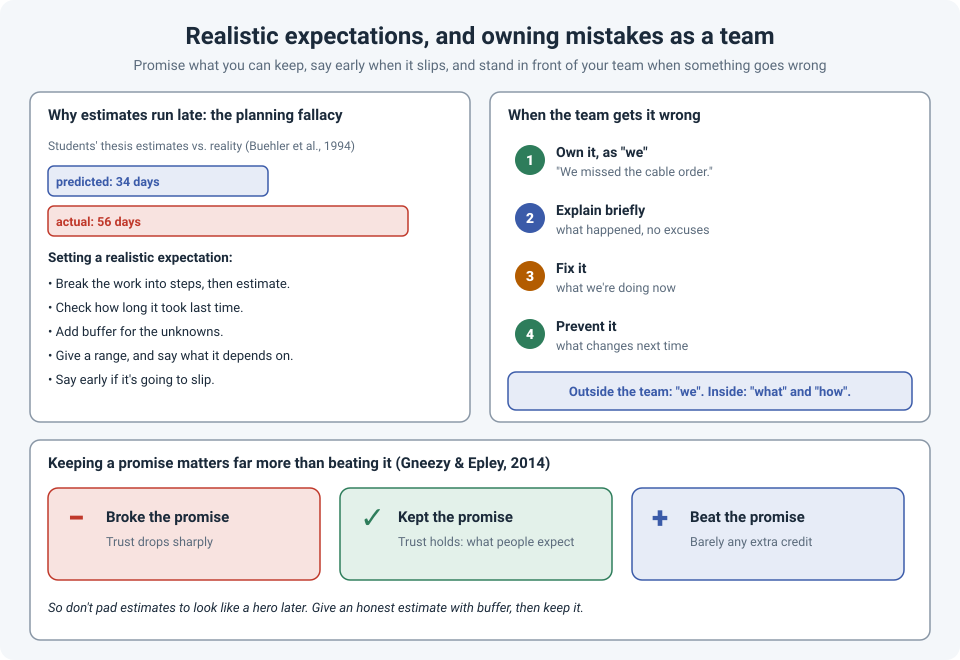

# Promise What You Can Keep: Realistic Expectations, and Owning Mistakes as a Team

"How long will it take?" is one of the hardest questions in our job. There's pressure to give a
small number: the manager wants it, the user wants it, and we want to look capable. So we say
"an hour," it takes four, and the trust we wanted to build goes the other way.

And sometimes the team simply gets something wrong: a cable not ordered, a firewall rule
forgotten, a change that ran over. How you talk about that, to the people affected and inside
the team, matters as much as the fix.

!!! abstract "Key takeaway"
    We underestimate almost every task (the **planning fallacy**), so build estimates from the
    steps, check how long similar work took last time, add buffer, and give a **range** with
    its assumptions. Research shows **breaking** a promise costs a lot of trust, while
    **exceeding** it earns surprisingly little, so aim to **keep** promises, not to beat them.
    When the team makes a mistake, **own it as "we"** outside the team, explain briefly,
    fix it, and say what will change. Inside the team, ask "what" and "how", not "who".

## Why our estimates are too optimistic

In a classic study by Buehler, Griffin and Ross (1994), students estimated how long their
thesis would take. On average they predicted about **34 days**; it actually took about
**56**, and only around a third finished by the date they predicted. Even their
"worst case" estimates were usually too optimistic.

This is the **planning fallacy**: when we estimate our own work, we picture the plan going
smoothly and forget the interruptions, the surprises and the things that went wrong last
time. It's one of the most consistently replicated findings in decision research, and
engineers aren't immune.

In networking it looks like:

- "The switch replacement is a 30-minute job" (until the stack doesn't come up in the right
  order).
- "The firmware upgrade is quick" (until it needs an intermediate version first).
- "The circuit will be live Monday" (because that's what the provider said).

## How to set an expectation people can rely on

- **Break it down first.** Estimate the steps, not the whole job: prep, change, testing,
  rollback time, documentation. The total is almost always bigger than the gut feeling.
- **Look at last time.** How long did the **last** similar change really take? Past results
  are a better guide than your plan. (Researchers call this taking the **outside view**.)
- **Add buffer, deliberately.** Not to look like a hero later, but for the unknowns you know
  are coming (see the change window advice in
  [Safe Changes on Remote Switches](../field-stories/safe-remote-changes.md)).
- **Give a range and its assumptions.** "Two to three hours, assuming the new optics arrive
  tomorrow and the vendor confirms the upgrade path." Now everyone knows what the number depends
  on.
- **Separate what you control from what you don't.** "Our part takes a day. The ISP's
  provisioning is usually two weeks, and that's outside our control."
- **Say it early when it slips.** The moment you know a date won't hold, say so, with a new
  estimate. A slip announced early is a planning problem; a slip announced at the deadline is
  a trust problem.

### Keep it, don't beat it

It's tempting to promise less so you can deliver more and look great. Research suggests that
doesn't pay off the way people think. In experiments by Gneezy and Epley (2014), **breaking** a
promise clearly hurt how people were judged, but **exceeding** a promise earned little extra
credit compared with simply keeping it.

So the goal isn't to sandbag. It's an honest estimate, with buffer, that you then keep.

## When the team gets it wrong

Mistakes happen: something gets forgotten, a step gets missed, a change goes long. Two bad
reactions are common: **hiding it** ("we're looking into it") or **pointing at someone**
("the junior forgot to order it"). Both damage trust: one with the people you serve, the other
inside your team.

A better structure for the outside conversation:

1. **Own it, as "we".** "We missed ordering the patch cables for the new rack." Not "someone
   on my team", and not "mistakes were made".
2. **Explain briefly, without excuses.** One or two sentences on what happened is enough. A
   long explanation sounds like an excuse even when it isn't.
3. **Fix it.** "They've been ordered for next-day delivery, and we've borrowed enough from
   stock to bring the critical servers up today."
4. **Prevent it.** "We've added cable ordering to the build checklist."

This lines up with research on apologies: in a study of what makes an apology effective
(Lewicki, Polin and Lount, 2016), the two most important parts were **acknowledging
responsibility** and **offering to repair** the damage.

### Defending the team without covering up

Defending your team doesn't mean pretending nothing went wrong. It means:

- **Outside the team, the team owns it.** Individual names stay out of it. The person who made
  the mistake is probably already feeling worse than anyone else on the call.
- **Inside the team, focus on the process.** Ask what happened and how the process allowed it,
  not who did it (see [When Something Breaks, Ask "What" and "How"](process-not-people.md)).
  People who aren't afraid of being blamed report problems sooner.
- **Give context, not excuses.** If the team was stretched across three projects, that's useful
  context for the conversation about priorities, but lead with the ownership and the fix, and
  raise the workload separately.
- **Be honest about the impact.** Downplaying it ("it was only a few users") makes the apology
  sound hollow.

## How strong is the evidence?

| Claim | Source | Evidence strength |
|---|---|---|
| People consistently underestimate how long their own tasks will take | Buehler, Griffin & Ross, 1994, and many replications | **Strong.** Replicated across tasks and settings |
| Breaking a promise is costly; exceeding it adds little over keeping it | Gneezy & Epley, 2014 | **Moderate.** Several experiments; workplace settings less studied |
| Acknowledging responsibility and offering repair are the most important parts of an apology | Lewicki, Polin & Lount, 2016 | **Moderate.** Two experiments; context matters |
| Blame-free review of mistakes helps teams learn | Edmondson, 1999, and research on psychological safety | **Moderate to strong.** Field studies across many organizations |

## References

- Buehler, R., Griffin, D., & Ross, M. (1994). Exploring the "planning fallacy": Why people underestimate their task completion times. *Journal of Personality and Social Psychology*, 67(3), 366–381.
- Gneezy, A., & Epley, N. (2014). Worth keeping but not exceeding: Asymmetric consequences of breaking versus exceeding promises. *Social Psychological and Personality Science*, 5(7), 796–804. Summary: [Chicago Booth Review](https://www.chicagobooth.edu/review/dont-bother-doing-more-than-you-promised).
- Lewicki, R. J., Polin, B., & Lount, R. B. (2016). An exploration of the structure of effective apologies. *Negotiation and Conflict Management Research*, 9(2), 177–196. Summary: [Ohio State University](https://news.osu.edu/the-6-elements-of-an-effective-apology-according-to-science/).
- Edmondson, A. (1999). Psychological safety and learning behavior in work teams. *Administrative Science Quarterly*, 44(2), 350–383.
- Kahneman, D., & Tversky, A. (1979). Intuitive prediction: Biases and corrective procedures. *TIMS Studies in Management Science*, 12, 313–327.
