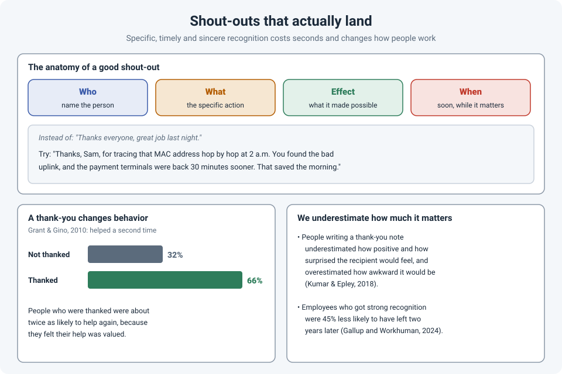

# Shout-Outs: Why Saying Thank You at Work Matters More Than You Think

In operations work, good work is mostly invisible. When the network works, nobody notices. When
someone stays on a call until 3 a.m. and fixes it, the next morning everyone is focused on the
incident report. The person who saved the day often hears nothing at all.

A shout-out takes a few seconds. The research says it matters far more than we expect, both to
the person receiving it and to how they work afterwards.

!!! abstract "Key takeaway"
    Good recognition is **specific**: name the **person**, the **action**, and the **effect**
    it had, and say it **soon**. Recognize effort and good decisions even when the outcome
    wasn't perfect, and keep the improvement feedback separate. Research shows people who are
    thanked are about **twice as likely to help again**, and that we consistently
    **underestimate** how much a thank-you means to the person receiving it.

## What makes a shout-out land

"Thanks everyone, great job" is better than nothing, but not much. It doesn't tell anyone what
was valued, so it doesn't change anything.

A shout-out that lands has four parts:

| Part | Example |
|---|---|
| **Who** | "Thanks, Sam..." |
| **What**, specifically | "...for tracing that MAC address hop by hop at 2 a.m...." |
| **The effect** | "...you found the bad uplink, and the payment terminals were back 30 minutes sooner." |
| **When**: soon | The next morning, not at the annual review. |

Specific recognition does two things at once: it tells the person their work was **seen**, and
it tells everyone else **what good work looks like**.

## Recognizing work that wasn't perfect

This is where many people hold back. The change ran long, the documentation had gaps, the fix
was a workaround. It feels wrong to praise something that wasn't perfect.

But you can recognize the good parts **honestly**, without pretending the rest was fine:

- **Recognize the effort and the judgment, not just the result.** "You made the right call to
  roll back when the second test failed" is true even if the change didn't go through.
- **Recognize progress.** In a large diary study of knowledge workers, Teresa Amabile and Steven
  Kramer found that **making progress** on meaningful work was the single biggest boost to
  people's motivation and mood at work. Pointing out progress ("we're much closer than we were
  this morning") is fuel.
- **Keep the improvement feedback separate.** Thank people for what went well, publicly if
  appropriate. Discuss what to improve privately, later, and focused on the process (see
  [When Something Breaks, Ask "What" and "How"](process-not-people.md)). Mixing the two in one
  sentence ("great job, but...") means people only hear the "but".

## Why it matters: the research

### A thank-you changes behavior

In experiments by Adam Grant and Francesca Gino (2010), people helped someone with a task and
then received either a neutral reply or one that included a thank-you. When asked for help a
second time, **66%** of those who'd been thanked helped again, compared with **32%** of those
who hadn't. The thank-you made people feel their help was **valued**, and that's what made them
willing to help again.

In a team that depends on people going beyond their job description at 2 a.m., that matters.

### We underestimate how much it means

In studies by Amit Kumar and Nicholas Epley (2018), people wrote letters of gratitude to someone
who had helped them. Before sending them, they predicted how the recipient would feel. They
consistently **underestimated** how surprised and positive the recipient would feel, and
**overestimated** how awkward it would be. That's one reason we don't say thank you as often as
we could: we think it matters less than it does.

### It affects whether people stay

A study by Gallup and Workhuman followed more than 3,400 employees from 2022 to 2024. Those who
reported receiving strong recognition in 2022 were **45% less likely to have left** their job two
years later. It's a correlation, not proof of cause, but it points the same way as the
experiments.

## Making it a habit

- **Recognize across teams.** Thank the server team, the helpdesk, the vendor engineer who stayed
  late. It's one of the fastest ways to break down "us vs. them" between teams (see
  ["It's the Network"](us-vs-them-teams.md)).
- **Tell their manager.** A short message to someone's manager about what they did is often worth
  more than a thank-you to the person alone.
- **Make it part of the incident review.** Start the post-incident review with who did what
  well, before getting to what went wrong.
- **Match the person.** Some people enjoy public recognition; others would much rather get a
  private message. If you're not sure, private is safer.
- **Be sincere.** Recognition that's automatic or exaggerated quickly loses its value. Specific
  and true beats big and vague.

## How strong is the evidence?

| Claim | Source | Evidence strength |
|---|---|---|
| Being thanked makes people more likely to help again | Grant & Gino, 2010 | **Moderate.** Several experiments; mechanism tested (feeling valued) |
| People underestimate how positive a thank-you feels to the recipient | Kumar & Epley, 2018 | **Moderate.** Several experiments; replicated in related studies |
| Progress on meaningful work is a major driver of motivation | Amabile & Kramer, 2011 | **Moderate.** Large diary study; correlational |
| Strong recognition is linked to lower turnover | Gallup & Workhuman, 2024 | **Limited to moderate.** Large longitudinal survey; correlational; industry research |

## References

- Grant, A. M., & Gino, F. (2010). A little thanks goes a long way: Explaining why gratitude expressions motivate prosocial behavior. *Journal of Personality and Social Psychology*, 98(6), 946–955.
- Kumar, A., & Epley, N. (2018). Undervaluing gratitude: Expressers misunderstand the consequences of showing appreciation. *Psychological Science*, 29(9), 1423–1435. Summary: [University of Chicago](https://news.uchicago.edu/story/people-underestimate-value-sending-letters-appreciation).
- Amabile, T. M., & Kramer, S. J. (2011). *The Progress Principle: Using Small Wins to Ignite Joy, Engagement, and Creativity at Work*. Harvard Business Review Press.
- Gallup & Workhuman (2024). Recognition and retention study. Summary: [HRO Today](https://www.hrotoday.com/news/ticker/workplace-recognition-could-prevent-45-of-voluntary-turnover/).
