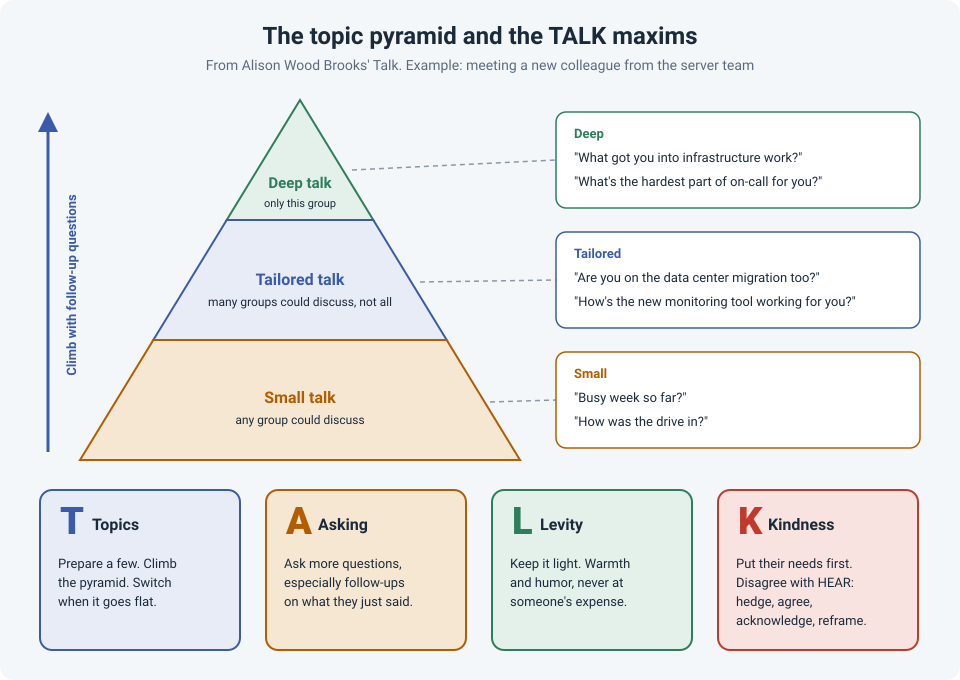

# TALK: The Topic Pyramid and Better Conversations at Work

A lot of engineers treat conversation as something you're either good at or not. We'll spend
weeks learning a routing protocol, but walk into a meeting with a new stakeholder and just hope
it goes well.

Alison Wood Brooks, a professor at Harvard Business School, studies conversation scientifically.
In her book *Talk: The Science of Conversation and the Art of Being Ourselves* (2025), she
sums up her research in four maxims, **TALK**: **T**opics, **A**sking, **L**evity and
**K**indness. The good news for engineers: like any skill, it improves with deliberate practice.

!!! abstract "Key takeaway"
    Before an important conversation, **prepare a few topics**. Start with small talk, then
    **climb the topic pyramid** with follow-up questions toward topics that matter to this
    person. **Ask more questions**, especially follow-ups. **Keep it light** where you can. And
    **put the other person's needs first**, especially when you disagree. Research also suggests
    people like you more than you think, and deeper conversations go better than you expect.

## T: Topics, and the topic pyramid

Brooks describes conversation topics as a pyramid with three levels:

| Level | What it is | Example with a new colleague from the server team |
|---|---|---|
| **Small talk** (base) | Topics any group of people could discuss | "Busy week so far?" "How was the drive in?" |
| **Tailored talk** (middle) | Topics many groups could discuss, but not all | "Are you on the data center migration too?" "How's the new monitoring tool working for you?" |
| **Deep talk** (top) | Topics only this group could discuss | "What got you into infrastructure work?" "What's the hardest part of on-call for you?" |

Small talk isn't the problem. It's the safe **base** everyone can stand on. The problem is
**staying there too long**. The way up is follow-up questions: they pick up something the other
person just said and take it one step more specific.

> "Busy week?" → "Yeah, the migration cutover." → "How's it going? Are the new hosts on the new
> switches yet?" → "Mostly. Honestly the hard part is the weekend work." → "That's rough. How do
> you manage it with on-call?"

Three moves, and you've gone from weather-level talk to something real, and you've probably
learned something useful about the migration too.

Two practical habits from Brooks' work:

- **Prepare topics.** Before a meeting with a new stakeholder, a vendor or a new team, take about
  30 seconds to write down a few possible topics. You may not use any of them. The point is the
  confidence of knowing you could.
- **Switch when it goes flat.** Long silences or the same point coming back around are signs a
  topic has run its course. Switching is fine; use a question to bridge to a new one.

And don't be afraid of the top of the pyramid. In studies by Kardas, Kumar and Epley (2022),
people expected deep conversations with strangers to be more awkward and less enjoyable than
they actually were. We consistently **underestimate** how much others want to go deeper.

## A: Asking, especially follow-up questions

Most of us don't ask enough questions. When we do, they're often generic, or we ask just to get
to our own story.

In a set of studies by Huang, Yeomans, Brooks and colleagues (2017), people who asked more
questions, especially **follow-up questions**, were liked more by their conversation partners.
In speed dating, people who asked more follow-up questions were more likely to get a second
date. Follow-ups work because they prove you were listening.

At work this is a double win. On a troubleshooting call with an application owner, follow-up
questions build the relationship **and** get you better information:

- Generic: "Is the app slow?"
- Follow-up: "You said it's slow mostly in the morning. Is that for everyone, or just the remote
  sites?"

Asking for advice works too. Brooks, Gino and Schweitzer (2015) found that people who ask for
advice are seen as **more** competent, not less, as long as the request is sensible (see
[Ask Early](ask-for-help-early.md)).

## L: Levity

Brooks calls boredom "a quiet killer of conversation". A bit of humor or warmth keeps things
engaging and lowers tension. It doesn't need to be a joke; a light comment, a smile or shared
amusement at a ridiculous situation counts.

But levity carries risk. Bitterly, Brooks and Schweitzer (2017) found that humor that lands
**raises** how confident and competent people think you are, while inappropriate humor
**lowers** it. In engineering terms:

- Shared, light humor in a long maintenance window: usually good.
- Joking about the outage while the user's business is down: not good.
- Humor at a colleague's or user's expense: never.

## K: Kindness

Kindness here means **putting your partner's conversational needs first**: what do they need
from this conversation, and how can you make it worthwhile for them? Sometimes they need
information, sometimes reassurance, sometimes just to be heard (see
[Making a User Feel Heard](feel-heard.md)).

Kindness matters most when you **disagree**, for example when the server team wants a change
the network team thinks is risky. Research on **conversational receptiveness** by Yeomans,
Minson and colleagues (2020) found that people who show they're genuinely engaging with the
other side are seen as better partners and teammates. Their "receptiveness recipe" is often summarized as **HEAR**:

- **H**edge your claims: "I *think* this might cause an issue with..." rather than "This will
  break."
- **E**mphasize agreement: "We both want the migration done without downtime."
- **A**cknowledge their view: "I understand you need this before the cutover date."
- **R**eframe to the positive: "It'd be great to test it on one host first" rather than "We
  can't do it on all of them."

It's the same idea as building a bigger "we" across teams (see
["It's the Network"](us-vs-them-teams.md)).

!!! tip "You're probably doing better than you think"
    Boothby and colleagues (2018) found a **liking gap**: after a conversation, people
    consistently underestimate how much the other person liked them. If you walked out of a
    meeting worried you talked too much or said something awkward, the other person most likely
    remembers it more warmly than you do.

## How strong is the evidence?

| Claim | Source | Evidence strength |
|---|---|---|
| Asking more questions, especially follow-ups, increases liking | Huang et al., 2017 (lab chats and speed dating) | **Moderate to strong.** Several studies, including a real-world dating setting |
| Asking for advice increases perceived competence | Brooks, Gino & Schweitzer, 2015 | **Moderate.** Several experiments; depends on the request being sensible |
| Successful humor raises perceived status; failed or inappropriate humor lowers it | Bitterly, Brooks & Schweitzer, 2017 | **Moderate.** Several experiments |
| Receptive language makes people seen as better partners in disagreement | Yeomans et al., 2020 | **Moderate.** Experiments plus field data |
| People underestimate how much others like them after a conversation | Boothby et al., 2018 | **Moderate to strong.** Replicated across lab and real-world settings |
| Deep conversations go better than people expect | Kardas, Kumar & Epley, 2022 | **Moderate.** Multiple experiments with strangers |
| The topic pyramid and topic preparation | Brooks, 2025 | **Practical framework** built from the research; not tested as a package |

## References

- Brooks, A. W. (2025). *Talk: The Science of Conversation and the Art of Being Ourselves*. Crown.
- Huang, K., Yeomans, M., Brooks, A. W., Minson, J., & Gino, F. (2017). [It doesn't hurt to ask: Question-asking increases liking](https://doi.org/10.1037/pspi0000097). *Journal of Personality and Social Psychology*, 113(3), 430–452.
- Brooks, A. W., Gino, F., & Schweitzer, M. E. (2015). [Smart people ask for (my) advice: Seeking advice boosts perceptions of competence](https://doi.org/10.1287/mnsc.2014.2054). *Management Science*, 61(6), 1421–1435.
- Bitterly, T. B., Brooks, A. W., & Schweitzer, M. E. (2017). [Risky business: When humor increases and decreases status](https://faculty.wharton.upenn.edu/wp-content/uploads/2017/03/2016-54537-001.pdf). *Journal of Personality and Social Psychology*, 112(3), 431–455.
- Yeomans, M., Minson, J., Collins, H., Chen, F., & Gino, F. (2020). [Conversational receptiveness: Improving engagement with opposing views](https://doi.org/10.1016/j.obhdp.2020.03.011). *Organizational Behavior and Human Decision Processes*, 160, 131–148.
- Boothby, E. J., Cooney, G., Sandstrom, G. M., & Clark, M. S. (2018). [The liking gap in conversations: Do people like us more than we think?](https://doi.org/10.1177/0956797618783714) *Psychological Science*, 29(11), 1742–1756.
- Kardas, M., Kumar, A., & Epley, N. (2022). [Overly shallow?: Miscalibrated expectations create a barrier to deeper conversation](https://doi.org/10.1037/pspa0000281). *Journal of Personality and Social Psychology*, 122(3), 367–398.
- Brooks, A. W. (2025). [*TALK* workbook](https://assetbucketpublic.7169.prh.com/9780/593/443/491/sales-assets/9780593443491_FINAL_TALK_AWB_%20Workbook.pdf). Crown.
