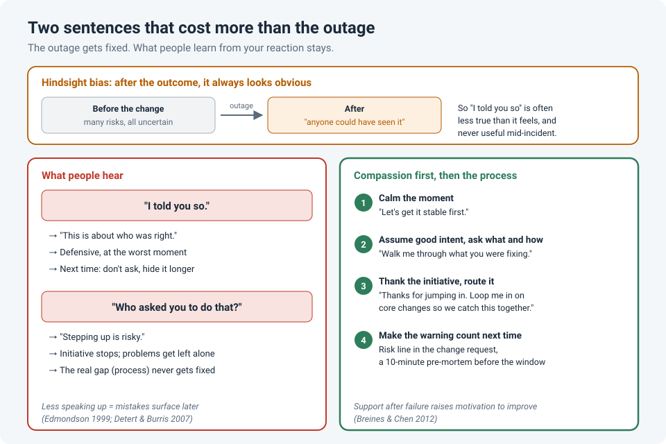

# "I Told You So" and "Who Asked You to Do That?"

A change goes wrong, and someone in the room says it: "**I told you so.**"

Or a colleague tries to fix something on their own, it goes sideways, and the first
question they hear is: "**Who asked you to do that?**"

Both sentences are short, and both are usually said in frustration rather than malice. But
they do more damage to a team than most outages, because the outage gets fixed and the
sentence stays with people.

!!! abstract "Key takeaway"
    "I told you so" is about the speaker being right, and thanks to **hindsight bias**, it's
    often less true than it feels. "Who asked you to do that?" punishes **initiative**. Both
    teach people to hide problems, stop asking for your input, and stop stepping up. Replace
    them with **compassion first** (get things stable, check on the person), then a calm
    look at the **process**: how to make the warning count next time, and how to route the
    initiative safely.

## Why "I told you so" lands so badly

### It's about you, not the problem

In the middle of an incident, the team needs facts and focus. "I told you so" adds neither.
It moves attention from *what's broken* to *who was right*, and it puts the other person on
the defensive at the exact moment you need them thinking clearly.

### It's often less true than it feels

Psychologists call it **hindsight bias**: once we know how something turned out, we
remember it as having been more predictable than it really was. Roese and Vohs (2012)
describe three layers of it:

| Layer | What happens | In IT |
|---|---|---|
| **Memory distortion** | We misremember what we predicted | "I said this would break" (you said you had a bad feeling about the change) |
| **Inevitability** | The outcome feels like it was bound to happen | "Of course the upgrade failed, that firmware was always going to be trouble" |
| **Foreseeability** | We believe we could have known | "Anyone could have seen this coming" |

Baruch Fischhoff showed this in the 1970s: people who were told an outcome rated it as much
more likely than people who weren't, and they didn't realize the outcome had changed their
judgement. So the warning you remember clearly may have been one vague concern among many,
and the person you're saying it to had their own reasons for going ahead.

### It teaches people to stop involving you

If involving you means being told off when things go wrong, people quietly stop involving
you. They make the change without asking, or they hide the problem a little longer. Teams
learn from mistakes when people feel safe to speak up about them (Edmondson, 1999), and "I
told you so" makes the next mistake **less** likely to be reported early.

!!! info "If you really did warn them"
    Then the warning didn't carry enough weight, and that's the thing worth fixing. Not with
    an "I told you so", but with a process that makes concerns visible **before** the change:
    a risk line in the change request, a pre-mortem, or a go/no-go question for the
    reviewer.

## Why "Who asked you to do that?" lands so badly

### It punishes the behaviour you want

Most teams want people who notice a problem and do something about it. "Who asked you to do
that?" tells them the opposite: **do only what you're told**. People hear it once and decide
that stepping up isn't worth the risk. Next time they'll see the problem and leave it alone.

Research on employee **voice** supports this. In a study across a restaurant chain, managers
who were genuinely open to input had employees who spoke up more, and **psychological
safety** explained much of that link (Detert & Burris, 2007). The effect was modest, but
consistent, and the lesson matters: an "open door" policy means little if the reaction to
initiative is a cold question.

### There's often a real issue underneath, just not that one

Sometimes the person really shouldn't have made that change alone: no change request, no
peer review, on a production core. That's a fair concern. But it's a **process** gap, and
it's better handled later, privately, and as a question about how the work gets routed, not
as a challenge in front of the team.

## Compassion first, then the process

In the moment, the person who made the mistake usually feels worse than you think. They're
already replaying it. What helps is the same four steps described in
[Compassion at Work](compassion-at-work.md): **notice** they're struggling, **feel** concern
rather than judgement, **make sense** of why they did it (they were trying to help, or under
pressure), and **act**: help fix it.

Compassion isn't letting things slide. People who are treated with understanding after a
failure are **more** motivated to improve, not less. In Breines and Chen's experiments,
participants who were guided to respond to a failure with self-compassion studied longer for
a retest, and were more motivated to make amends after a mistake, than participants given a
self-esteem boost or no intervention. The same logic applies between colleagues: attack people
and they defend themselves; support them and they look at what went wrong.

## What to say instead

| Instead of… | Try… |
|---|---|
| "I told you so." | "Okay, let's get it stable first. We'll look at what to change afterwards." |
| "I told you so" (and you did warn them) | "I had a concern about this earlier. Can we add a check for it to the change template?" |
| "Who asked you to do that?" | "Walk me through what you were trying to fix." |
| "Who asked you to do that?" (it was outside the process) | "Thanks for jumping in. Next time, loop me in before core changes so we can catch this kind of thing together." |
| "Why didn't you listen?" | "What would have made that risk easier to see before the change?" |

Notice the pattern. Each replacement either **calms the moment**, asks **what or how**
instead of who (see [Ask 'What' and 'How', Not 'Who'](process-not-people.md)), or turns the
problem into a **process change**.

## Make the warning count next time

If you keep being right after the fact, the most useful thing you can do is be heard
**before** it. A **pre-mortem** is a simple way to do that: before a big change, the team
imagines it has already failed and lists the reasons why. Research on "prospective
hindsight" found that imagining an event has already happened helps people come up with more
reasons for the outcome (Mitchell, Russo & Pennington, 1989). Ten minutes before a change
window turns "I told you so" into "we planned for that".

## If you're on the receiving end

Someone will say one of these to you eventually.

- Don't argue about who was right in the middle of the incident. "Fair. Let's fix it first,
  then I'd like your view on what we change" keeps things moving.
- Afterwards, take the useful part: was there a real warning you missed? A process you
  skipped?
- And separate the mistake from your worth as an engineer. One bad change is information,
  not a verdict.

## How strong is the evidence?

| Claim | Source | Evidence strength |
|---|---|---|
| Knowing the outcome makes events seem more predictable than they were | Fischhoff, 1975; Roese & Vohs, 2012 | **Strong.** One of the most replicated findings in judgement research, across many settings |
| Teams where people feel safe to speak up learn more from mistakes | Edmondson, 1999 | **Moderate to strong.** A field study of 51 teams, supported by many later studies; much of it correlational |
| Manager openness is linked to employees speaking up, through psychological safety | Detert & Burris, 2007 | **Moderate.** Large samples and a longitudinal design, but one industry and modest effects |
| Self-compassion after failure increases motivation to improve | Breines & Chen, 2012 | **Moderate.** Four experiments with student samples; promising, but the effects between colleagues are an extrapolation |
| Imagining an outcome has already happened helps people find more reasons for it | Mitchell, Russo & Pennington, 1989 | **Moderate.** Laboratory experiments; the pre-mortem itself is a widely used practice with little direct testing |

## References

- Breines, J. G., & Chen, S. (2012). [Self-compassion increases self-improvement motivation](https://pubmed.ncbi.nlm.nih.gov/22645164/). *Personality and Social Psychology Bulletin*, 38(9), 1133–1143.
- Detert, J. R., & Burris, E. R. (2007). Leadership behavior and employee voice: Is the door really open? *Academy of Management Journal*, 50(4), 869–884.
- Edmondson, A. (1999). Psychological safety and learning behavior in work teams. *Administrative Science Quarterly*, 44(2), 350–383.
- Fischhoff, B. (1975). Hindsight ≠ foresight: The effect of outcome knowledge on judgment under uncertainty. *Journal of Experimental Psychology: Human Perception and Performance*, 1(3), 288–299.
- Klein, G. (2007). Performing a project premortem. *Harvard Business Review*, 85(9), 18–19.
- Mitchell, D. J., Russo, J. E., & Pennington, N. (1989). Back to the future: Temporal perspective in the explanation of events. *Journal of Behavioral Decision Making*, 2(1), 25–38.
- Roese, N. J., & Vohs, K. D. (2012). Hindsight bias. *Perspectives on Psychological Science*, 7(5), 411–426.
