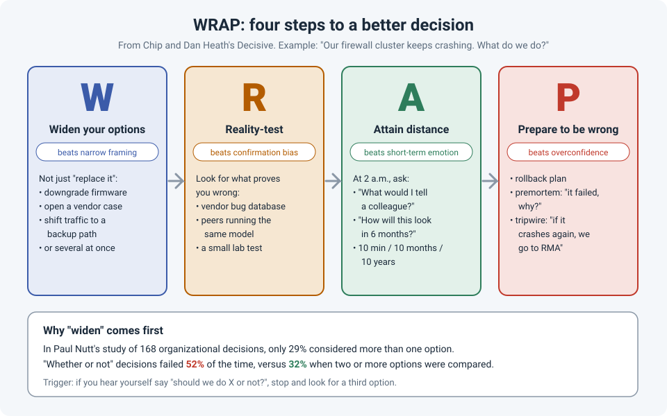

# WRAP: Four Steps to Better Decisions Under Pressure

Network work is full of decisions made under pressure: the firewall cluster that keeps crashing,
the upgrade that's half done when the change window ends, the vendor who says "just replace it".
We usually decide fast, with whatever option showed up first, and only find out later that there
was a better one.

In *Decisive* (2013), Chip and Dan Heath pulled decades of decision research into a four-step
process called **WRAP**. Each step targets one of the four most common ways decisions go wrong.

!!! abstract "Key takeaway"
    Before a decision that matters: **W**iden your options (don't settle for "yes or no"),
    **R**eality-test your assumptions (look for what proves you wrong), **A**ttain distance
    (decide as if you were advising a colleague), and **P**repare to be wrong (rollback plan,
    premortem, tripwire). The strongest evidence is for the first step: decisions that compared
    two or more options failed far less often than "whether or not" decisions.

## The example: a firewall cluster that keeps crashing

A firewall HA pair reboots every few days. Each time, traffic fails over, users notice a short
drop, and the pressure grows. Someone says: "Should we just replace them?"

That's the moment WRAP is built for.

## W: Widen your options

**The trap: narrow framing.** "Should we replace the firewalls, yes or no?" looks like a decision,
but it's only one option and its opposite.

The Heaths' rule of thumb: when you hear yourself say "**whether or not**", stop and look for more
options. In the firewall case:

- Downgrade to the last stable firmware, or upgrade to a fixed release
- Open a vendor case with crash dumps and core files
- Disable the feature that seems to trigger it, as a temporary measure
- Shift critical traffic to a backup path while you investigate
- Replace the hardware

These aren't mutually exclusive. Often the best answer is "**this and that**": open the case
*and* stage a firmware change *and* prepare the replacement in parallel.

A useful prompt: "If replacing them were impossible, what would we do?" Taking the obvious
option away forces new ones to appear.

## R: Reality-test your assumptions

**The trap: confirmation bias.** Once we believe "it's a hardware fault", we notice everything
that fits and skip everything that doesn't.

Go looking for evidence that could prove you **wrong**:

- **Check the vendor's bug database and release notes** for your exact version. A known bug
  changes the whole decision.
- **Ask someone who runs the same model.** A peer, a forum, the vendor's TAC. "Have you seen
  this?" is cheap and fast.
- **Ask the disconfirming question:** "If it *were* hardware, what would we expect to see?" Both
  units crashing the same way points away from a single bad box.
- **Test small first.** A lab unit, or a firmware change on the standby member, before you commit
  the whole cluster.

## A: Attain distance before deciding

**The trap: short-term emotion.** At 2 a.m., after the third crash this week, the option that
makes the pressure stop *tonight* looks like the best one, even if it isn't.

Two simple tools:

- **Advise a colleague.** Ask, "If a colleague described this exact situation, what would I tell
  them to do?" We often give clearer advice to others than to ourselves.
- **10/10/10.** How will I feel about this decision in 10 minutes? In 10 months? In 10 years?
  A rushed emergency replacement might feel great in 10 minutes and look expensive and
  unnecessary in 10 months.

And ask what matters most here. If the priority is "stable service for users", that may point to
a different choice than "never get paged about this again".

## P: Prepare to be wrong

**The trap: overconfidence.** We assume the future will go the way we expect. It often doesn't.

- **Run a premortem.** Before you act, imagine it's two weeks later and the decision **failed**.
  Ask everyone: "What went wrong?" Gary Klein, who developed the technique, reports it surfaces
  more risks than asking "what could go wrong?", because people stop defending the plan.
- **Have a rollback plan.** If the firmware change makes things worse, how do you get back, and
  how long will it take? (See [Safe Remote Changes](../field-stories/safe-remote-changes.md).)
- **Set a tripwire.** Decide *now* what will trigger the next step: "If it crashes again after the
  firmware change, we go straight to RMA." Tripwires stop you drifting for weeks on a decision
  that isn't working.
- **Bookend the outcome.** Expect a range, not one result: best case, worst case, most likely.

!!! tip "When to use it"
    You don't need WRAP for every ticket. Use it for decisions that are **costly, hard to undo,
    or emotional**: replacing hardware, choosing a vendor, a risky change, a career move. For a
    quick version, just ask: *What else could we do? What would prove us wrong? What would I tell
    a colleague? What's our plan if this fails?* And if you're stuck, it's a good time to bring
    someone else in (see [Ask Early](ask-for-help-early.md)).

## How strong is the evidence?

| Claim | Source | Evidence strength |
|---|---|---|
| Most organizational decisions consider only one option, and "whether or not" decisions fail more often (52% vs. 32%) | Nutt, studies of 168 organizational decisions (1999; *Why Decisions Fail*, 2002) | **Moderate.** Large field study of real decisions; observational, so it shows association, not cause |
| Imagining a project has already failed surfaces more reasons for failure | Mitchell, Russo & Pennington, 1989 ("prospective hindsight"); Klein, 2007 | **Moderate.** Lab evidence that imagining an outcome as certain generates more explanations (about 30% more); the premortem itself is widely used but less formally tested |
| Considering the opposite reduces biased judgments | Lord, Lepper & Preston, 1984 | **Moderate.** Classic experiments; effect shown in lab settings |
| Giving advice to others is less biased than deciding for ourselves | Research on self-other decision making, summarized in *Decisive* | **Limited to moderate.** Consistent findings, mostly lab-based |
| WRAP as a complete process improves decisions | Heath & Heath, 2013 | **Limited.** A well-sourced synthesis of the research above, not itself tested as a package |

## References

- Heath, C., & Heath, D. (2013). *Decisive: How to Make Better Choices in Life and Work*. Crown Business.
- Nutt, P. C. (1999). [Surprising but true: Half the decisions in organizations fail](https://cebma.org/assets/Uploads/Nutt-1999-gecomprimeerd.pdf). *Academy of Management Executive*, 13(4), 75–90.
- Nutt, P. C. (2002). *Why Decisions Fail: Avoiding the Blunders and Traps That Lead to Debacles*. Berrett-Koehler.
- Klein, G. (2007). [Performing a project premortem](https://hbr.org/2007/09/performing-a-project-premortem). *Harvard Business Review*, 85(9), 18–19.
- Mitchell, D. J., Russo, J. E., & Pennington, N. (1989). [Back to the future: Temporal perspective in the explanation of events](https://doi.org/10.1002/bdm.3960020103). *Journal of Behavioral Decision Making*, 2(1), 25–38.
- Lord, C. G., Lepper, M. R., & Preston, E. (1984). [Considering the opposite: A corrective strategy for social judgment](https://doi.org/10.1037/0022-3514.47.6.1231). *Journal of Personality and Social Psychology*, 47(6), 1231–1243.
